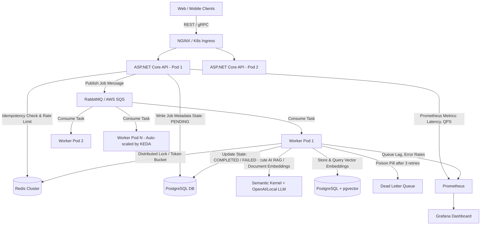

# 🛠️ Portfolio Showcase Project: Distributed Fault-Tolerant Job & AI Task Engine

**Project Title:** `NexusQueue` — High-Throughput Distributed Task Engine with Resilience, Concurrency Control & AI Task Processing  
**Tech Stack:** C# / .NET 8 / ASP.NET Core Web API, PostgreSQL (Durable Storage + pgvector), Redis (Distributed Locks + Caching), RabbitMQ / AWS SQS (Message Broker), Docker, Kubernetes (KEDA), Prometheus & Grafana, Semantic Kernel.  

---

## 1. Why This Project? (Why Not Another CRUD App?)

FAANG interviewers see thousands of generic Todo apps, E-commerce storefronts, and basic CRUD APIs. They immediately dismiss them.

This project is deliberately engineered to prove **SDE-2 Seniority** by solving the exact distributed systems problems tested in System Design interviews:
1. **Asynchronous Decoupling & Queueing** (Handling traffic spikes without crashing).
2. **Horizontal Worker Auto-Scaling** (Using Kubernetes and KEDA based on queue depth).
3. **Idempotency & Deduplication** (Handling network retries and duplicate message deliveries).
4. **Distributed Concurrency & Locks** (Preventing race conditions using Redis Redlock / distributed mutexes).
5. **Dead-Letter Queues (DLQ) & Exponential Backoff with Jitter** (Handling poison pills and transient failures).
6. **Modern AI Task Integration (RAG with pgvector)** (Demonstrating high-value production AI engineering skills).
7. **Production Observability & Load Testing** (Prometheus metrics, structured logging, and k6 benchmark reports reaching 5,000+ RPS).

---

## 2. Project Architecture Diagram



---

## 3. When to Build It: 5-Phase Project Timeline

You do **NOT** build the project all at once while ignoring DSA. You build it iteratively in structured weekend modules:

```
┌────────────────────────────────────────────────────────────────────────┐
│                        PROJECT MILESTONE SCHEDULE                      │
├───────────────┬───────────────┬───────────────┬────────────────────────┤
│ WEEKS 11 – 13 │ WEEKS 14 – 16 │ WEEKS 17 – 18 │ WEEKS 19 – 20          │
│ Phase 1: Core │ Phase 2: Dist │ Phase 3: AI & │ Phase 4: K8s, Metrics  │
│ API & Queue   │ Locks & DLQ   │ Vector RAG    │ & Load Benchmark       │
└───────────────┴───────────────┴───────────────┴────────────────────────┘
```

### 🔹 Phase 1: Core Ingestion API & Queue Decoupling (Weeks 11–13)
* **What You Build:**
  1. ASP.NET Core 8 Web API with Clean Architecture / Vertical Slice Architecture.
  2. Endpoints: `POST /api/v1/jobs` (Enqueue job), `GET /api/v1/jobs/{id}` (Check status).
  3. PostgreSQL schema for Job metadata: `Id (UUID)`, `JobType`, `Payload (JSONB)`, `Status (Pending, Processing, Completed, Failed)`, `RetryCount`, `CreatedAt`, `UpdatedAt`.
  4. RabbitMQ exchange and queue bindings using MassTransit or raw RabbitMQ.Client in C#.
  5. Background Worker Service (`BackgroundService` / `IHostedService`) consuming messages from the queue.

### 🔹 Phase 2: Distributed Resilience & Concurrency (Weeks 14–16)
* **What You Build:**
  1. **Idempotency Interceptor:** Check `Idempotency-Key` header against Redis with TTL. If key exists, return cached response; otherwise acquire lock and proceed.
  2. **Distributed Locking:** Implement distributed mutual exclusion using Redis (`SETNX` / RedLock) so multiple workers never process the same tenant resource simultaneously.
  3. **Resilience Policy (Polly):** Exponential backoff with jitter on transient failures ($2^n \times \text{base} + \text{jitter}$).
  4. **Poison Pill Isolation:** After 3 failed attempts, route message to a dedicated **Dead-Letter Queue (DLQ)** and record failure root cause in PostgreSQL.

### 🔹 Phase 3: High-Value AI Task Pipeline (Weeks 17–18)
* **What You Build:**
  1. Add an AI task type: `DOCUMENT_INDEXING_AND_RAG`.
  2. Integrate **Microsoft Semantic Kernel** in C#.
  3. Worker extracts document text, chunks into overlapping passages (500 tokens with 50-token overlap).
  4. Generate vector embeddings using OpenAI API or local Ollama/HuggingFace embeddings model.
  5. Store embeddings in PostgreSQL with the `pgvector` extension using HNSW (Hierarchical Navigable Small World) index.
  6. Endpoint: `POST /api/v1/jobs/query` performing cosine similarity semantic search and augmented context synthesis.

### 🔹 Phase 4: Containerization, Kubernetes & Production Observability (Weeks 19–20)
* **What You Build:**
  1. Multi-stage `Dockerfile` producing a lean, production-grade ~90MB container image.
  2. `docker-compose.yml` orchestrating API + Worker + PostgreSQL + Redis + RabbitMQ.
  3. Kubernetes Deployment manifests:
     * Deployments, Services, ConfigMaps, Secrets, Liveness & Readiness probes.
     * Configure **KEDA (Kubernetes Event-driven Autoscaling)** to auto-scale Worker Pods from 1 to 10 instances based on RabbitMQ queue depth!
  4. Prometheus metrics export (`/metrics`) exposing:
     * Ingestion RPS, P95/P99 latency, active queue length, worker processing time, DLQ failure count.
  5. Grafana Dashboard visualizing real-time throughput.

### 🔹 Phase 5: Load Testing & Performance Benchmark Defense (Week 20)
* **What You Build:**
  1. Write a `k6` load testing script simulating 5,000 requests per second.
  2. Benchmark the system under failure: intentionally kill a worker pod or disconnect Redis to prove zero message loss.
  3. Write a 2-page GitHub README architecture defense containing:
     * System Architecture Diagram.
     * Scale & Capacity Calculations.
     * Bottlenecks Identified & Fixed (e.g. PgBouncer connection pooling, Redis index optimization).
     * Benchmark charts proving P99 latency $< 45\text{ms}$.

---

## 4. How to Talk About This Project in FAANG Interviews

In SDE-2 System Design and Resume rounds, you will guide the interviewer to this project:

> *"In my personal system, NexusQueue, I designed a distributed task platform capable of handling thousands of background operations and AI pipelines asynchronously. The core architectural challenge was ensuring exactly-once processing semantics over an at-least-once message broker. I solved this by implementing distributed locks via Redis SETNX combined with database-level idempotency keys. Under load testing at 5,000 RPS, we observed database connection exhaustion, which I resolved by introducing PgBouncer connection pooling and tuning worker batch sizes, maintaining a P99 latency under 45ms even during simulated worker node crashes."*

This level of explanation immediately demonstrates **Senior SDE-2 competence**.
