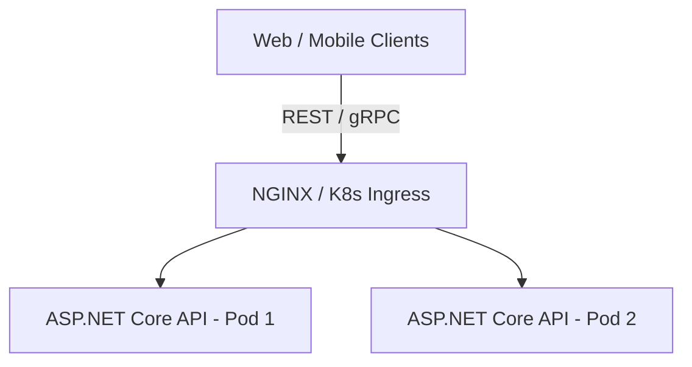

# Both full project specifications and resource directory

[Start here](../START_HERE.md) · [All questions](../QUESTION_INDEX.md) · [Every topic](../FULL_TOPIC_INDEX.md)

Read one question/section, close it, and explain it from memory. Reading alone does not mark a coding/design exercise complete. Every original source block has a stable ID for coverage and links. Original schedules are retained as historical context; use the revised daily tracker for execution.

<a id="F01"></a>

## F01 — 01_PROJECT_BLUEPRINT_DISTRIBUTED_AI_ENGINE

Full source content: [FAANG-Master-Plan/01_PROJECT_BLUEPRINT_DISTRIBUTED_AI_ENGINE.md](../SOURCE_LIBRARY/FAANG-Master-Plan/01_PROJECT_BLUEPRINT_DISTRIBUTED_AI_ENGINE.md). Original wording is retained below. For conflicting statements, use the visible correction and the current execution plan.

> Project correction: target/benchmark values are goals until measured. Implement atomic database-local effect plus deduplication where possible; downstream idempotency or reconciliation is required for external effects. A marker alone is not an exactly-once guarantee. Use .NET 10 LTS for a new study project, or confirm the target employer’s runtime; the old .NET 8 references are preserved.


<a id="F01-B0001"></a>

# 🛠️ Portfolio Showcase Project: Distributed Fault-Tolerant Job & AI Task Engine

<a id="F01-B0002"></a>

**Project Title:** `NexusQueue` — High-Throughput Distributed Task Engine with Resilience, Concurrency Control & AI Task Processing  
**Tech Stack:** C# / .NET 8 / ASP.NET Core Web API, PostgreSQL (Durable Storage + pgvector), Redis (Distributed Locks + Caching), RabbitMQ / AWS SQS (Message Broker), Docker, Kubernetes (KEDA), Prometheus & Grafana, Semantic Kernel.  

<a id="F01-B0003"></a>

---

<a id="F01-B0004"></a>

## 1. Why This Project? (Why Not Another CRUD App?)

<a id="F01-B0005"></a>

FAANG interviewers see thousands of generic Todo apps, E-commerce storefronts, and basic CRUD APIs. They immediately dismiss them.

<a id="F01-B0006"></a>

This project is deliberately engineered to prove **SDE-2 Seniority** by solving the exact distributed systems problems tested in System Design interviews:
1. **Asynchronous Decoupling & Queueing** (Handling traffic spikes without crashing).
2. **Horizontal Worker Auto-Scaling** (Using Kubernetes and KEDA based on queue depth).
3. **Idempotency & Deduplication** (Handling network retries and duplicate message deliveries).
4. **Distributed Concurrency & Locks** (Preventing race conditions using Redis Redlock / distributed mutexes).
5. **Dead-Letter Queues (DLQ) & Exponential Backoff with Jitter** (Handling poison pills and transient failures).
6. **Modern AI Task Integration (RAG with pgvector)** (Demonstrating high-value production AI engineering skills).
7. **Production Observability & Load Testing** (Prometheus metrics, structured logging, and k6 benchmark reports reaching 5,000+ RPS).


> Study correction: Treat benchmark figures in source plans as proposed targets/examples, not measured achievements. Record hardware, workload, errors, percentile latency and date before claiming a result.

<a id="F01-B0007"></a>

---

<a id="F01-B0008"></a>

## 2. Project Architecture Diagram

<a id="F01-B0009"></a>



<a id="F01-B0010"></a>

```
    API1 -->|Idempotency Check & Rate Limit| Redis[(Redis Cluster)]
    API1 -->|Write Job Metadata State: PENDING| Postgres[(PostgreSQL DB)]
    API1 -->|Publish Job Message| Queue[RabbitMQ / AWS SQS]

```

<a id="F01-B0011"></a>

```
    Queue -->|Consume Task| Worker1[Worker Pod 1]
    Queue -->|Consume Task| Worker2[Worker Pod 2]
    Queue -->|Consume Task| WorkerN[Worker Pod N - Auto-scaled by KEDA]

```

<a id="F01-B0012"></a>

```
    Worker1 -->|Distributed Lock / Token Bucket| Redis
    Worker1 -->|Execute AI RAG / Document Embeddings| SemanticKernel[Semantic Kernel + OpenAI/Local LLM]
    Worker1 -->|Store & Query Vector Embeddings| PgVector[(PostgreSQL + pgvector)]
    Worker1 -->|Update State: COMPLETED / FAILED| Postgres
    Worker1 -->|Poison Pill after 3 retries| DLQ[Dead Letter Queue]

```

<a id="F01-B0013"></a>

```
    API1 -->|Prometheus Metrics: Latency, QPS| Prometheus[Prometheus]
    Worker1 -->|Queue Lag, Error Rates| Prometheus
    Prometheus --> Grafana[Grafana Dashboard]
```

<a id="F01-B0014"></a>

---

<a id="F01-B0015"></a>

## 3. When to Build It: 5-Phase Project Timeline

<a id="F01-B0016"></a>

You do **NOT** build the project all at once while ignoring DSA. You build it iteratively in structured weekend modules:

<a id="F01-B0017"></a>

```
┌────────────────────────────────────────────────────────────────────────┐
│                        PROJECT MILESTONE SCHEDULE                      │
├───────────────┬───────────────┬───────────────┬────────────────────────┤
│ WEEKS 11 – 13 │ WEEKS 14 – 16 │ WEEKS 17 – 18 │ WEEKS 19 – 20          │
│ Phase 1: Core │ Phase 2: Dist │ Phase 3: AI & │ Phase 4: K8s, Metrics  │
│ API & Queue   │ Locks & DLQ   │ Vector RAG    │ & Load Benchmark       │
└───────────────┴───────────────┴───────────────┴────────────────────────┘
```

<a id="F01-B0018"></a>

### 🔹 Phase 1: Core Ingestion API & Queue Decoupling (Weeks 11–13)
* **What You Build:**
  1. ASP.NET Core 8 Web API with Clean Architecture / Vertical Slice Architecture.
  2. Endpoints: `POST /api/v1/jobs` (Enqueue job), `GET /api/v1/jobs/{id}` (Check status).
  3. PostgreSQL schema for Job metadata: `Id (UUID)`, `JobType`, `Payload (JSONB)`, `Status (Pending, Processing, Completed, Failed)`, `RetryCount`, `CreatedAt`, `UpdatedAt`.
  4. RabbitMQ exchange and queue bindings using MassTransit or raw RabbitMQ.Client in C#.
  5. Background Worker Service (`BackgroundService` / `IHostedService`) consuming messages from the queue.

<a id="F01-B0019"></a>

### 🔹 Phase 2: Distributed Resilience & Concurrency (Weeks 14–16)
* **What You Build:**
  1. **Idempotency Interceptor:** Check `Idempotency-Key` header against Redis with TTL. If key exists, return cached response; otherwise acquire lock and proceed.
  2. **Distributed Locking:** Implement distributed mutual exclusion using Redis (`SETNX` / RedLock) so multiple workers never process the same tenant resource simultaneously.
  3. **Resilience Policy (Polly):** Exponential backoff with jitter on transient failures ($2^n \times \text{base} + \text{jitter}$).
  4. **Poison Pill Isolation:** After 3 failed attempts, route message to a dedicated **Dead-Letter Queue (DLQ)** and record failure root cause in PostgreSQL.

<a id="F01-B0020"></a>

### 🔹 Phase 3: High-Value AI Task Pipeline (Weeks 17–18)
* **What You Build:**
  1. Add an AI task type: `DOCUMENT_INDEXING_AND_RAG`.
  2. Integrate **Microsoft Semantic Kernel** in C#.
  3. Worker extracts document text, chunks into overlapping passages (500 tokens with 50-token overlap).
  4. Generate vector embeddings using OpenAI API or local Ollama/HuggingFace embeddings model.
  5. Store embeddings in PostgreSQL with the `pgvector` extension using HNSW (Hierarchical Navigable Small World) index.
  6. Endpoint: `POST /api/v1/jobs/query` performing cosine similarity semantic search and augmented context synthesis.

<a id="F01-B0021"></a>

### 🔹 Phase 4: Containerization, Kubernetes & Production Observability (Weeks 19–20)
* **What You Build:**
  1. Multi-stage `Dockerfile` producing a lean, production-grade ~90MB container image.
  2. `docker-compose.yml` orchestrating API + Worker + PostgreSQL + Redis + RabbitMQ.
  3. Kubernetes Deployment manifests:
     * Deployments, Services, ConfigMaps, Secrets, Liveness & Readiness probes.
     * Configure **KEDA (Kubernetes Event-driven Autoscaling)** to auto-scale Worker Pods from 1 to 10 instances based on RabbitMQ queue depth!
  4. Prometheus metrics export (`/metrics`) exposing:
     * Ingestion RPS, P95/P99 latency, active queue length, worker processing time, DLQ failure count.
  5. Grafana Dashboard visualizing real-time throughput.

<a id="F01-B0022"></a>

### 🔹 Phase 5: Load Testing & Performance Benchmark Defense (Week 20)
* **What You Build:**
  1. Write a `k6` load testing script simulating 5,000 requests per second.
  2. Benchmark the system under failure: intentionally kill a worker pod or disconnect Redis to prove zero message loss.
  3. Write a 2-page GitHub README architecture defense containing:
     * System Architecture Diagram.
     * Scale & Capacity Calculations.
     * Bottlenecks Identified & Fixed (e.g. PgBouncer connection pooling, Redis index optimization).
     * Benchmark charts proving P99 latency $< 45\text{ms}$.


> Study correction: Treat benchmark figures in source plans as proposed targets/examples, not measured achievements. Record hardware, workload, errors, percentile latency and date before claiming a result.

<a id="F01-B0023"></a>

---

<a id="F01-B0024"></a>

## 4. How to Talk About This Project in FAANG Interviews

<a id="F01-B0025"></a>

In SDE-2 System Design and Resume rounds, you will guide the interviewer to this project:

<a id="F01-B0026"></a>

> *"In my personal system, NexusQueue, I designed a distributed task platform capable of handling thousands of background operations and AI pipelines asynchronously. The core architectural challenge was ensuring exactly-once processing semantics over an at-least-once message broker. I solved this by implementing distributed locks via Redis SETNX combined with database-level idempotency keys. Under load testing at 5,000 RPS, we observed database connection exhaustion, which I resolved by introducing PgBouncer connection pooling and tuning worker batch sizes, maintaining a P99 latency under 45ms even during simulated worker node crashes."*


> Study correction: Treat benchmark figures in source plans as proposed targets/examples, not measured achievements. Record hardware, workload, errors, percentile latency and date before claiming a result.

<a id="F01-B0027"></a>

This level of explanation immediately demonstrates **Senior SDE-2 competence**.


<a id="S01"></a>

## S01 — 01_Free_Resource_Directory

Full source content: [Study-Plan/01_Free_Resource_Directory.docx](../SOURCE_LIBRARY/Study-Plan/01_Free_Resource_Directory.docx). Original wording is retained below. For conflicting statements, use the visible correction and the current execution plan.


<a id="S01-B0001"></a>

Free Resource Directory

<a id="S01-B0002"></a>

Document 01 - Every resource here is free. Nothing in this plan requires a paid course.

<a id="S01-B0003"></a>

Resources for the two parallel tracks live in their own documents: AI development, MCP and RAG in Document 12, and aptitude in Document 13. Behavioural resources are in Document 14.

<a id="S01-B0004"></a>

### How to use this directory

<a id="S01-B0005"></a>

The monthly documents name topics and reference this directory for where to learn them. Resist collecting more resources than these. Resource hunting is a very comfortable form of procrastination. One primary source per topic, one backup, then start.

<a id="S01-B0006"></a>

A hard rule for every item below: you are not finished with a resource when you have watched or read it. You are finished when you can explain its content with it closed.

<a id="S01-B0007"></a>

### 1. C# and .NET - depth

<a id="S01-B0008"></a>

| Resource | What it is best for | Type |
| --- | --- | --- |
| Microsoft Learn - .NET learn.microsoft.com/dotnet | The canonical reference. Language guide, runtime, ASP.NET Core, EF Core. Start every topic here | Docs |
| .NET Blog devblogs.microsoft.com/dotnet | Deep engineering posts from the team that builds it | Blog |
| How Async/Await Really Works (Stephen Toub, .NET Blog) | The single best article on async. Read it three times across the plan | Article |
| Deep .NET (YouTube, Microsoft Developer) | Toub and Hanselman on async, spans, GC, LINQ internals. Best deep-dive video series that exists | Video |
| SharpLab sharplab.io | Paste C#, see the compiler-generated code. Use it to actually see the async state machine and closures | Tool |
| source.dot.net | Browse the real .NET source. When docs are ambiguous, read the implementation | Tool |
| Book of the Runtime (BotR) in github.com/dotnet/runtime docs | CLR internals: type loader, GC design, JIT. Month 2 material | Docs |
| Stephen Cleary's blog blog.stephencleary.com | The authority on async pitfalls, deadlocks, ConfigureAwait | Blog |
| Konrad Kokosa tooslowexception.com | .NET memory and GC internals | Blog |
| Nick Chapsas (YouTube) | Modern C#, performance, testing, clean patterns. Free videos | Video |
| Milan Jovanovic (YouTube + blog) | .NET architecture, DDD, clean architecture, CQRS | Video |
| Tim Corey (YouTube) | Long-form fundamentals, well paced for filling gaps | Video |
| Exercism C# track exercism.org | ~150 free exercises with human mentoring. Excellent for language fluency | Practice |
| BenchmarkDotNet benchmarkdotnet.org | Prove your optimisation claims with numbers. Needed for the project | Tool |

<a id="S01-B0009"></a>

### 2. DSA - learning and practice

<a id="S01-B0010"></a>

| Resource | What it is best for | Type |
| --- | --- | --- |
| NeetCode neetcode.io | Free roadmap + NeetCode 150 + video for every problem. Your primary DSA spine | Practice |
| NeetCode YouTube | Explanations that build intuition rather than reciting code | Video |
| Grind 75 techinterviewhandbook.org/grind75 | Configurable ordered list by weeks available. Set it to your timeline | List |
| Blind 75 | The classic minimum set. ~85% overlap with NeetCode 150 | List |
| Tech Interview Handbook techinterviewhandbook.org | Free and genuinely excellent: algorithms, behavioural, resume, negotiation | Guide |
| Sean Prashad's Leetcode Patterns seanprashad.com/leetcode-patterns | Problems grouped by pattern with company tags. Free | List |
| LeetCode free tier leetcode.com | Where you actually solve. Free tier is sufficient - premium is not required | Practice |
| CSES Problem Set cses.fi/problemset | Free, high quality, strong on graphs and DP | Practice |
| VisuAlgo visualgo.net | Watch the data structure move. Use when a structure will not click | Tool |
| Big-O Cheat Sheet bigocheatsheet.com | Complexity reference for common operations | Reference |
| MIT OCW 6.006 | University-grade algorithms if you want theory beneath the patterns | Course |

<a id="S01-B0011"></a>

### 3. System design

<a id="S01-B0012"></a>

| Resource | What it is best for | Type |
| --- | --- | --- |
| System Design Primer github.com/donnemartin/system-design-primer | 270k+ stars. The most complete free system design resource. Primary | Repo |
| ByteByteGo (YouTube) | Short, clear, visual explanations of every core concept. Free videos | Video |
| Hello Interview hellointerview.com | Free written system design guides and a strong delivery framework | Guide |
| Gaurav Sen (YouTube) | Long-form design walkthroughs with reasoning shown | Video |
| Arpit Bhayani arpitbhayani.me + YouTube | Deep backend and distributed internals. Excellent for the "how does it really work" layer | Video |
| Jordan has no life (YouTube) | Distributed systems and DDIA concepts explained properly | Video |
| Martin Kleppmann's distributed systems lectures (YouTube, Cambridge) | Free lecture series + free PDF notes. The rigorous option | Course |
| MIT 6.5840 Distributed Systems | Raft, consistency, fault tolerance. Free lectures and labs | Course |
| Jepsen jepsen.io | Real analyses of how real databases break their consistency claims | Articles |
| The Twelve-Factor App 12factor.net | Short, and shapes how you build the project | Guide |
| Excalidraw excalidraw.com / draw.io app.diagrams.net | Diagramming for practice and for your project README | Tool |

<a id="S01-B0013"></a>

### 4. Computer science fundamentals

<a id="S01-B0014"></a>

| Resource | What it is best for | Type |
| --- | --- | --- |
| Gate Smashers / Neso Academy (YouTube) | Operating systems and networking, clearly taught, exam-grade coverage. Free | Video |
| High Performance Browser Networking hpbn.co | Free full book by Ilya Grigorik. TCP, TLS, HTTP/2, WebSockets. Excellent | Book |
| Beej's Guide to Network Programming beej.us/guide/bgnet | Sockets from the ground up, free | Book |
| MDN HTTP docs developer.mozilla.org | Methods, status codes, headers, caching, CORS | Docs |
| Use The Index, Luke use-the-index-luke.com | Free book on SQL indexing and execution plans. Directly upgrades your day job | Book |
| PostgreSQL documentation | MVCC, isolation levels, EXPLAIN. Among the best DB docs written | Docs |
| SQLBolt sqlbolt.com / PG Exercises pgexercises.com | Interactive SQL practice, free | Practice |
| OSTEP pages.cs.wisc.edu/~remzi/OSTEP | Free operating systems textbook. Processes, threads, scheduling, concurrency | Book |

<a id="S01-B0015"></a>

### 5. LLD, design patterns, clean code

<a id="S01-B0016"></a>

| Resource | What it is best for | Type |
| --- | --- | --- |
| Refactoring Guru refactoring.guru | Design patterns and refactoring with C# examples. Clear and free | Guide |
| SourceMaking sourcemaking.com | Patterns and anti-patterns | Guide |
| Microsoft .NET architecture guides learn.microsoft.com/dotnet/architecture | Free e-books: microservices, DDD, containerised apps | Book |
| Awesome Low Level Design (GitHub) | LLD problem statements: parking lot, elevator, rate limiter, splitwise | Repo |

<a id="S01-B0017"></a>

### 6. DevOps, CI/CD, cloud

<a id="S01-B0018"></a>

| Resource | What it is best for | Type |
| --- | --- | --- |
| GitHub Actions docs docs.github.com/actions | Your CI/CD spine for the project. Free minutes on public repos | Docs |
| Docker docs docs.docker.com | Dockerfile, compose, multi-stage builds, networking | Docs |
| Play with Docker labs.play-with-docker.com | Free browser Docker sandbox, no local install needed | Lab |
| AWS Free Tier aws.amazon.com/free | Where the project gets deployed. Set a billing alarm on day one | Cloud |
| AWS Skill Builder (free tier) | Free official courses on SQS, SES, EventBridge, ECS, RDS | Course |
| k6 k6.io | Free open source load testing. Required for the project's performance report | Tool |
| Prometheus + Grafana docs | Metrics and dashboards for the project's observability phase | Docs |
| Serilog serilog.net | Structured logging in .NET | Docs |
| Testcontainers for .NET | Integration tests against real Postgres and Redis in Docker | Tool |

<a id="S01-B0019"></a>

### 7. Mock interviews - the free path

<a id="S01-B0020"></a>

Mocks are the single highest-return activity from Month 5 onward, and the most avoided because they are uncomfortable. That discomfort is the point.

<a id="S01-B0021"></a>

| Platform | Reality check | Cost |
| --- | --- | --- |
| Pramp pramp.com | Peer-to-peer mocks, matched with another engineer, you interview each other. Free tier is now capped around 5 credits per month - budget them | Free (capped) |
| Google Interview Warmup grow.google/certificates/interview-warmup | Fully free, no paywall. Good for behavioural and speaking fluency | Free |
| interviewing.io | Paid mocks ($179+, more for FAANG engineers) - skip the paid tier. But their free recorded real interviews are genuinely valuable: watch how strong candidates narrate | Free content |
| Discord / Reddit study groups (r/leetcode, cscareerquestions) | Free peer mock partners. Quality varies; a consistent partner is worth a lot | Free |
| A friend or colleague | Underrated. Even a non-specialist can time you and detect rambling | Free |
| Self-recording | Phone camera, 45 minutes, one problem, narrate throughout. Watch it back once | Free |

<a id="S01-B0022"></a>

### Mock schedule

<a id="S01-B0023"></a>

| Month | Mocks |
| --- | --- |
| M1-M4 | Self-recording only. Weekly. You are building content, not yet performing |
| M5 | 2 Pramp sessions. Expect them to go badly. That is data, not failure |
| M6 | 4-6 mocks: 2 DSA, 2 system design, 2 behavioural. Plus real interviews at smaller companies as calibration |
| M7 | Weekly full loop simulation: DSA + design + behavioural in one sitting |
| M8 | Targeted mocks only on your remaining weak areas |

<a id="S01-B0024"></a>

### 8. Behavioural and company research

<a id="S01-B0025"></a>

| Resource | What it is best for | Type |
| --- | --- | --- |
| Amazon Leadership Principles amazon.jobs (our-workplace/leadership-principles) | Read Amazon's own wording. Do not learn them second-hand | Official |
| Amazon interviewing resources on amazon.jobs | Amazon publishes its own STAR guidance. Free and authoritative | Official |
| Tech Interview Handbook - behavioural | Free, structured question bank | Guide |
| Levels.fyi | Level calibration and compensation reality before you negotiate | Data |
| Glassdoor / LeetCode Discuss | Recent real interview reports. Filter by date - anything older than a year is stale | Reports |

<a id="S01-B0026"></a>

### 9. Tools

<a id="S01-B0027"></a>

| Tool | Use |
| --- | --- |
| Anki apps.ankiweb.net | Spaced repetition. Free on desktop and Android. Max 15 min/day |
| Obsidian or plain Word/Markdown | Master Notes. Do not over-engineer this; the notes matter, not the app |
| Excalidraw | System design diagrams, and diagrams for your project README |
| Phone voice recorder | The Explain-Aloud protocol. Already on your phone |
| A plain text editor (Notepad, VS Code with everything disabled) | Whiteboard-condition DSA practice from Month 3 |
| Git + GitHub | The project, and a green contribution graph as passive evidence |

<a id="S01-B0028"></a>

### 10. What to deliberately ignore

<a id="S01-B0029"></a>

Saying no is part of the strategy. Each of these is either paid, redundant, or an active time sink for your situation.

<a id="S01-B0030"></a>

| Skip | Why |
| --- | --- |
| Paid courses (Educative, Interview Kickstart, AlgoExpert, Scaler) | Everything above covers the same ground free. Documented cases exist of free-only preparation reaching the same outcomes |
| LeetCode Premium | Useful but not necessary. Sean Prashad's list gives you company tags free |
| Learning a second language (Go, Rust, Python) | You interview in C#. Both companies accept it. Splitting focus is pure cost |
| Competitive programming (Codeforces contests) | Different skill. Interview DSA is easier and narrower |
| General spoken-English courses | Your gap is technical vocabulary under pressure, not grammar |
| Certifications (AZ-204, AWS SAA) | Neither Google nor Amazon weighs them meaningfully for SWE |
| Rebuilding your resume every month | Once in Month 1, polish in Month 6. It is not preparation |
| New framework tourism | Depth in .NET beats breadth across five stacks |

<a id="S01-B0031"></a>

### A note on books

<a id="S01-B0032"></a>

Two books are worth owning if you ever choose to spend money, and only these two: Designing Data-Intensive Applications (Kleppmann) and System Design Interview Vol 1 (Alex Xu). Both have free substitutes listed above - Kleppmann's own lecture series and notes are free, and ByteByteGo's YouTube channel covers Xu's material. Do not buy anything before Month 3. By then you will know whether you actually need them.

<a id="S10"></a>

## S10 — 10_Project_Distributed_Job_Platform_Spec

Full source content: [Study-Plan/10_Project_Distributed_Job_Platform_Spec.docx](../SOURCE_LIBRARY/Study-Plan/10_Project_Distributed_Job_Platform_Spec.docx). Original wording is retained below. For conflicting statements, use the visible correction and the current execution plan.

> Project correction: target/benchmark values are goals until measured. Implement atomic database-local effect plus deduplication where possible; downstream idempotency or reconciliation is required for external effects. A marker alone is not an exactly-once guarantee. Use .NET 10 LTS for a new study project, or confirm the target employer’s runtime; the old .NET 8 references are preserved.


<a id="S10-B0001"></a>

Project Specification - Distributed Job Processing Platform

<a id="S10-B0002"></a>

Document 10 - Built across Months 4 and 5. Your primary engineering artefact.

<a id="S10-B0003"></a>

### Why this project

<a id="S10-B0004"></a>

A CRUD API proves you can use a framework. This project proves you can reason about failure, concurrency, scale and trade-offs - which is exactly what an SDE II or L4/L5 interview is trying to establish.

<a id="S10-B0005"></a>

It is also deliberately close to work you have already done. Your Casepoint email-processing pipeline using SES, EventBridge and SQS is the same shape of problem. That is not a coincidence - it means you can build this fluently and defend it from genuine experience rather than tutorial memory.

<a id="S10-B0006"></a>

### The one-sentence pitch (memorise this)

<a id="S10-B0007"></a>

A multi-tenant distributed job processing platform in .NET that accepts job submissions over HTTP, durably persists them, distributes them to horizontally scalable workers via a queue, and guarantees each job completes exactly once despite worker crashes, duplicate deliveries and downstream failures.

<a id="S10-B0008"></a>

### Non-negotiable requirements

<a id="S10-B0009"></a>

If any of these are missing, the project has not done its job. Build against this list, not against what feels comfortable.

<a id="S10-B0010"></a>

| Capability | Must demonstrate |
| --- | --- |
| Durable submission | Job survives an API restart between submission and processing |
| Asynchronous processing | Real queue, real separate worker process. Not an in-memory BackgroundService pretending |
| Horizontal scaling | Run 1 worker, then 4. Throughput must measurably increase. With numbers |
| Crash recovery | Kill a worker mid-job. The job must be recovered and completed, not lost |
| Idempotency | Deliver the same message twice. The job must execute once |
| Retries | Exponential backoff with jitter, bounded attempts |
| Dead letter queue | Poison messages land in a DLQ, are inspectable, and can be replayed |
| Priority | High-priority jobs preempt a backlog of low-priority jobs |
| Fairness | One tenant flooding the queue must not starve others |
| Rate limiting | Correct across multiple API instances, not per-instance |
| Multi-tenancy | Tenant A provably cannot read or affect tenant B's jobs |
| Observability | Structured logs with correlation IDs, metrics, health checks |
| Deployment | Docker, CI/CD, running on AWS |
| Evidence | Load test results with p50/p95/p99, and a written bottleneck analysis |

<a id="S10-B0011"></a>

### Architecture

<a id="S10-B0012"></a>

### Components

<a id="S10-B0013"></a>

| Component | Responsibility |
| --- | --- |
| API service (ASP.NET Core) | Job submission, status queries, DLQ inspection and replay, auth, rate limiting |
| Worker service (.NET worker) | Consumes from the queue, executes handlers, manages state transitions, heartbeats |
| PostgreSQL | Durable job metadata, state, attempt history, idempotency keys, outbox |
| Queue (SQS in AWS; RabbitMQ locally) | Work distribution, visibility timeout, DLQ |
| Redis | Status read cache, distributed rate limiting, worker registry |
| Prometheus + Grafana | Metrics and dashboards |

<a id="S10-B0014"></a>

### Job state machine

<a id="S10-B0015"></a>

Define this explicitly and enforce illegal transitions in code. Interviewers ask about it.

<a id="S10-B0016"></a>

| State | Transitions to |
| --- | --- |
| Pending | Queued (on successful enqueue), Cancelled |
| Queued | Running (worker claims it), Cancelled |
| Running | Completed, Failed, Retrying, Orphaned (heartbeat lost) |
| Retrying | Queued (after backoff), DeadLettered (attempts exhausted) |
| Orphaned | Queued (reclaimed by the reaper) |
| Failed | DeadLettered |
| Completed / Cancelled / DeadLettered | Terminal |

<a id="S10-B0017"></a>

### The three hard problems (and your answers)

<a id="S10-B0018"></a>

| Problem | Your solution |
| --- | --- |
| Duplicate delivery. The queue guarantees at-least-once, so the same message will eventually arrive twice | Idempotency key per job. A processed_jobs table with a unique constraint. Worker attempts an insert first; a unique-violation means already processed, so acknowledge and skip |
| Worker crash mid-job. The job is Running but nobody is running it | Worker heartbeats every N seconds. A reaper process finds Running jobs whose heartbeat is stale past a threshold, transitions them to Orphaned, then re-queues. Combined with idempotency, a job that actually completed before the crash will not re-run its side effects |
| Dual write. You must both save the job and enqueue the message, and either can fail | Transactional outbox: write job and outbox row in one DB transaction, then a relay publishes from the outbox and marks it sent. At-least-once publish, made safe by idempotency |

<a id="S10-B0019"></a>

These three answers are the heart of your interview story. Be able to draw each failure on a whiteboard and explain exactly where your design catches it.

<a id="S10-B0020"></a>

### Build phases

<a id="S10-B0021"></a>

### Phase 1 - Walking skeleton (Month 4, Week 16)

<a id="S10-B0022"></a>

•  Solution structure: Api, Worker, Contracts, Infrastructure, plus test projects.

<a id="S10-B0023"></a>

•  Docker Compose: Postgres, Redis, RabbitMQ.

<a id="S10-B0024"></a>

•  POST /jobs persists a job as Pending; GET /jobs/{id} returns status.

<a id="S10-B0025"></a>

•  EF Core schema and migrations. Job entity, state enum, attempt count.

<a id="S10-B0026"></a>

•  Enqueue on submit, worker consumes, transitions Running then Completed.

<a id="S10-B0027"></a>

•  Serilog structured logging with a correlation ID flowing API to worker.

<a id="S10-B0028"></a>

•  Health check endpoints. README started with an architecture diagram.

<a id="S10-B0029"></a>

### Phase 2 - Reliability (Month 5, Week 17)

<a id="S10-B0030"></a>

•  Retry policy: exponential backoff with jitter, configurable max attempts.

<a id="S10-B0031"></a>

•  Dead letter queue with an inspection endpoint and a replay endpoint.

<a id="S10-B0032"></a>

•  Idempotency keys and the processed_jobs dedup table.

<a id="S10-B0033"></a>

•  Transactional outbox with a relay.

<a id="S10-B0034"></a>

•  Worker heartbeats and the orphan reaper.

<a id="S10-B0035"></a>

•  Job priority with a priority-aware consumer.

<a id="S10-B0036"></a>

•  Per-tenant fairness (round-robin or weighted).

<a id="S10-B0037"></a>

•  Failure simulation documented: kill worker, kill DB, flood queue, add latency.

<a id="S10-B0038"></a>

### Phase 3 - Production concerns (Month 5, Week 18)

<a id="S10-B0039"></a>

•  Redis cache-aside for status reads, with correct invalidation on state change.

<a id="S10-B0040"></a>

•  Distributed rate limiting (token bucket in Redis), 429 with Retry-After.

<a id="S10-B0041"></a>

•  Authentication, plus tenant isolation with a test proving cross-tenant denial.

<a id="S10-B0042"></a>

•  Prometheus metrics: submitted, completed, failed, queue depth, duration histogram.

<a id="S10-B0043"></a>

•  Grafana dashboard.

<a id="S10-B0044"></a>

•  Liveness vs readiness probes, correctly distinguished.

<a id="S10-B0045"></a>

•  Integration tests with Testcontainers against real Postgres and Redis.

<a id="S10-B0046"></a>

### Phase 4 - Ship and prove (Month 5, Week 19)

<a id="S10-B0047"></a>

•  Multi-stage Dockerfiles, non-root user, image size optimised and measured.

<a id="S10-B0048"></a>

•  GitHub Actions: build, test, lint on PR; image push on merge.

<a id="S10-B0049"></a>

•  AWS: ECS or EC2, RDS Postgres, ElastiCache Redis, real SQS, IAM least privilege, billing alarm.

<a id="S10-B0050"></a>

•  k6 load tests: baseline, ramp, sustained, spike.

<a id="S10-B0051"></a>

•  Scale workers 1 to 4, re-measure, prove horizontal scaling with numbers.

<a id="S10-B0052"></a>

•  Written performance and architecture report committed to the repo.

<a id="S10-B0053"></a>

### The README - treated as a deliverable, not an afterthought

<a id="S10-B0054"></a>

Many interviewers will read your README and never run your code. It is the artefact, and it should be written from Week 16, not bolted on in Week 19.

<a id="S10-B0055"></a>

| Section | Content |
| --- | --- |
| One-paragraph pitch | The memorised sentence from page 1 |
| Architecture diagram | Excalidraw, embedded as an image |
| Why this exists | The problem it solves. Not "a demo project" |
| Design decisions | Each with the alternative you rejected and why |
| Failure modes table | Failure, detection, response, observed behaviour |
| Performance results | Load test numbers, p50/p95/p99, throughput at 1 vs 4 workers |
| Bottleneck analysis | Where it breaks, why, evidenced |
| Trade-offs and limitations | Be honest. Stating a known limitation is a senior signal |
| What I would do next | Shows you know where the edges are |
| How to run it | docker compose up and it works. Test this on a clean machine |

<a id="S10-B0056"></a>

### Interview questions you must be able to answer about it

<a id="S10-B0057"></a>

•  Why a queue rather than direct processing? What did that cost you?

<a id="S10-B0058"></a>

•  What happens if a worker dies mid-job? Walk me through the recovery, second by second.

<a id="S10-B0059"></a>

•  How do you guarantee exactly-once processing on an at-least-once queue?

<a id="S10-B0060"></a>

•  Why Postgres and not a NoSQL store? What would change if jobs were 100x larger?

<a id="S10-B0061"></a>

•  How would you handle a job that takes six hours?

<a id="S10-B0062"></a>

•  Your queue backs up to a million messages. What breaks first, and what do you do?

<a id="S10-B0063"></a>

•  How would you make this multi-region?

<a id="S10-B0064"></a>

•  Where is your bottleneck, and how do you know? (Have the numbers ready.)

<a id="S10-B0065"></a>

•  What would you do differently if you started again?

<a id="S10-B0066"></a>

•  How would you add a job that depends on another job completing first?

<a id="S10-B0067"></a>

Rehearse all ten out loud. They are the most likely questions and the answers should be fluent, not constructed on the spot.

<a id="S10-B0068"></a>

### Scope discipline

<a id="S10-B0069"></a>

The project must be finished by the end of Month 5 because Months 6-8 belong to interviewing. Two rules protect that:

<a id="S10-B0070"></a>

•  No new features after Week 19. Polish and documentation only.

<a id="S10-B0071"></a>

•  When you are tempted to add something, ask whether it demonstrates a distributed-systems property you cannot already demonstrate. A React admin dashboard does not. A saga across two services might - and still probably is not worth the time.
