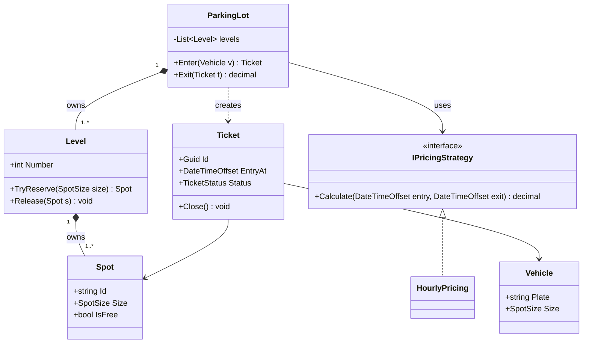
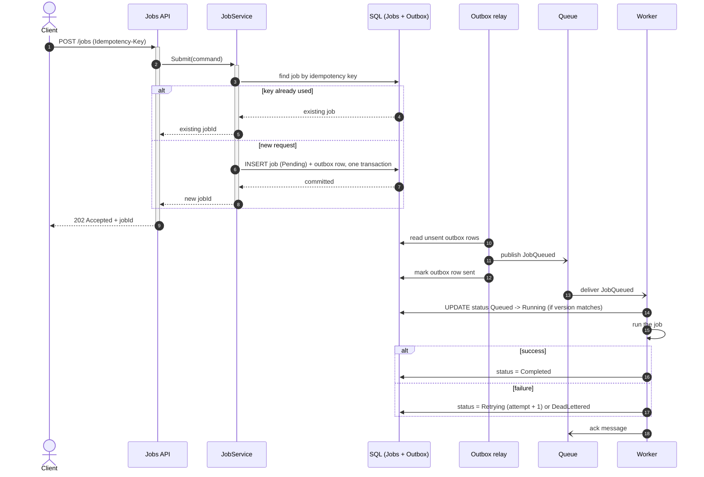
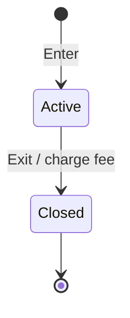
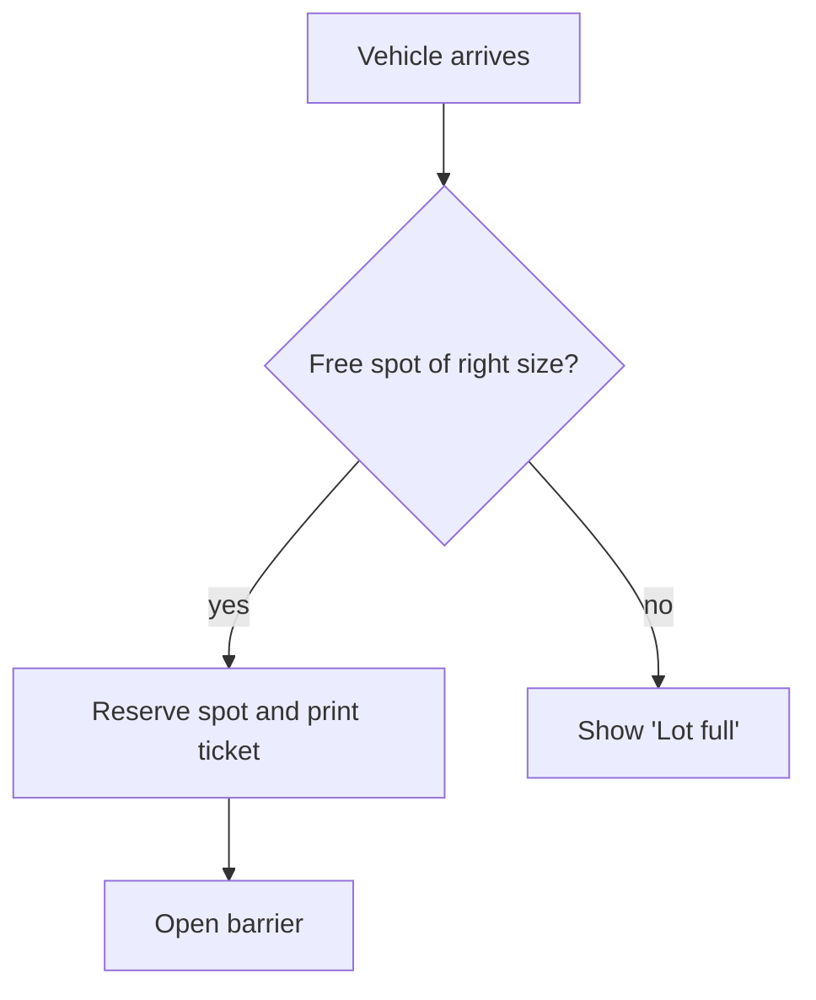
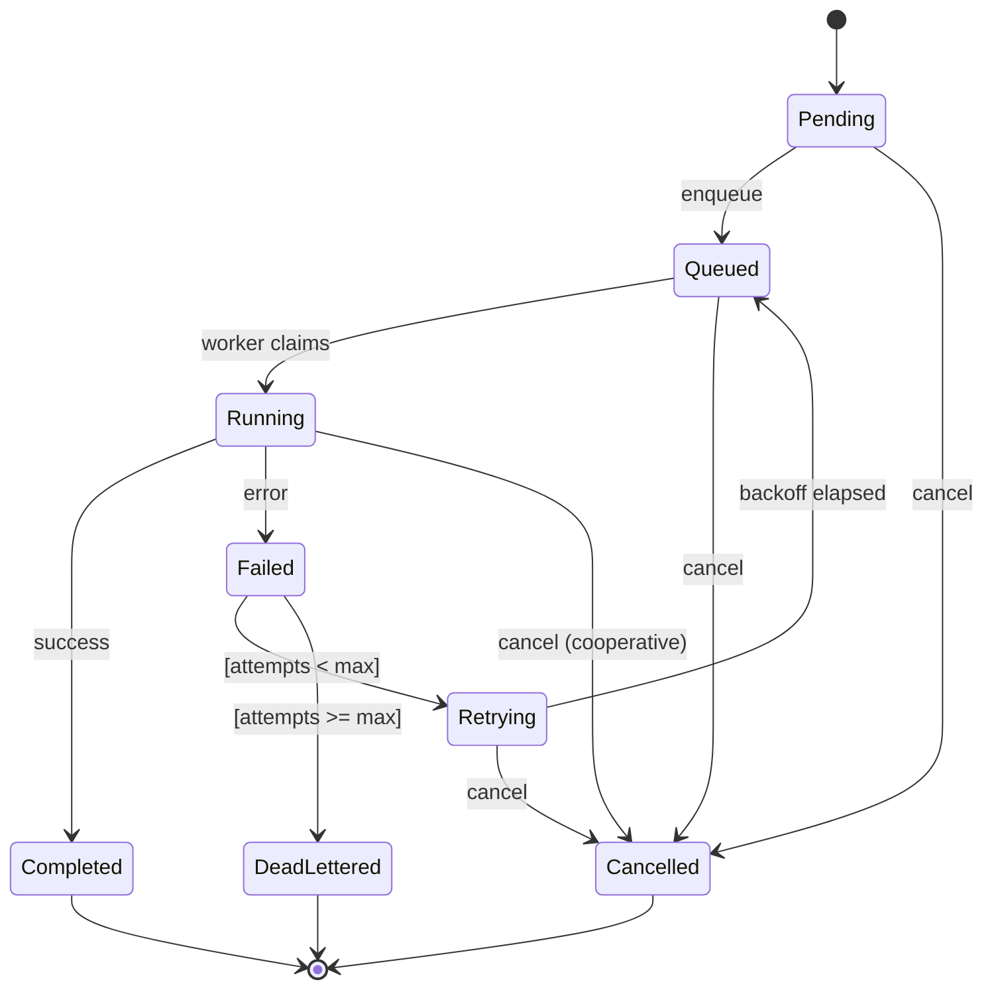
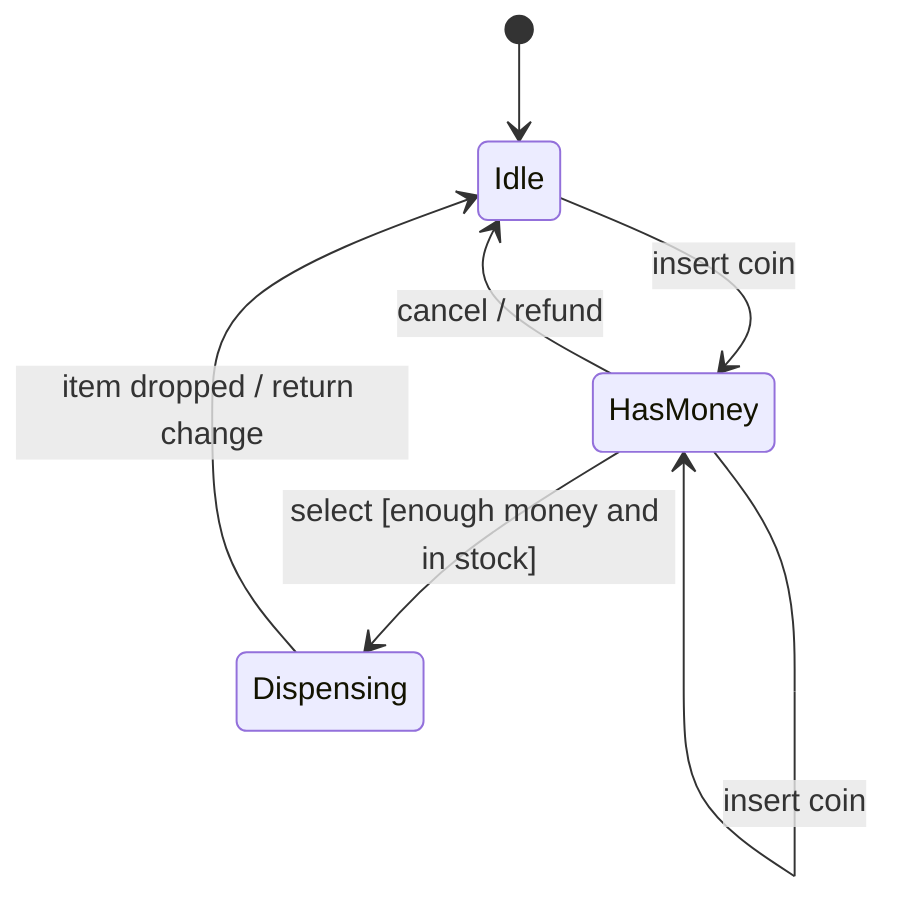

# Low-level design — OOP, SOLID, UML, design patterns, machine coding

[← Start here](../README.md) · [The plan](../PLAN.md) · [All notes](README.md)

Month 4 parts A, B and D, the complete LLD encyclopedia, the 17 LLD prompts with outlines, and the added method. Week 14 and every Saturday LLD block use this chapter. Per-problem cards are in DESIGNS.md.

Use it like this: read one question, close it, explain it aloud from memory, then check. Reading is not the same as knowing. ⚠️ boxes mark corrections to the original text. Sections marked ➕ were added in the final version to fill gaps.

**In this chapter:**

- PART A - SOLID, with real violations
- PART B - The patterns that matter
- PART D - The LLD round (Amazon tests this explicitly)
- LLD encyclopedia (FAANG plan, Part 1)
- 📖 Master Curriculum Encyclopedia (CodeWithShubham & CodeLLDWithShubham Integration)
- LLD practice prompts and outlines
- ➕ The LLD interview method, step by step
- ➕ OOP essentials with C# examples
- ➕ SOLID in code, and the 8 design principles
- ➕ All 23 GoF patterns: table, code for the important ones
- ➕ UML cheat sheet (text and Mermaid)
- ➕ Designing state machines in code
- ➕ Thread safety in LLD
- ➕ Making an LLD testable
- ➕ LLD self-review checklist and the 10 most common mistakes
- ➕ Enterprise patterns beyond GoF (.NET backend)

---

<a id="m4-part-a"></a>

## PART A - SOLID, with real violations

*Source: Q-and-A/M4_Design_and_Distributed_Systems.docx. Original wording kept below; ⚠️ boxes are corrections added in the final version.*

<a id="m4-q1"></a>

#### Q1. Explain Single Responsibility without reciting the definition.
Say this. "One reason to change" - not "does one thing". A class that formats a report and also emails it has two reasons to change: the layout team and the delivery team. When one changes you risk breaking the other, and two teams end up editing one file.
Why. The unit is a reason for change, which means a stakeholder, not a verb. That is why "does one thing" is misleading - a method that validates, saves and publishes does one business thing and has three reasons to change.
Watch out. Use a real example from your own code. "I had a service that parsed the file and also decided the retry policy" is worth ten textbook definitions.
<a id="m4-q2"></a>

#### Q2. What does Open/Closed actually look like in practice?
Say this. You should be able to add behaviour without editing existing code. In practice that means the variation point is behind an abstraction - a new payment provider is a new class implementing an interface, not a new branch in a switch that everything already depends on.
Why. Editing working code risks breaking working behaviour. Adding a class cannot break what was already there, so the blast radius of a change is bounded.
Instead of. Do not abstract pre-emptively. Open/Closed is a response to observed change - the second time you edit that switch, extract the abstraction. Doing it on the first is speculative generality.
<a id="m4-q3"></a>

#### Q3. Give a Liskov violation that compiles fine and breaks at runtime.
Say this. A `Square` inheriting `Rectangle` with independent width and height setters. Code written against `Rectangle` sets width to 4 and height to 5 and asserts the area is 20 - which holds for every rectangle and fails for a square, because setting one dimension changes the other.
Why. Liskov is about behavioural substitutability, not just signature compatibility. The compiler checks the signature; the invariants are what break.
Watch out. A better real-world one: an implementation that throws `NotSupportedException` for a method on the interface. It satisfies the compiler and violates the contract - a read-only collection implementing `IList` is the classic.
<a id="m4-q4"></a>

#### Q4. Why is Dependency Inversion not the same thing as using a DI container?
Say this. Dependency Inversion is a design principle: high-level policy should not depend on low-level detail; both should depend on an abstraction, and the abstraction should be owned by the high-level side. A DI container is a tool that wires up constructors. You can use a container and still violate the principle completely - inject a concrete `SqlRepository` everywhere and nothing is inverted.
Why. The inversion is about who owns the interface. If your domain layer defines `IOrderRepository` and the data layer implements it, the dependency arrow points inward and the domain is testable in isolation. If the data layer defines it, nothing changed.
Watch out. This is a favourite question because almost everyone conflates them. Getting it right is a strong signal, and it leads naturally into talking about testability.
<a id="m4-q5"></a>

#### Q5. When is a design pattern over-engineering?
Say this. When there is only one implementation and no concrete reason to expect a second. A Strategy with one strategy is a switch statement with three extra files and one more indirection to trace when debugging.
Why. Every abstraction has a cost: more files, more indirection, harder navigation. It pays only when it absorbs a change you actually make. If the change never comes, you paid for nothing.
Watch out. Interviewers love a candidate who can say "I would not use a pattern here, and here is why". Enthusiasm for patterns reads as junior; judgement about them reads as senior.

<a id="m4-part-b"></a>

## PART B - The patterns that matter

*Source: Q-and-A/M4_Design_and_Distributed_Systems.docx. Original wording kept below; ⚠️ boxes are corrections added in the final version.*

<a id="m4-q6"></a>

#### Q6. Strategy or a switch statement?
Say this. Strategy when the behaviours are genuinely independent, likely to grow, and better tested separately - payment providers, pricing rules, export formats. A switch when there are two or three cases, they are stable, and they are short enough to read at a glance.
Why. Strategy converts a compile-time branch into a runtime composition. That buys extensibility and testability and costs indirection.
Watch out. The honest version: refactor the switch to Strategy when you edit it for the third time. "I refactored a switch to Strategy and then judged whether it actually improved" is a mature answer.
<a id="m4-q7"></a>

#### Q7. How do event handlers cause memory leaks in .NET?
Say this. Subscribing creates a reference from the publisher to the subscriber. If the publisher outlives the subscriber and you never unsubscribe, the subscriber can never be collected - along with everything it references.
Why. The direction is what surprises people. You wrote `publisher.Event += handler`, so it looks like the subscriber depends on the publisher, but the delegate list lives on the publisher and holds the subscriber alive.
Instead of. Unsubscribe in `Dispose`, or use weak event patterns. In practice: any long-lived singleton raising events is a leak waiting to happen.
Watch out. A lambda capturing `this` has the same effect and is harder to spot, because there is no named method to search for.
<a id="m4-q8"></a>

#### Q8. Decorator or inheritance?
Say this. Decorator when you want to add behaviour to an instance at runtime and combine additions freely - caching plus logging plus retry over the same repository, composed in any order. Inheritance when the behaviour is fixed at compile time and there is a genuine is-a relationship.
Why. Decorator composes; inheritance multiplies. Three optional behaviours by inheritance means eight classes for every combination. By decoration it is three classes you stack.
Watch out. ASP.NET Core middleware is the Decorator pattern - each one wraps the next and can act before and after. Saying that connects Month 2 to Month 4 and is a genuinely good observation.
<a id="m4-q9"></a>

#### Q9. Should you wrap EF Core in a repository? Argue both sides.
Say this. Against: `DbSet<T>` is already a repository and `DbContext` is already a unit of work, so a thin wrapper is duplication that also hides useful capability - you lose composable `IQueryable`, `Include`, projections and split queries, or you leak them through anyway. For: it gives you a domain-shaped interface, keeps EF out of the domain layer, makes unit tests trivial, and centralises query logic so you do not have the same filter written twelve times.
Why. The real question is what you are isolating from. If it is "we might swap the ORM" - you will not, and the abstraction will leak. If it is "the domain should not know about EF" - that is a legitimate architectural boundary.
Watch out. Having a genuine opinion with reasons on both sides is the answer. A confident one-sided answer here reads as inexperience, because both are defensible.
<a id="m4-q10"></a>

#### Q10. Why is Singleton often called an anti-pattern, and when is it still right?
Say this. Because it hides a dependency - anything can reach it globally, so it does not appear in any constructor and cannot be substituted in a test. It also introduces shared mutable state across the whole process. It is still right for genuinely stateless, thread-safe, expensive-to-create things: a configured `HttpClient`, a logger, a cache.
Why. The problem is the static access, not the single instance. A singleton registered in a DI container and injected through a constructor has the single instance without the global access, which is why that is the pattern everyone actually uses.
Watch out. "Singleton lifetime is fine; the Singleton pattern is usually not" is a crisp way to say it.
<a id="m4-q11"></a>

#### Q11. Name three anti-patterns you have actually seen.
Say this. Anemic domain model - entities that are just property bags with all the logic in "service" classes, so the rules are scattered and duplicated. Service locator - resolving dependencies from a container inside a class, which hides them and defeats the point of DI. God object - one class that grew until nobody dares change it, usually called Manager or Helper.
Why. All three share a cause: it is easier to add to an existing thing than to create the right new thing. That is also why they grow rather than appear.
Watch out. You have worked on a legacy eDiscovery platform - you have seen these. A specific, unnamed example from real code is far more convincing than the definitions.
<a id="m4-q12"></a>

#### Q12. Why is untestable code usually badly designed code?
Say this. Because the things that make code hard to test are the things that make it hard to change: hidden dependencies, static state, doing too much, and no seams. If you cannot construct the class without a database, the class knows too much about the database.
Why. A test is just another caller. If a test cannot use it in isolation, no other caller can either - so tomorrow's feature will not be able to reuse it.
Watch out. "Testability and good design are the same conversation" is the line. Interviewers who care about design care about this.

<a id="m4-part-d"></a>

## PART D - The LLD round (Amazon tests this explicitly)

*Source: Q-and-A/M4_Design_and_Distributed_Systems.docx. Original wording kept below; ⚠️ boxes are corrections added in the final version.*

<a id="m4-q23"></a>

#### Q23. How do you approach a 45-minute LLD from a blank page?
Say this. Five minutes clarifying requirements and explicitly stating what is out of scope. Five listing the nouns - those become your entities. Ten defining the interfaces and where the variation lives. Twenty coding the core classes, with real method bodies for the interesting parts and stubs for the boring ones. Five on edge cases and one alternative you rejected.
Why. Interviewers score whether you got to working code, and whether your class boundaries make sense. Perfect completeness is not expected; a sensible structure and an articulated trade-off is.
Watch out. The most common failure is spending twenty-five minutes on requirements and never writing a class. Set yourself a hard limit and move.
<a id="m4-q24"></a>

#### Q24. Design a parking lot - what are the real decisions?
Say this. Entities: Vehicle with a size, Spot with a size and occupancy, Level, Ticket, and a PricingStrategy. The real decisions are: how a vehicle maps to eligible spot sizes; how you find a free spot efficiently, which is a free-list or a per-size counter rather than a scan; making pricing a strategy so hourly, daily and flat are separate classes; and thread safety on allocation so two cars cannot take one spot.
Why. The allocation concurrency is the part that separates a real answer from a class diagram. It is the same compare-and-set problem as everywhere else.
Watch out. Have one rejected alternative ready. "I considered a single list of spots scanned linearly and rejected it because lookup becomes O(n) at exactly the busiest time."
<a id="m4-q25"></a>

#### Q25. Design a logger - and where does your design differ from a real library?
Say this. Entities: a Logger facade, a Level enum, Sinks (console, file, HTTP), Formatters, and a buffered async writer. Key decisions: level filtering as early as possible so a disabled level costs almost nothing; sinks as an interface for extension; buffering with a background flush so logging never blocks the caller; and deciding what happens when the buffer is full - drop or block.
Why. Serilog adds structured logging: the message template and its properties are kept separate so downstream tools can query on fields rather than grepping strings. That is the biggest difference from a naive design and it is the right thing to mention.
Watch out. "What happens if the sink is down?" is the follow-up. Answer: buffer with a bound, then drop, and never let logging take down the application.


## LLD encyclopedia (FAANG plan, Part 1)


*Source: FAANG-Master-Plan/02_GRANULAR_CURRICULUM_ENCYCLOPEDIA.md. Original wording kept below; ⚠️ boxes are corrections added in the final version.*

<a id="f02-lld-master-curriculum-encyclopedia-codewithshubham-codelldwithsh"></a>

## 📖 Master Curriculum Encyclopedia (CodeWithShubham & CodeLLDWithShubham Integration)

This encyclopedia integrates **every single branch, sub-pattern, design pattern, and algorithm** from your reference mindmaps:
* **CodeLLDWithShubham Mindmap:** OOP Fundamentals, 5 Class Relationships, 8 Design Principles, 5 SOLID Principles, 5 UML Diagrams, and all 23 Gang of Four (GoF) Design Patterns.
* **DSA Patterns (CodeWithShubham) Mindmap:** Arrays, Strings (KMP, Rabin-Karp), Stacks, Queues, Linked Lists, Recursion & Backtracking, Trees (Views, Traversals, BST), Heaps, Graphs (Shortest Paths, Topo Sort, DSU, Bipartite), Trie, DP (1D, Knapsack, LCS, LIS, Grid, MCM), Greedy, Bit Manipulation, all 8 Sorting Algorithms, and Range Queries (Segment & Fenwick Trees).

---

<a id="f02-lld-part-1-low-level-design-lld-complete-breakdown"></a>

### 🏛️ PART 1: Low-Level Design (LLD) Complete Breakdown

<a id="f02-lld-1-oop-fundamentals"></a>

#### 1. OOP Fundamentals
* **Classes & Objects:** Blueprints, memory instantiation on heap vs stack in C#, object lifecycle.
* **Constructors:** Default, parameterized, copy constructors, static constructors in C#, constructor chaining (`this()`, `base()`).
* **Encapsulation:** Data hiding, information hiding, getters/setters, properties with backing fields.
* **Abstraction:** Hiding implementation complexity, exposing essential contracts via interfaces and abstract base classes.
* **Inheritance:** `is-a` relationship, single vs multiple interface inheritance in C#, `virtual`, `override`, `new` keywords.
* **Polymorphism:**
  * Compile-time (Static): Method overloading, operator overloading.
  * Runtime (Dynamic): Method overriding via virtual method table (vtable).
* **Abstract Classes:** Partial implementation, abstract methods, when to use vs interfaces.
* **Access Modifiers:** `public`, `private`, `protected`, `internal`, `protected internal`, `private protected`.
* **Static:** Static classes, static methods, static constructors, static fields (thread safety considerations).
* **Enums:** Strongly typed constants, flags enums (`[Flags]`), underlying types (`byte`, `int`).

---


> ⚠️ **Correction (final version, 19 Oct 2026):** [Nuance] Do not say 'objects on the heap, value types on the stack' as a rule — where a value lives depends on where it is declared (see M1 Q2).

<a id="f02-lld-2-class-relationships-uml-notations-semantics"></a>

#### 2. Class Relationships (UML Notations & Semantics)
* **Association (`-->`):** General `uses-a` relationship between two independent classes (e.g., `Order` uses `EmailService`).
* **Dependency (`..>`):** Weakest relationship; one class depends on another as a method parameter or local variable (temporary interaction).
* **Aggregation (`◇--`):** `has-a` relationship with **weak ownership** (Whole-Part). The child can exist independently of the parent (e.g., `Department` has `Professors`; if department dissolves, professors still exist).
* **Composition (`◆--`):** `has-a` relationship with **strong ownership**. The child's lifetime is bound to the parent's lifetime (e.g., `House` and `Rooms`; destroying the house destroys the rooms).
* **Realization (`..▷`):** Interface implementation or abstract contract realization (`class Car : IVehicle`).

---

<a id="f02-lld-3-core-design-principles"></a>

#### 3. Core Design Principles
* **DRY (Don't Repeat Yourself):** Extract reusable logic; single source of truth for business rules.
* **KISS (Keep It Simple, Stupid):** Avoid premature optimization; prefer simple, readable code over clever one-liners.
* **YAGNI (You Aren't Gonna Need It):** Implement only what is currently required; avoid building speculative features.
* **Separation of Concerns (SoC):** Break software into distinct sections where each section addresses a separate concern (e.g., Presentation vs Business Logic vs Data Access).
* **Coupling (Loose vs Tight):** Measure of dependency between modules. Aim for loose coupling via interfaces.
* **Cohesion (High vs Low):** Measure of how strongly related the responsibilities inside a single class are. Aim for high cohesion (a class does one cohesive job).
* **Composition Over Inheritance:** Prefer composing objects with interfaces rather than inheriting deep hierarchies (avoids fragile base class problem).
* **Law of Demeter (Principle of Least Knowledge):** A method of an object should only call methods belonging to: its own class, parameters passed in, objects it instantiated, or its direct member fields. Don't chain calls like `a.GetB().GetC().DoSomething()`.

---

<a id="f02-lld-4-solid-principles-the-5-pillars"></a>

#### 4. SOLID Principles (The 5 Pillars)
1. **SRP (Single Responsibility Principle):** A class should have only one reason to change. Separate domain entities from persistence, formatting, and validation.
2. **OCP (Open-Closed Principle):** Software entities should be open for extension, but closed for modification. Implement new behavior by adding new classes/strategies, not modifying existing tested code.
3. **LSP (Liskov Substitution Principle):** Subtypes must be substitutable for their base types without altering program correctness (e.g., classic Rectangle vs Square violation).
4. **ISP (Interface Segregation Principle):** Clients should not be forced to depend on interfaces they do not use. Split fat interfaces into smaller, cohesive role interfaces (`IReadable`, `IWritable` rather than `IReadWriteAdminSuperService`).
5. **DIP (Dependency Inversion Principle):** High-level modules should not depend on low-level modules; both should depend on abstractions. Abstractions should not depend on details; details should depend on abstractions (Dependency Injection).

---

<a id="f02-lld-5-uml-diagrams-for-interviews"></a>

#### 5. UML Diagrams for Interviews
* **Class Diagram:** Visualizing classes, fields, methods, access modifiers (`+`, `-`, `#`), and relationships (Inheritance, Composition, Aggregation, Dependency).
* **Use Case Diagram:** Actors, system boundaries, use cases, `<<include>>` and `<<extend>>` relationships.
* **Sequence Diagram:** Chronological interaction between objects over time; lifelines, synchronous messages, asynchronous calls, return messages, activation bars.
* **Activity Diagram:** Workflow and business logic flowchart; decision diamonds, fork/join parallel nodes.
* **State Machine Diagram:** States, transitions, events, guards, actions (critical for designing Elevators, Vending Machines, Order fulfillment).

---

<a id="f02-lld-6-all-23-gang-of-four-gof-design-patterns"></a>

#### 6. All 23 Gang of Four (GoF) Design Patterns


> ⚠️ **Correction (final version, 19 Oct 2026):** [Structure] The list below has 22 patterns, not 23: **Interpreter is missing** (behavioral), and the structural heading says 8 but lists 7. Correct split: Creational 5 (Singleton, Factory Method, Abstract Factory, Builder, Prototype), Structural 7 (Adapter, Bridge, Composite, Decorator, Facade, Flyweight, Proxy), Behavioral 11 (Chain of Responsibility, Command, Interpreter, Iterator, Mediator, Memento, Observer, State, Strategy, Template Method, Visitor). Interpreter: represent a small grammar as classes and evaluate it (e.g. a rule or filter expression language). Low interview priority.

<a id="f02-lld-a-creational-patterns-5"></a>

##### A. Creational Patterns (5)
1. **Singleton:** Ensures a class has only one instance, with a global access point. In C#: Thread-safe double-checked locking or `Lazy<T>`.
2. **Builder:** Separates the construction of a complex object from its representation (e.g., fluent query builder, complex document generator).
3. **Factory Method:** Defines an interface for creating an object, but lets subclasses decide which class to instantiate.
4. **Abstract Factory:** Creates families of related or dependent objects without specifying their concrete classes (e.g., DarkTheme vs LightTheme UI components).
5. **Prototype:** Creates new objects by cloning an existing instance (in C#: `ICloneable` or memberwise clone).

<a id="f02-lld-b-behavioral-patterns-10"></a>

##### B. Behavioral Patterns (10)
1. **Strategy:** Defines a family of algorithms, encapsulates each one, and makes them interchangeable at runtime (e.g., Payment strategies, Pricing rules).
2. **Iterator:** Provides a way to access elements of an aggregate object sequentially without exposing its underlying representation (`IEnumerator<T>` in C#).
3. **Command:** Encapsulates a request as an object, thereby letting you parameterize clients with different requests, queue or log requests, and support undo/redo.
4. **Observer:** Defines a one-to-many dependency so that when one object changes state, all its dependents are notified automatically (Event-driven architectures).
5. **State:** Allows an object to alter its behavior when its internal state changes (e.g., Elevator: `IdleState`, `MovingUpState`, `MovingDownState`).
6. **Template Method:** Defines the skeleton of an algorithm in a method, deferring some steps to subclasses without changing algorithm structure.
7. **Chain of Responsibility:** Passes a request along a chain of handlers. Each handler decides either to process the request or pass it to the next handler (e.g., ASP.NET Core Middleware pipeline).
8. **Visitor:** Separates an algorithm from the object structure on which it operates (e.g., Tax calculation across different product types).
9. **Mediator:** Defines an object that encapsulates how a set of objects interact, preventing direct dependencies between them (e.g., MediatR library in .NET, Air Traffic Controller).
10. **Memento:** Captures and externalizes an object's internal state so the object can be restored to this state later (Undo/Redo checkpoints).

<a id="f02-lld-c-structural-patterns-8"></a>

##### C. Structural Patterns (8)
1. **Adapter:** Converts the interface of a class into another interface clients expect (wrapping legacy APIs or third-party SDKs).
2. **Facade:** Provides a simplified, unified high-level interface to a complex subsystem.
3. **Decorator:** Attaches additional responsibilities to an object dynamically without subclass explosion (e.g., CachingDecorator, LoggingDecorator around repositories).
4. **Composite:** Composes objects into tree structures to represent part-whole hierarchies. Lets clients treat individual objects and compositions uniformly (e.g., File System folders and files).
5. **Proxy:** Provides a surrogate or placeholder for another object to control access to it (e.g., Virtual Proxy for lazy loading, Remote Proxy, Protection Proxy).
6. **Bridge:** Decouples an abstraction from its implementation so that the two can vary independently (e.g., `Shape` and `Color` hierarchies).
7. **Flyweight:** Reduces memory footprint by sharing common state among multiple fine-grained objects (e.g., Character glyph rendering in text editors, game particle systems).

---


## LLD practice prompts and outlines

<a id="qs-9"></a>

### 9. One major thing missing: OO/LLD practice

*Source: Q-and-A/system-designdistributed-systems foundation.docx (prompt list). Original wording kept below; ⚠️ boxes are corrections added in the final version.*

Month 4 gives you the theory, but for FAANG/MAANG SDE-II you should practice actual LLD problems.
Add:
- Design parking lot
- Design elevator
- Design ATM
- Design vending machine
- Design library
- Design hotel booking
- Design movie ticket booking
- Design chess
- Design snake and ladder
- Design notification system
- Design logger
- Design rate limiter
- Design cache
- Design task scheduler
- Design pub/sub system
- Design file system
- Design food delivery/order system
And for each, practice:
requirements → entities → interfaces → relationships → core flows → concurrency → extensibility → edge cases → code


<a id="gap-09"></a>

#### Answers to the section 9 prompts (written 13 Oct 2026, kept in full)

Practice for every card below: Close the answer and explain the mechanism; draw one concrete flow, state a failure case and defend an alternative. For a design outline, develop APIs, data schema, estimates and failure recovery before treating it as a completed design.

<a id="gap-09-001"></a>


#### GAP-09-001 — Design parking lot

**Answer / starting outline.** LLD starting point: ParkingLot, Floor, Spot, Vehicle, Ticket and PricingPolicy. Separate spot assignment from pricing/payment. Guard spot allocation under concurrent arrivals; release only the ticket’s assigned spot. Test full capacity, wrong vehicle type, duplicate exit and lost-ticket rules. Follow requirements → entities → interfaces → relationships → core flows → concurrency → extensibility → edge cases → code.


<a id="gap-09-002"></a>


#### GAP-09-002 — Design elevator

**Answer / starting outline.** LLD starting point: ElevatorCar, Request, Scheduler, Door and explicit car states. Separate request scheduling from motion/door safety. Define direction, pickup rules, capacity and emergency behavior. Test requests arriving during movement and reject motion with an open door; compare scheduling strategies through interfaces. Follow requirements → entities → interfaces → relationships → core flows → concurrency → extensibility → edge cases → code.


<a id="gap-09-003"></a>


#### GAP-09-003 — Design ATM

**Answer / starting outline.** LLD starting point: ATM state machine, CardSession, AccountGateway, CashInventory and Transaction. Define authentication, limits and dispensing/reconciliation. Model uncertain bank response and cash-dispense failure explicitly. Never simulate financial correctness with only an in-memory balance subtraction. Follow requirements → entities → interfaces → relationships → core flows → concurrency → extensibility → edge cases → code.


<a id="gap-09-004"></a>


#### GAP-09-004 — Design vending machine

**Answer / starting outline.** LLD starting point: Machine, Inventory, Product, PaymentSession and states for idle/payment/selection/dispense. Enforce stock and money invariants, change/refund rules and failed dispense recovery. Test selecting unavailable stock, cancelling and concurrent requests. Follow requirements → entities → interfaces → relationships → core flows → concurrency → extensibility → edge cases → code.


<a id="gap-09-005"></a>


#### GAP-09-005 — Design library

**Answer / starting outline.** LLD starting point: BookTitle, BookCopy, Member, Loan and Reservation. Titles and physical copies are different entities. Define lending limits, due dates, fines and reservation order. Protect one-copy/one-active-loan and test renewal conflicts or returning twice. Follow requirements → entities → interfaces → relationships → core flows → concurrency → extensibility → edge cases → code.


<a id="gap-09-006"></a>


#### GAP-09-006 — Design hotel booking

**Answer / starting outline.** LLD starting point: Hotel, RoomType, physical Room, DateRange, Availability and Booking. Model per-night capacity/overlap rules and hold/confirm/cancel transitions. Use a repository contract that supports guarded reservations; test concurrent overlapping dates and cancellation. Follow requirements → entities → interfaces → relationships → core flows → concurrency → extensibility → edge cases → code.


<a id="gap-09-007"></a>


#### GAP-09-007 — Design movie ticket booking

**Answer / starting outline.** LLD starting point: Movie, Show, Seat, Hold, Booking and PaymentGateway. Isolate seat-state transitions and hold expiry from presentation logic. Test two buyers of one seat, payment after expiry and duplicate confirm. Reuse guarded atomic reservation rather than trusting a read-then-write check. Follow requirements → entities → interfaces → relationships → core flows → concurrency → extensibility → edge cases → code.


<a id="gap-09-008"></a>


#### GAP-09-008 — Design chess

**Answer / starting outline.** LLD starting point: Board, Piece, Position, Move and Game state. Separate movement rules from game-level turn/check/checkmate validation. Represent special moves and promotion deliberately. Test illegal moves, check exposure and undo; avoid a subclass for every possible board condition. Follow requirements → entities → interfaces → relationships → core flows → concurrency → extensibility → edge cases → code.


<a id="gap-09-009"></a>


#### GAP-09-009 — Design snake and ladder

**Answer / starting outline.** LLD starting point: Board, Cell, Jump, Player, Dice and Game. Specify finish rules, overshoot, turn order and jump chaining/cycles. Inject dice for deterministic tests. Keep the board configuration separate from the game loop. Follow requirements → entities → interfaces → relationships → core flows → concurrency → extensibility → edge cases → code.


<a id="gap-09-010"></a>


#### GAP-09-010 — Design notification system

**Answer / starting outline.** LLD starting point: NotificationRequest, Template, PreferenceRepository, ChannelSender and DeliveryAttempt. Use Strategy for genuinely varying channels and explicit delivery states. Test opt-outs, provider failures and duplicate submission; separate request orchestration from provider adapter code. Follow requirements → entities → interfaces → relationships → core flows → concurrency → extensibility → edge cases → code.


<a id="gap-09-011"></a>


#### GAP-09-011 — Design logger

**Answer / starting outline.** LLD starting point: LogEvent, Level, Formatter, Sink and Logger. Define filtering, synchronous/asynchronous delivery, bounded buffering and failure policy. Use composable sinks and thread-safe writes. Test shutdown drain, malformed formatting and sink failure without recursive logging loops. Follow requirements → entities → interfaces → relationships → core flows → concurrency → extensibility → edge cases → code.


<a id="gap-09-012"></a>


#### GAP-09-012 — Design rate limiter

**Answer / starting outline.** LLD starting point: Limiter, Policy, KeyResolver, Clock and AtomicStateStore. Implement one strategy first with a documented invariant. Inject time for boundary tests and use atomic state operations for shared limits. Test bursts, multiple callers and storage outage behavior. Follow requirements → entities → interfaces → relationships → core flows → concurrency → extensibility → edge cases → code.


<a id="gap-09-013"></a>


#### GAP-09-013 — Design cache

**Answer / starting outline.** LLD starting point: Cache<K,V>, Entry, Clock and EvictionPolicy. Define get/put/remove, capacity, TTL and concurrency. For LRU, combine a dictionary with a doubly linked list. Test replacing entries, expired values, capacity zero and concurrent access; state complexity precisely. Follow requirements → entities → interfaces → relationships → core flows → concurrency → extensibility → edge cases → code.


<a id="gap-09-014"></a>


#### GAP-09-014 — Design task scheduler

**Answer / starting outline.** LLD starting point: TaskDefinition, Trigger, Scheduler, ClaimStore and Executor. Distinguish selecting due jobs from executing them. Use durable claims/leases when distributed; inject time and test duplicate triggers, long jobs, cancellation and missed runs. Follow requirements → entities → interfaces → relationships → core flows → concurrency → extensibility → edge cases → code.


<a id="gap-09-015"></a>


#### GAP-09-015 — Design pub/sub system

**Answer / starting outline.** LLD starting point: Topic, Publisher, Subscription, Broker and Message. Define ordering, fan-out, acknowledgments, retention and subscriber isolation. A slow subscriber needs a bounded policy. Test duplicate delivery, unsubscription during publish and subscriber failure. Follow requirements → entities → interfaces → relationships → core flows → concurrency → extensibility → edge cases → code.


<a id="gap-09-016"></a>


#### GAP-09-016 — Design file system

**Answer / starting outline.** LLD starting point: Node, File, Directory, PathResolver and PermissionPolicy. Composite can represent directories and files through common operations, but file-only operations should remain clear. Define duplicate names, moving into descendants and access checks. Test path normalization and cycle prevention. Follow requirements → entities → interfaces → relationships → core flows → concurrency → extensibility → edge cases → code.


<a id="gap-09-017"></a>


#### GAP-09-017 — Design food delivery/order system

**Answer / starting outline.** LLD starting point: Order, Item, Restaurant, Courier, PaymentGateway and an OrderStateMachine. Put allowed transitions/invariants in domain logic and external integrations behind interfaces. Test rejection, cancellation races, failed payment and reassignment; define compensations where side effects have escaped. Follow requirements → entities → interfaces → relationships → core flows → concurrency → extensibility → edge cases → code.


<a id="add-lld-method"></a>

## ➕ The LLD interview method, step by step

[Q23](#m4-q23) gives the short version. This is the full method. Use the same steps for every problem in the LLD list. Practise them until they are automatic.

### The steps

1. **Clarify requirements and scope.** Ask 3–5 questions. Write the answers down. Say what is out of scope.
2. **List use cases.** Write 4–6 short lines: "driver parks a car", "driver pays and leaves". Each one becomes a public method later.
3. **Identify entities and their responsibilities.** Take the nouns from the use cases. Give each one a single job. Drop nouns that have no behaviour.
4. **Define interfaces / APIs.** Write method signatures first, with no bodies. Put an interface only where behaviour really varies (pricing, payment, spot selection).
5. **Relationships.** For each pair of classes, decide: composition (owns it), aggregation (holds it), association (knows it) or inheritance (is-a). Prefer composition.
6. **State machines.** Find the entities that change status (ticket, order, job, elevator). Draw the states and the allowed transitions.
7. **Write the core code first (happy path).** Real bodies for the interesting methods. Stubs for boring ones. The code must run in your head.
8. **Edge cases and tests.** Full lot, wrong vehicle size, double exit, lost ticket. Write one or two tests.
9. **Concurrency.** Which state is shared? Who can change it at the same time? Protect it (see [concurrency](#add-lld-concurrency)).
10. **Extension.** The interviewer will ask for one change: "add electric charging spots" or "add monthly passes". Show that the change is a new class, not edits everywhere.
11. **Talk the whole time.** Say what you are doing and why. Silence is scored as "stuck".

### Time split

| Step | 45-minute round | 90-minute machine-coding round |
|---|---|---|
| 1–2 Requirements and use cases | 5 min | 10 min |
| 3–5 Entities, interfaces, relationships | 8 min | 15 min |
| 6 State machine | 2 min | 5 min |
| 7 Core code (happy path) | 18 min | 35 min |
| 8 Edge cases and tests | 5 min | 12 min |
| 9 Concurrency | 4 min | 8 min |
| 10 Extension request | 3 min | 5 min |

In the 90-minute round the code must usually compile and run. Leave 5 minutes at the end to run it and fix small errors. In the 45-minute round, clean pseudo-real C# is usually enough. Ask the interviewer which one they expect.

### What to say aloud at each step

| Step | Say this |
|---|---|
| Requirements | "Before I design, let me confirm scope. Is it one building or many? Do we need payment? I will leave reservations out unless you want them." |
| Use cases | "These are the five things a user can do. Each will become a public method." |
| Entities | "The main entities are X, Y, Z. X is responsible for ..., Y only for ..." |
| Interfaces | "Pricing will change often, so I put it behind an interface. Spot size will not change, so it is a simple enum." |
| Relationships | "A level owns its spots, so that is composition. A ticket only refers to a spot, so that is association." |
| State machine | "A ticket can be Active, Paid or Closed. Paying twice is not allowed, so I guard that transition." |
| Core code | "I will write the happy path first, then come back for edge cases." |
| Edge cases | "What if the lot is full? I return a failure result, not an exception, because it is a normal case." |
| Concurrency | "Two cars can arrive at the same moment. Spot allocation must be atomic. I will use a lock per level." |
| Extension | "To add EV spots I add a new spot type and a new selection rule. Existing classes do not change." |

### Filled example skeleton: parking lot

**Requirements (agreed with the interviewer)**

- One building, several levels. Spot sizes: Small, Medium, Large.
- Motorbike fits any spot. Car needs Medium or Large. Truck needs Large.
- Entry gives a ticket. Exit calculates the fee and frees the spot.
- Pricing is hourly now. It may change later.
- Out of scope: reservations, payment gateway, display boards.

**Classes and responsibilities**

| Class | Responsibility |
|---|---|
| `ParkingLot` | Entry and exit flow. Facade for the client. |
| `Level` | Owns its spots. Finds and reserves a free spot. |
| `Spot` | Size and occupied flag. |
| `Vehicle` (record) | Plate and size. |
| `Ticket` | Which vehicle, which spot, entry time, status. |
| `IPricingStrategy` | Calculates a fee. `HourlyPricing` is the first implementation. |

**Code (C#, .NET 10)**

```csharp
public enum SpotSize { Small = 1, Medium = 2, Large = 3 }
public enum TicketStatus { Active, Closed }

public sealed record Vehicle(string Plate, SpotSize Size);

public sealed class Spot(string id, SpotSize size)
{
    public string Id { get; } = id;
    public SpotSize Size { get; } = size;
    public bool IsFree { get; private set; } = true;
    internal void Occupy() => IsFree = false;
    internal void Release() => IsFree = true;
}

public sealed class Ticket(Guid id, Vehicle vehicle, Spot spot, DateTimeOffset entryAt)
{
    public Guid Id { get; } = id;
    public Vehicle Vehicle { get; } = vehicle;
    public Spot Spot { get; } = spot;
    public DateTimeOffset EntryAt { get; } = entryAt;
    public TicketStatus Status { get; private set; } = TicketStatus.Active;

    public void Close()
    {
        if (Status != TicketStatus.Active)
            throw new InvalidOperationException("Ticket already closed.");
        Status = TicketStatus.Closed;
    }
}

public interface IPricingStrategy
{
    decimal Calculate(DateTimeOffset entry, DateTimeOffset exit);
}

public sealed class HourlyPricing(decimal ratePerHour) : IPricingStrategy
{
    public decimal Calculate(DateTimeOffset entry, DateTimeOffset exit)
    {
        var hours = (int)Math.Ceiling((exit - entry).TotalHours);
        return Math.Max(1, hours) * ratePerHour;
    }
}

public sealed class Level(int number, IEnumerable<Spot> spots)
{
    private readonly List<Spot> _spots = spots.ToList();
    private readonly Lock _gate = new();          // .NET 9+ lock type
    public int Number { get; } = number;

    public Spot? TryReserve(SpotSize needed)
    {
        lock (_gate)                              // check + occupy must be atomic
        {
            var spot = _spots
                .Where(s => s.IsFree && s.Size >= needed)
                .OrderBy(s => s.Size)             // smallest spot that fits
                .FirstOrDefault();
            spot?.Occupy();
            return spot;
        }
    }

    public void Release(Spot spot)
    {
        lock (_gate) spot.Release();
    }
}

public sealed class ParkingLot(IEnumerable<Level> levels, IPricingStrategy pricing, TimeProvider clock)
{
    private readonly List<Level> _levels = levels.ToList();

    public Ticket? Enter(Vehicle vehicle)
    {
        foreach (var level in _levels)
        {
            var spot = level.TryReserve(vehicle.Size);
            if (spot is not null)
                return new Ticket(Guid.NewGuid(), vehicle, spot, clock.GetUtcNow());
        }
        return null;                              // lot full: a normal case, not an exception
    }

    public decimal Exit(Ticket ticket)
    {
        ticket.Close();                           // throws on double exit
        var level = _levels.First(l => l.Number == LevelOf(ticket.Spot));
        level.Release(ticket.Spot);
        return pricing.Calculate(ticket.EntryAt, clock.GetUtcNow());
    }

    private static int LevelOf(Spot spot) => int.Parse(spot.Id.Split('-')[0]); // id format "1-07"
}
```

Note: the size check `s.Size >= needed` works because the enum values are ordered. Say this aloud. It is a design choice, and it breaks if someone reorders the enum.

**One test (xUnit)**

```csharp
using Microsoft.Extensions.Time.Testing;   // NuGet: Microsoft.Extensions.TimeProvider.Testing

public class ParkingLotTests
{
    [Fact]
    public void Car_parked_for_2h_10m_pays_three_hours()
    {
        var clock = new FakeTimeProvider(new DateTimeOffset(2026, 10, 19, 9, 0, 0, TimeSpan.Zero));
        var level = new Level(1, [new Spot("1-01", SpotSize.Medium)]);
        var lot = new ParkingLot([level], new HourlyPricing(50m), clock);

        var ticket = lot.Enter(new Vehicle("MH12AB1234", SpotSize.Medium));
        clock.Advance(TimeSpan.FromMinutes(130));
        var fee = lot.Exit(ticket!);

        Assert.Equal(150m, fee);
        Assert.NotNull(lot.Enter(new Vehicle("MH12CD5678", SpotSize.Medium))); // spot was freed
    }
}
```

**Extension you can offer:** "Add EV charging spots." Add `bool HasCharger` to `Spot` and an `ISpotSelector` interface. `Level` asks the selector instead of using a fixed LINQ query. `ParkingLot`, `Ticket` and pricing do not change.

<a id="add-lld-oop"></a>

## ➕ OOP essentials with C# examples

The encyclopedia above lists the OOP topics. This section shows each one in code, the way an interviewer wants to see it.

### Encapsulation: protect the invariants

An invariant is a rule that must always be true. Example: "an account balance is never negative". Encapsulation means the object itself enforces its rules. Nobody outside can put it in a bad state.

How to do it in C#:

- Check the rules in the constructor. An object that exists is always valid.
- Use `private set` or `init`, not public setters.
- Change state only through methods with business names (`Withdraw`, not `SetBalance`).
- Do not return a mutable internal list. Return `IReadOnlyList<T>`.

```csharp
public sealed class BankAccount
{
    private readonly List<string> _history = [];

    public BankAccount(string owner, decimal openingBalance)
    {
        ArgumentException.ThrowIfNullOrWhiteSpace(owner);
        ArgumentOutOfRangeException.ThrowIfNegative(openingBalance);
        Owner = owner;
        Balance = openingBalance;
    }

    public string Owner { get; }
    public decimal Balance { get; private set; }
    public IReadOnlyList<string> History => _history;

    public void Withdraw(decimal amount)
    {
        ArgumentOutOfRangeException.ThrowIfNegativeOrZero(amount);
        if (amount > Balance)
            throw new InvalidOperationException("Insufficient funds.");
        Balance -= amount;
        _history.Add($"Withdraw {amount}");
    }
}
```

C# 14 (.NET 10) adds the `field` keyword. It lets you validate in a property setter without writing a backing field:

```csharp
public string Name
{
    get;
    set => field = string.IsNullOrWhiteSpace(value)
        ? throw new ArgumentException("Name is required.") : value;
}
```

Bad sign in an interview: a class with only `{ get; set; }` properties and all the rules in a "service". That is the anemic domain model from [Q11](#m4-q11).

### Abstraction: show what, hide how

The caller knows *what* an object does, not *how*. In C# you use an interface or an abstract class.

```csharp
public interface INotificationSender
{
    Task SendAsync(string to, string message, CancellationToken ct);
}
```

The order service calls `SendAsync`. It does not know if this is SMTP, an SMS provider or a test fake.

**Interface or abstract class?**

| Use an interface when | Use an abstract class when |
|---|---|
| Unrelated classes share a capability | Subclasses share real code and state |
| You need several "roles" on one class | There is a fixed algorithm with steps (Template Method) |
| You want easy test fakes | You want to force a constructor rule on all children |

C# interfaces can have default method bodies (since C# 8). Use this rarely. It is mainly for adding a method to a public interface without breaking old implementers.

### Inheritance vs composition

Inheritance = "is-a". Composition = "has-a" or "uses-a".

Problem with inheritance: the child depends on the parent's internal details. A change in the parent can break every child. This is the "fragile base class" problem. Also, C# allows only one base class.

```csharp
// Inheritance gone wrong: behaviour combinations multiply
public class Report { public virtual string Render() => "..."; }
public class PdfReport : Report { }
public class EmailedPdfReport : PdfReport { }       // and EmailedCsvReport, ArchivedPdfReport...

// Composition: combine small parts
public sealed class ReportJob(IReportRenderer renderer, IReportDelivery delivery)
{
    public Task RunAsync(ReportData data, CancellationToken ct)
        => delivery.DeliverAsync(renderer.Render(data), ct);
}
```

Use inheritance when the is-a is real and stable (`FileNotFoundException : IOException`), or when a framework asks for it (`BackgroundService`, `ControllerBase`). Otherwise prefer composition.

### Polymorphism: one call, many behaviours

**Runtime polymorphism with `virtual` / `override`:**

```csharp
public abstract class Shape
{
    public abstract double Area();                     // must override
    public virtual string Describe() => $"Area {Area():F2}"; // may override
}

public sealed class Circle(double r) : Shape
{
    public override double Area() => Math.PI * r * r;
}

public sealed class Square(double side) : Shape
{
    public override double Area() => side * side;
    public override string Describe() => $"Square, {base.Describe()}";
}

// Caller does not know the concrete type:
Shape[] shapes = [new Circle(1), new Square(2)];
foreach (var s in shapes) Console.WriteLine(s.Describe());
```

**Polymorphism through interfaces:** the same idea, but classes do not share a base class. `IPricingStrategy` in the parking lot is an example.

Know these keywords:

- `virtual` – the method can be overridden.
- `override` – replaces the base method. The call goes to the real runtime type.
- `new` – hides the base method. The call depends on the *variable* type, not the object type. Almost always a mistake. Say so if asked.
- `sealed` – stops further overriding. Mark classes `sealed` by default. It makes intent clear, and the JIT can sometimes call the method directly instead of through the virtual table.
- `abstract` – no body. Children must implement it.

Compile-time polymorphism is method overloading (same name, different parameters). It is chosen by the compiler, not at runtime.

### The 5 class relationships

The encyclopedia lists them. Here they are with code and correct UML notation. In UML, the diamond is at the "whole" end, and the triangle points to the parent or the interface.

| Relationship | Meaning | UML notation | Mermaid |
|---|---|---|---|
| Dependency | Uses it briefly (parameter, local variable) | dashed line, open arrow `- - ->` | `A ..> B` |
| Association | Knows it for a long time (field), both live independently | solid line, open arrow `——>` | `A --> B` |
| Aggregation | Has it, but the part can live without the whole | solid line, **hollow** diamond at the whole | `A o-- B` |
| Composition | Owns it; the part dies with the whole | solid line, **filled** diamond at the whole | `A *-- B` |
| Inheritance | is-a (class extends class) | solid line, hollow triangle at the parent | `B <\|-- A` |
| Realization | implements an interface | dashed line, hollow triangle at the interface | `I <\|.. A` |

(Inheritance and realization are often counted as one relationship: "generalization". That is why lists say "5 relationships".)

```csharp
// Dependency: only a method parameter
public sealed class InvoicePrinter
{
    public string Print(Invoice invoice) => $"Invoice {invoice.Number}";
}

// Association: a long-lived reference, independent lifetimes
public sealed class Order(Customer customer)
{
    public Customer Customer { get; } = customer;
}

// Aggregation: a team holds employees, but employees exist without the team
public sealed class Team
{
    private readonly List<Employee> _members = [];
    public void Add(Employee e) => _members.Add(e);   // created outside, passed in
}

// Composition: the order creates and owns its lines
public sealed class PurchaseOrder
{
    private readonly List<OrderLine> _lines = [];
    public void AddLine(string sku, int qty) => _lines.Add(new OrderLine(sku, qty)); // created inside
}

// Inheritance and realization
public abstract class Vehicle2 { }
public sealed class Truck : Vehicle2, IDisposable { public void Dispose() { } }
```

A simple test for aggregation vs composition: *who creates the part, and can anyone else hold it?* If the whole creates it and nobody else holds it, it is composition. In C#, garbage collection makes the line soft. Say "the whole controls the part's lifetime", not "the whole destroys it".

<a id="add-lld-solid"></a>

## ➕ SOLID in code, and the 8 design principles

[Part A](#m4-part-a) explains S, O, L and D in words. Here each one has a short "violation → fix" pair in C#. Interface Segregation had no question, so it is complete here.

### S — Single Responsibility

**Violation:** one class builds the report *and* sends it. The layout team and the email team both edit this file.

```csharp
public sealed class SalesReport(IDbConnection db)
{
    public void GenerateAndEmail(string to)
    {
        var rows = db.Query<Sale>("SELECT * FROM Sales");        // data access
        var html = string.Join("", rows.Select(r => $"<tr>{r}</tr>")); // formatting
        using var smtp = new SmtpClient("smtp.local");            // delivery
        smtp.Send("noreply@x.com", to, "Sales", html);
    }
}
```

**Fix:** three classes, one reason to change each. A small coordinator wires them.

```csharp
public interface ISalesSource  { Task<IReadOnlyList<Sale>> GetAsync(CancellationToken ct); }
public interface IReportFormatter { string Format(IReadOnlyList<Sale> sales); }
public interface IReportSender { Task SendAsync(string to, string body, CancellationToken ct); }

public sealed class SalesReportJob(ISalesSource src, IReportFormatter fmt, IReportSender sender)
{
    public async Task RunAsync(string to, CancellationToken ct)
        => await sender.SendAsync(to, fmt.Format(await src.GetAsync(ct)), ct);
}
```

### O — Open/Closed

**Violation:** every new discount type edits this switch.

```csharp
public decimal Discount(string type, decimal total) => type switch
{
    "festival" => total * 0.10m,
    "loyalty"  => total * 0.05m,
    _          => 0m               // add "student" here = edit tested code
};
```

**Fix:** a new discount is a new class. Existing code stays closed.

```csharp
public interface IDiscountRule { string Code { get; } decimal Apply(decimal total); }
public sealed class FestivalDiscount : IDiscountRule { public string Code => "festival"; public decimal Apply(decimal t) => t * 0.10m; }
public sealed class LoyaltyDiscount  : IDiscountRule { public string Code => "loyalty";  public decimal Apply(decimal t) => t * 0.05m; }

public sealed class DiscountCalculator(IEnumerable<IDiscountRule> rules)
{
    private readonly Dictionary<string, IDiscountRule> _byCode = rules.ToDictionary(r => r.Code);
    public decimal Discount(string code, decimal total)
        => _byCode.TryGetValue(code, out var rule) ? rule.Apply(total) : 0m;
}
```

Remember [Q2](#m4-q2): do this after the second or third change, not on day one.

### L — Liskov Substitution

[Q3](#m4-q3) has Rectangle/Square. Here is the `NotSupportedException` case in code.

**Violation:** a read-only store pretends to be a full store.

```csharp
public interface IDocumentStore
{
    Document Get(Guid id);
    void Save(Document doc);
}

public sealed class ArchiveStore : IDocumentStore
{
    public Document Get(Guid id) => /* read from archive */ throw new NotImplementedException();
    public void Save(Document doc) => throw new NotSupportedException("Archive is read-only"); // breaks callers
}
```

Any code that takes `IDocumentStore` and calls `Save` now fails at runtime.

**Fix:** model the real capabilities. The archive only promises what it can do.

```csharp
public interface IDocumentReader { Document Get(Guid id); }
public interface IDocumentStore : IDocumentReader { void Save(Document doc); }

public sealed class ArchiveStore : IDocumentReader { public Document Get(Guid id) => LoadFromArchive(id); private static Document LoadFromArchive(Guid id) => new(id); }
public sealed class LiveStore : IDocumentStore    { public Document Get(Guid id) => new(id); public void Save(Document doc) { } }

public sealed record Document(Guid Id);
```

Liskov rules to say aloud: a subtype must not demand more (stronger preconditions), must not promise less (weaker postconditions), and must not throw new kinds of exceptions for normal calls.

### I — Interface Segregation (complete answer)

**Interview question: "Explain Interface Segregation with a real example."**

**Say this.** No client should be forced to depend on methods it does not use. When one interface serves many different callers, every caller is coupled to every method. A change for one caller forces the others to recompile, re-test, or implement methods they do not need. So split a "fat" interface into small *role interfaces*, each shaped by one kind of client.

**Violation:** one big interface for every printer.

```csharp
public interface IMachine
{
    void Print(Document d);
    void Scan(Document d);
    void Fax(Document d);
    void Staple(Document d);
}

public sealed class BasicPrinter : IMachine
{
    public void Print(Document d) { /* works */ }
    public void Scan(Document d)   => throw new NotSupportedException(); // forced
    public void Fax(Document d)    => throw new NotSupportedException(); // forced
    public void Staple(Document d) => throw new NotSupportedException(); // forced
}
```

Look closely: the ISP violation also caused an LSP violation (the `NotSupportedException`). This is common. Fat interfaces push implementers into lying.

**Fix:** role interfaces. A class implements only the roles it really has. A client asks only for the role it really needs.

```csharp
public interface IPrinter { void Print(Document d); }
public interface IScanner { void Scan(Document d); }
public interface IFax     { void Fax(Document d); }

public sealed class BasicPrinter : IPrinter { public void Print(Document d) { } }

public sealed class OfficeMachine : IPrinter, IScanner, IFax
{
    public void Print(Document d) { }
    public void Scan(Document d)  { }
    public void Fax(Document d)   { }
}

// The client depends only on what it calls:
public sealed class InvoiceService(IPrinter printer)
{
    public void PrintInvoice(Document d) => printer.Print(d);
}
```

**Why.** Small interfaces are easier to fake in tests (one method, not twelve). They make dependencies honest: `InvoiceService(IPrinter)` tells you it only prints. And a change to `IFax` cannot affect `InvoiceService`.

**Real .NET examples.** `IEnumerable<T>` (read in order), `IReadOnlyCollection<T>` (plus `Count`), `ICollection<T>` (plus add/remove), `IList<T>` (plus index). A method that only loops should accept `IEnumerable<T>`. Also `IDisposable` and `IAsyncDisposable` are tiny role interfaces.

**Real backend example.** A repository interface with 25 methods used by 10 services. Split it by use: `IOrderReader` for query handlers, `IOrderWriter` for commands. A reporting service then cannot accidentally write.

**Watch out.**
- Do not split into one interface per method everywhere. Group methods that the *same client* uses together. The unit is "one kind of client", not "one method".
- ISP is about the client's view. One class can still implement several interfaces. That is fine.
- If an interface has exactly one implementation and one client, you may not need it at all (see YAGNI below).

### D — Dependency Inversion

[Q4](#m4-q4) explains who owns the interface. In code:

**Violation:** the domain service creates a concrete SQL class.

```csharp
public sealed class OrderService
{
    private readonly SqlOrderRepository _repo = new("Server=...");   // high level depends on low level
    public void Place(Order o) => _repo.Insert(o);
}
```

**Fix:** the domain project defines the interface. The infrastructure project implements it. The arrow now points inward.

```csharp
// Domain project
public interface IOrderRepository { Task AddAsync(Order order, CancellationToken ct); }
public sealed class OrderService(IOrderRepository repo)
{
    public Task PlaceAsync(Order o, CancellationToken ct) => repo.AddAsync(o, ct);
}

// Infrastructure project (references Domain, not the other way)
public sealed class SqlOrderRepository(AppDbContext db) : IOrderRepository
{
    public async Task AddAsync(Order order, CancellationToken ct)
    {
        db.Orders.Add(order);
        await db.SaveChangesAsync(ct);
    }
}

// Composition root (Program.cs)
builder.Services.AddScoped<IOrderRepository, SqlOrderRepository>();
```

### The 8 design principles: one line each, and when NOT to over-apply

| Principle | One line | When not to over-apply it |
|---|---|---|
| DRY | One business rule lives in one place. | Two pieces of code that *look* the same but change for different reasons are not duplication. Merging them couples two features. "Duplication is cheaper than the wrong abstraction." |
| KISS | Choose the simplest design that meets the requirements. | Simple must still be correct. Do not skip thread safety or validation and call it "simple". |
| YAGNI | Do not build features or extension points nobody asked for. | Some things are expensive to add later: tests, logging, idempotency keys, a schema version. Add those early. |
| Separation of concerns | UI, business rules and data access live in different places. | Do not create five layers for a CRUD endpoint. Three folders can be enough. |
| High cohesion | Everything inside a class belongs to the same job. | Do not split a cohesive class into tiny classes just to make it small. Small but scattered is also hard to read. |
| Low coupling | Classes know as little as possible about each other. | An interface for every class is not low coupling. It is extra files. Couple freely to stable things (`string`, `List<T>`, your own value objects). |
| Composition over inheritance | Build behaviour by combining objects, not by deep class trees. | Shallow, real is-a hierarchies are fine. Framework base classes (`BackgroundService`) are fine. |
| Law of Demeter | Talk to your direct friends only: avoid `order.Customer.Address.City.Name`. | Fluent APIs and LINQ chains (`list.Where().Select()`) are not violations. Plain data records (DTOs) can be navigated. |

How these connect: high cohesion + low coupling is the goal. SOLID and the other six are ways to get there. In the interview, use them as *reasons* ("I split this because the pricing changes for a different reason"), not as a list to recite.

<a id="add-lld-gof"></a>

## ➕ All 23 GoF patterns: table, code for the important ones

The encyclopedia list above has 22 patterns (Interpreter is missing). This table has all 23. "Priority" means how often the pattern matters in an SDE-2 LLD round. It is a study-time guide, not a statistic.

### Creational (5): how objects are made

| Pattern | Problem it solves | One-line structure | .NET example you already know | Priority |
|---|---|---|---|---|
| Singleton | Exactly one shared instance is needed | Private constructor + static instance | `services.AddSingleton<T>()`, `TimeProvider.System`, `ArrayPool<T>.Shared` | Medium (asked as a discussion) |
| Factory Method | Caller should not know which concrete class to create | A method returns an interface; subclasses or config pick the class | `DbProviderFactory.CreateConnection()`, `IHttpClientFactory.CreateClient(name)`, `ILoggerFactory.CreateLogger()` | High |
| Abstract Factory | Create a *family* of related objects that must match | Factory interface with several create methods, one factory per family | `DbProviderFactory` (connection + command + parameter for one database) | Medium |
| Builder | Object needs many optional parts or several steps | Fluent methods collect parts; `Build()` validates and creates | `WebApplication.CreateBuilder()`, `StringBuilder`, `UriBuilder`, `DbContextOptionsBuilder` | High |
| Prototype | Copying is easier than building from scratch | Object can clone itself | Record `with` expressions, `MemberwiseClone()`, `ICloneable` | Low |

### Structural (7): how objects are combined

| Pattern | Problem it solves | One-line structure | .NET example you already know | Priority |
|---|---|---|---|---|
| Adapter | An existing class has the wrong interface | Wrapper implements the expected interface and translates calls | `StreamReader` (adapts a `Stream` to `TextReader`), logging provider packages that plug Serilog/NLog into `ILogger` | High |
| Bridge | Two dimensions vary independently (what vs how) | Abstraction holds a reference to an implementor interface | `ILogger` (what you call) vs `ILoggerProvider` (where it goes) | Low |
| Composite | Treat a tree of items and a single item the same way | Leaf and container share one interface; container holds children | `IConfiguration` sections, `CompositeFileProvider`, file/folder trees | Medium |
| Decorator | Add behaviour to an object without changing it or subclassing | Wrapper implements the same interface and calls the inner object | `Stream` wrappers: `BufferedStream`, `GZipStream`, `CryptoStream`; `DelegatingHandler` | High |
| Facade | A subsystem is complex to use | One simple class in front of many | `HttpClient` (over handlers, sockets, pooling), `File.ReadAllTextAsync` | Medium |
| Flyweight | Too many similar objects use too much memory | Share the common (intrinsic) state; pass the rest in | `string.Intern`, cached boxed values, glyphs in a text editor | Low |
| Proxy | Control access to an object (lazy, remote, security, caching) | Same interface as the real object; decides when/if to call it | EF Core lazy-loading proxies, gRPC client stubs, `Lazy<T>` (similar idea) | Medium |

### Behavioral (11): how objects talk and share work

| Pattern | Problem it solves | One-line structure | .NET example you already know | Priority |
|---|---|---|---|---|
| Chain of Responsibility | Several handlers may process a request, in order | Each handler does its part, then calls next or stops | ASP.NET Core middleware (can short-circuit), `HttpClient` `DelegatingHandler` chain | Medium |
| Command | Treat a request as an object (queue, log, retry, undo) | Command object with `Execute` (and `Undo`) | Messages in a queue, MediatR requests, WPF `ICommand` | High |
| Interpreter | Evaluate sentences of a small language | One class per grammar rule; each has `Interpret` | LINQ expression trees translated to SQL by EF Core, `Regex` | Low |
| Iterator | Walk a collection without knowing its inside | `MoveNext` / `Current` | `IEnumerable<T>`, `yield return`, `IAsyncEnumerable<T>` | Medium |
| Mediator | Many objects talk to each other; too many links | Objects talk only to a central mediator | MediatR `ISender`, a chat room, an air traffic controller | Medium |
| Memento | Save and restore state without exposing internals | Originator creates an opaque snapshot; caretaker stores it | Undo stacks; EF Core keeps original values in the change tracker | Low |
| Observer | Many parties need to react when something changes | Subject keeps a list of subscribers and notifies them | C# `event`, `IObservable<T>`, `IOptionsMonitor<T>.OnChange` | High |
| State | Behaviour depends on the current state; big `switch` on status | One class per state; context delegates to the current state | Circuit breaker states (closed/open/half-open) in Polly | High |
| Strategy | Swap one algorithm for another at runtime | Interface for the algorithm; context receives one | `IComparer<T>` in `List.Sort`, `IEqualityComparer<T>`, auth schemes | High |
| Template Method | Fixed steps, some steps vary | Base class method calls abstract/virtual steps | `BackgroundService.ExecuteAsync`, `DbContext.OnModelCreating` | Medium |
| Visitor | Add new operations over a fixed set of node types | Each node has `Accept(visitor)`; visitor has one method per node type | `ExpressionVisitor`, Roslyn `CSharpSyntaxWalker` | Low |

Totals: 5 + 7 + 11 = 23.

Two notes that sound senior:

- ASP.NET Core middleware fits **both** Chain of Responsibility (any middleware can stop the request, for example authentication returning 401) and Decorator (each one wraps the next and acts before and after). [Q8](#m4-q8) calls it Decorator. Both views are correct.
- Decorator, Proxy and Adapter all "wrap" an object. The difference is intent: Decorator **adds** behaviour (same interface). Proxy **controls access** (same interface). Adapter **changes** the interface.

### Strategy

Use when one step of a flow has several algorithms that change independently.

```csharp
public interface IShippingCost { string Name { get; } decimal For(decimal weightKg); }

public sealed class StandardShipping : IShippingCost { public string Name => "standard"; public decimal For(decimal kg) => 40m + 10m * kg; }
public sealed class ExpressShipping  : IShippingCost { public string Name => "express";  public decimal For(decimal kg) => 100m + 25m * kg; }

public sealed class Checkout(IEnumerable<IShippingCost> strategies)
{
    private readonly Dictionary<string, IShippingCost> _map = strategies.ToDictionary(s => s.Name);

    public decimal Total(decimal itemsTotal, decimal weightKg, string shipping)
        => _map.TryGetValue(shipping, out var s)
            ? itemsTotal + s.For(weightKg)
            : throw new ArgumentException($"Unknown shipping '{shipping}'.");
}

// DI: register all; Checkout receives IEnumerable<IShippingCost>
// builder.Services.AddSingleton<IShippingCost, StandardShipping>();
// builder.Services.AddSingleton<IShippingCost, ExpressShipping>();
```

### Factory Method

The classic GoF form: a base class has an abstract "create" method; subclasses decide the concrete type.

```csharp
public interface IExporter { byte[] Export(IReadOnlyList<Row> rows); }
public sealed record Row(string Key, decimal Value);
public sealed class CsvExporter  : IExporter { public byte[] Export(IReadOnlyList<Row> r) => []; }
public sealed class JsonExporter : IExporter { public byte[] Export(IReadOnlyList<Row> r) => []; }

public abstract class ExportJob
{
    protected abstract IExporter CreateExporter();          // the factory method

    public byte[] Run(IReadOnlyList<Row> rows)
    {
        var exporter = CreateExporter();
        return exporter.Export(rows);
    }
}

public sealed class CsvExportJob  : ExportJob { protected override IExporter CreateExporter() => new CsvExporter(); }
public sealed class JsonExportJob : ExportJob { protected override IExporter CreateExporter() => new JsonExporter(); }
```

The modern .NET form: a factory chooses by key. .NET 8+ has **keyed services** built in.

```csharp
builder.Services.AddKeyedSingleton<IExporter, CsvExporter>("csv");
builder.Services.AddKeyedSingleton<IExporter, JsonExporter>("json");

public sealed class ExporterFactory(IServiceProvider sp)
{
    public IExporter Create(string format) => sp.GetRequiredKeyedService<IExporter>(format);
}
```

Say this: "Strategy is *which algorithm runs*. Factory is *which object gets created*. They often work together: a factory returns a strategy."

### Observer

C# events are the built-in Observer. Remember the leak from [Q7](#m4-q7): unsubscribe.

```csharp
public sealed record PriceChanged(string Sku, decimal OldPrice, decimal NewPrice);

public sealed class Product(string sku, decimal price)
{
    public string Sku { get; } = sku;
    public decimal Price { get; private set; } = price;
    public event EventHandler<PriceChanged>? PriceChangedEvent;

    public void ChangePrice(decimal newPrice)
    {
        if (newPrice == Price) return;
        var old = Price;
        Price = newPrice;
        PriceChangedEvent?.Invoke(this, new PriceChanged(Sku, old, newPrice));
    }
}

public sealed class PriceAlert : IDisposable
{
    private readonly Product _product;
    public PriceAlert(Product product) { _product = product; _product.PriceChangedEvent += OnChanged; }
    private void OnChanged(object? sender, PriceChanged e) => Console.WriteLine($"{e.Sku}: {e.OldPrice} -> {e.NewPrice}");
    public void Dispose() => _product.PriceChangedEvent -= OnChanged;   // no leak
}
```

Know the limits: events run **synchronously** on the publisher's thread. One slow or throwing subscriber blocks or breaks the others. For cross-service or slow work, use a queue (the distributed form of Observer is pub/sub).

### Decorator

Add caching to a repository without touching it.

```csharp
public interface IProductRepository { Task<Product?> GetAsync(string sku, CancellationToken ct); }

public sealed class CachedProductRepository(IProductRepository inner, IMemoryCache cache) : IProductRepository
{
    public async Task<Product?> GetAsync(string sku, CancellationToken ct)
    {
        if (cache.TryGetValue(sku, out Product? hit)) return hit;
        var product = await inner.GetAsync(sku, ct);
        if (product is not null) cache.Set(sku, product, TimeSpan.FromMinutes(5));
        return product;
    }
}

// DI without extra libraries: register the real one, then wrap it
builder.Services.AddScoped<SqlProductRepository>();
builder.Services.AddScoped<IProductRepository>(sp =>
    new CachedProductRepository(sp.GetRequiredService<SqlProductRepository>(),
                                sp.GetRequiredService<IMemoryCache>()));
```

You can stack more: `Logging(Cached(Sql))`. Order matters. Say which order you chose and why.

### Adapter

A legacy SDK has the wrong shape. Wrap it once, behind your own interface.

```csharp
// Third-party SDK (cannot change it)
public sealed class LegacySmsClient
{
    public int SendText(string msisdn, string body, bool flash) => 0;   // returns 0 on success
}

// Our interface
public interface ISmsSender { Task<bool> SendAsync(string phone, string text, CancellationToken ct); }

public sealed class LegacySmsAdapter(LegacySmsClient client) : ISmsSender
{
    public Task<bool> SendAsync(string phone, string text, CancellationToken ct)
    {
        var code = client.SendText(phone.TrimStart('+'), text, flash: false);
        return Task.FromResult(code == 0);
    }
}
```

The rest of the code never sees `LegacySmsClient`. Replacing the provider later means one new adapter.

### Builder

Use when an object has many optional parts and a rule that must hold at the end.

```csharp
public sealed record EmailMessage(string From, IReadOnlyList<string> To, string Subject, string Body, IReadOnlyList<string> Cc);

public sealed class EmailBuilder
{
    private string? _from, _subject, _body;
    private readonly List<string> _to = [], _cc = [];

    public EmailBuilder From(string from) { _from = from; return this; }
    public EmailBuilder To(string address) { _to.Add(address); return this; }
    public EmailBuilder Cc(string address) { _cc.Add(address); return this; }
    public EmailBuilder Subject(string s) { _subject = s; return this; }
    public EmailBuilder Body(string b) { _body = b; return this; }

    public EmailMessage Build()
    {
        if (_from is null) throw new InvalidOperationException("From is required.");
        if (_to.Count == 0) throw new InvalidOperationException("At least one recipient is required.");
        return new EmailMessage(_from, [.. _to], _subject ?? "", _body ?? "", [.. _cc]);
    }
}

var mail = new EmailBuilder().From("a@x.com").To("b@x.com").Subject("Hi").Build();
```

When not to use it: if all fields are required, a constructor (or a record with `required` properties) is simpler.

### State

The object changes behaviour when its state changes. Each state is a class. Here: a document workflow.

```csharp
public interface IDocState
{
    string Name { get; }
    IDocState Submit() => throw new InvalidOperationException($"Cannot submit in {Name}.");
    IDocState Approve() => throw new InvalidOperationException($"Cannot approve in {Name}.");
    IDocState Reject() => throw new InvalidOperationException($"Cannot reject in {Name}.");
}

public sealed class Draft : IDocState { public string Name => "Draft"; public IDocState Submit() => new InReview(); }
public sealed class InReview : IDocState
{
    public string Name => "InReview";
    public IDocState Approve() => new Published();
    public IDocState Reject() => new Draft();
}
public sealed class Published : IDocState { public string Name => "Published"; }

public sealed class WorkflowDocument
{
    private IDocState _state = new Draft();
    public string State => _state.Name;
    public void Submit()  => _state = _state.Submit();
    public void Approve() => _state = _state.Approve();
    public void Reject()  => _state = _state.Reject();
}
```

Note: the default interface methods give "not allowed" for free. Each state overrides only the moves it allows. The [state machines section](#add-lld-state-machines) compares this with an enum + transition table.

### Command

A request becomes an object. Then you can queue it, log it, retry it, or undo it.

```csharp
public interface IEditorCommand { void Execute(); void Undo(); }

public sealed class TextBuffer { public System.Text.StringBuilder Text { get; } = new(); }

public sealed class InsertText(TextBuffer buffer, int position, string value) : IEditorCommand
{
    public void Execute() => buffer.Text.Insert(position, value);
    public void Undo() => buffer.Text.Remove(position, value.Length);
}

public sealed class Editor
{
    private readonly Stack<IEditorCommand> _undo = new(), _redo = new();

    public void Run(IEditorCommand cmd) { cmd.Execute(); _undo.Push(cmd); _redo.Clear(); }
    public void Undo() { if (_undo.TryPop(out var c)) { c.Undo(); _redo.Push(c); } }
    public void Redo() { if (_redo.TryPop(out var c)) { c.Execute(); _undo.Push(c); } }
}
```

Backend link: a message on a queue (`ProcessDocument { DocumentId }`) is a Command. That is why it must carry everything needed to run it, and why handlers must be idempotent: the queue may deliver it twice.

### Interpreter (missing from the original notes)

Use when users write small rules in a tiny language and you must evaluate them. Example rule: `amount > 1000 AND country == IN`. Each grammar rule is a class with `Interpret`.

```csharp
public interface IExpr { bool Interpret(IReadOnlyDictionary<string, string> ctx); }

public sealed record Compare(string Field, string Op, string Value) : IExpr
{
    public bool Interpret(IReadOnlyDictionary<string, string> ctx)
    {
        if (!ctx.TryGetValue(Field, out var actual)) return false;
        return Op switch
        {
            "==" => actual == Value,
            "!=" => actual != Value,
            ">"  => decimal.Parse(actual) > decimal.Parse(Value),
            "<"  => decimal.Parse(actual) < decimal.Parse(Value),
            _    => throw new NotSupportedException($"Operator {Op}")
        };
    }
}

public sealed record And(IExpr Left, IExpr Right) : IExpr
{
    public bool Interpret(IReadOnlyDictionary<string, string> ctx) => Left.Interpret(ctx) && Right.Interpret(ctx);
}

public sealed record Or(IExpr Left, IExpr Right) : IExpr
{
    public bool Interpret(IReadOnlyDictionary<string, string> ctx) => Left.Interpret(ctx) || Right.Interpret(ctx);
}

// Tiny parser: "field op value (AND|OR field op value)*", evaluated left to right, no brackets.
public static class RuleParser
{
    public static IExpr Parse(string text)
    {
        var t = text.Split(' ', StringSplitOptions.RemoveEmptyEntries);
        if (t.Length < 3 || (t.Length - 3) % 4 != 0)
            throw new FormatException("Expected: field op value (AND|OR field op value)*");

        IExpr expr = new Compare(t[0], t[1], t[2]);
        for (var i = 3; i < t.Length; i += 4)
        {
            var right = new Compare(t[i + 1], t[i + 2], t[i + 3]);
            expr = t[i] switch
            {
                "AND" => new And(expr, right),
                "OR"  => new Or(expr, right),
                _     => throw new FormatException($"Expected AND/OR, got {t[i]}")
            };
        }
        return expr;
    }
}

var rule = RuleParser.Parse("amount > 1000 AND country == IN");
var ok = rule.Interpret(new Dictionary<string, string> { ["amount"] = "1500", ["country"] = "IN" }); // true
```

Say this: "The pattern is the class tree (`Compare`, `And`, `Or`), not the parser. For real rule engines I would use expression trees or an existing library. Interpreter is low priority but it is the 23rd pattern."

### Singleton: risks, and why the DI lifetime is better

The classic thread-safe version:

```csharp
public sealed class AppSettingsCache
{
    private static readonly Lazy<AppSettingsCache> _instance = new(() => new AppSettingsCache());
    public static AppSettingsCache Instance => _instance.Value;
    private AppSettingsCache() { }
}
```

Risks of the static Singleton pattern:

1. **Hidden dependency.** Callers use `AppSettingsCache.Instance` directly. It is not in any constructor, so you cannot see it or replace it.
2. **Hard to test.** Tests share the same instance. One test's data leaks into the next. Parallel tests fail randomly.
3. **Global mutable state.** Any code can change it from anywhere. Bugs are hard to trace.
4. **Thread safety.** The instance is shared by all threads. Every mutable field needs protection.
5. **Fixed lifetime.** It lives until the process ends. You cannot reset it or have one per tenant.

The DI singleton keeps "one instance" and removes the rest:

```csharp
builder.Services.AddSingleton<ISettingsCache, SettingsCache>();

public sealed class PricingService(ISettingsCache settings) { /* dependency is visible and replaceable */ }
```

One DI trap to know: the **captive dependency**. A singleton that receives a scoped service (for example a `DbContext`) keeps that one scoped instance forever. It is then shared across requests and threads. In development, ASP.NET Core validates scopes and throws on this. Fix: inject `IServiceScopeFactory` and create a scope per unit of work, or make the consumer scoped.

Good singleton candidates: stateless or thread-safe, expensive to create: `IHttpClientFactory`-made handlers, `JsonSerializerOptions`, an in-memory cache, `TimeProvider.System`.

<a id="add-lld-uml"></a>

## ➕ UML cheat sheet (text and Mermaid)

In an interview you draw on a whiteboard or type in a shared editor. Nobody checks perfect UML. They check that arrows mean the right thing. Learn the small set below. Mermaid lets you type diagrams as text; many shared editors and GitHub render it.

### Class diagram notation

A class box has three parts: name, fields, methods.

```text
+---------------------------+
| Ticket                    |
+---------------------------+
| - id : Guid               |
| - entryAt : DateTimeOffset|
| + Status : TicketStatus   |
+---------------------------+
| + Close() : void          |
| # Validate() : bool       |
+---------------------------+
```

**Visibility**

| Symbol | Meaning | C# |
|---|---|---|
| `+` | public | `public` |
| `-` | private | `private` |
| `#` | protected | `protected` |
| `~` | package / internal | `internal` |

Other marks: *italic* or `<<abstract>>` for abstract; `<<interface>>` for an interface; underline (or `$` in Mermaid) for static.

**Multiplicity** (written at the end of a line):

| Mark | Meaning |
|---|---|
| `1` | exactly one |
| `0..1` | zero or one (nullable) |
| `*` or `0..*` | any number |
| `1..*` | at least one |

**Relationship arrows** (see the [OOP section](#add-lld-oop) for code):

| Relationship | Line | End mark | Mermaid |
|---|---|---|---|
| Dependency | dashed | open arrow at the used class | `..>` |
| Association | solid | open arrow (or none) | `-->` |
| Aggregation | solid | hollow diamond at the whole | `o--` |
| Composition | solid | filled diamond at the whole | `*--` |
| Inheritance | solid | hollow triangle at the parent | `<\|--` |
| Realization | dashed | hollow triangle at the interface | `<\|..` |

### Example: parking lot class diagram



### Sequence diagram notation

- **Lifeline:** a participant (object or service) with a vertical dashed line under it. Time goes down.
- **Synchronous message:** solid line, filled arrow. The caller waits. Mermaid `->>`.
- **Return:** dashed line. Mermaid `-->>`.
- **Asynchronous message:** the caller does not wait (fire and forget, a queue). Mermaid `-)`.
- **Activation bar:** a thin box on the lifeline while it is working. Mermaid `activate` / `deactivate`, or `+` / `-` after the arrow.
- **Fragments:** `alt` (if/else), `opt` (optional), `loop`, `par` (parallel).

### Example: job submission flow (your project)



What to say: "The API returns 202 before the work runs. The outbox makes the database write and the message publish safe together. The worker checks the version, so a duplicate message cannot run the job twice at the same time."

### State machine diagram notation

- Rounded box = state. Filled black dot = start. Dot in a circle = end.
- Arrow = transition, labelled `event [guard] / action`. Example: `Fail [attempts < 3] / schedule retry`.
- Mermaid: `stateDiagram-v2`, `[*]` for start and end. A full example is in the [state machines section](#add-lld-state-machines).



### Use case diagram (overview)

- **Actor** (stick figure): a user role or an external system (Driver, Attendant, Payment Gateway).
- **Use case** (oval): one goal ("Park vehicle", "Pay ticket").
- **System boundary** (box) around the use cases.
- `<<include>>`: always part of another use case ("Pay ticket" includes "Calculate fee").
- `<<extend>>`: optional extra behaviour ("Pay ticket" is extended by "Apply coupon").

In interviews, a text list of actors and use cases is usually enough. That list is step 2 of the [LLD method](#add-lld-method).

### Activity diagram (overview)

A flowchart for a process. Rounded boxes are actions. Diamonds are decisions. A thick bar is a fork (start parallel work) or a join (wait for all). Swimlanes show who does each action. Use it for a business flow with branches, like order checkout. Mermaid `flowchart TD` is fine for this.



<a id="add-lld-state-machines"></a>

## ➕ Designing state machines in code

Many LLD problems are really state machines: job, order, ticket, elevator, vending machine, ATM, traffic light. If an entity has a `Status` field, it has a state machine. Make it explicit. Hidden state machines (status set from ten places) are a top source of bugs.

### Two ways to build one

| | Enum + transition table | State pattern (one class per state) |
|---|---|---|
| Shape | `enum Status` + a dictionary of allowed moves | `IState` interface + a class per state |
| Best when | Behaviour is the same in every state; only *which moves are allowed* changes | Behaviour is really different per state (what `InsertCoin` does depends on state) |
| Persisting | Easy: store the enum as a string column | Store a name, map it back to a class on load |
| Seeing all rules | One table, easy to review and test | Rules are spread across classes |
| Typical problems | Job, order, ticket, booking, payment | Vending machine, ATM, elevator, game turn |

Rule of thumb: start with the enum + table. Move to the State pattern when the `switch (status)` blocks appear in many methods.

### Guarding illegal transitions

1. All changes go through **one method**, for example `TransitionTo(next)`. The `Status` setter is private.
2. That method checks the table. An illegal move throws or returns a failure. It never silently succeeds.
3. Guards check extra conditions: "can retry only if attempts < max".
4. Terminal states have **no** outgoing moves.
5. Record each transition (from, to, time, reason) for audit and debugging.

### Example 1: a job (enum + transition table)



```csharp
public enum JobStatus { Pending, Queued, Running, Completed, Failed, Retrying, DeadLettered, Cancelled }

public sealed record Transition(JobStatus From, JobStatus To, DateTimeOffset At, string? Reason);

public sealed class Job
{
    private static readonly Dictionary<JobStatus, JobStatus[]> Allowed = new()
    {
        [JobStatus.Pending]      = [JobStatus.Queued, JobStatus.Cancelled],
        [JobStatus.Queued]       = [JobStatus.Running, JobStatus.Cancelled],
        [JobStatus.Running]      = [JobStatus.Completed, JobStatus.Failed, JobStatus.Cancelled],
        [JobStatus.Failed]       = [JobStatus.Retrying, JobStatus.DeadLettered],
        [JobStatus.Retrying]     = [JobStatus.Queued, JobStatus.Cancelled],
        [JobStatus.Completed]    = [],
        [JobStatus.DeadLettered] = [],
        [JobStatus.Cancelled]    = [],
    };

    private readonly List<Transition> _history = [];

    public Job(Guid id, int maxAttempts)
    {
        ArgumentOutOfRangeException.ThrowIfLessThan(maxAttempts, 1);
        Id = id;
        MaxAttempts = maxAttempts;
    }

    public Guid Id { get; }
    public int MaxAttempts { get; }
    public int Attempts { get; private set; }
    public JobStatus Status { get; private set; } = JobStatus.Pending;
    public int Version { get; private set; }                 // for optimistic concurrency
    public IReadOnlyList<Transition> History => _history;
    public bool IsTerminal => Allowed[Status].Length == 0;

    public void Enqueue(DateTimeOffset now)  => Move(JobStatus.Queued, now);
    public void Start(DateTimeOffset now)    { Move(JobStatus.Running, now); Attempts++; }
    public void Complete(DateTimeOffset now) => Move(JobStatus.Completed, now);
    public void Cancel(DateTimeOffset now, string reason) => Move(JobStatus.Cancelled, now, reason);

    public void Fail(DateTimeOffset now, string error)
    {
        Move(JobStatus.Failed, now, error);
        // Guard decides the next state automatically.
        Move(Attempts < MaxAttempts ? JobStatus.Retrying : JobStatus.DeadLettered, now);
    }

    private void Move(JobStatus next, DateTimeOffset now, string? reason = null)
    {
        if (!Allowed[Status].Contains(next))
            throw new InvalidOperationException($"Job {Id}: {Status} -> {next} is not allowed.");
        _history.Add(new Transition(Status, next, now, reason));
        Status = next;
        Version++;
    }
}
```

A table-driven test for this is in the [testing section](#add-lld-testing).

### Persisting state

- Store the status as a **string** column (`HasConversion<string>()` in EF Core). Integer enums break silently if someone reorders the enum.
- Two workers may load the same job. Protect the move with **optimistic concurrency**: the `UPDATE` only succeeds if the row has not changed since you read it.

```sql
UPDATE Jobs
SET    Status = 'Running', Version = Version + 1, Attempts = Attempts + 1
WHERE  Id = @id AND Status = 'Queued' AND Version = @expectedVersion;
-- 0 rows affected = someone else moved it first. Do not run the job.
```

In EF Core, mark `Version` as a concurrency token (`.IsConcurrencyToken()`) or use a SQL Server `rowversion` column. `SaveChangesAsync` then throws `DbUpdateConcurrencyException` when the row changed.

- Keep the history in a separate table (`JobTransitions`). It answers "why is this job dead-lettered?" in production.
- Time-based moves (Retrying → Queued after backoff) need a scheduler that queries `WHERE Status = 'Retrying' AND NextAttemptAt <= now`. Store `NextAttemptAt`. Do not keep timers only in memory: a restart loses them.

### Example 2: a vending machine (State pattern)

Here the *same action* does different things in each state. Inserting a coin while idle starts a session. Inserting a coin while dispensing is rejected. So the State pattern fits.



```csharp
public interface IVendingState
{
    void InsertCoin(VendingMachine m, decimal amount);
    void Select(VendingMachine m, string code);
    void Cancel(VendingMachine m);
}

public sealed class VendingMachine
{
    private readonly Dictionary<string, (decimal Price, int Stock)> _slots;
    internal decimal Balance { get; set; }
    internal IVendingState State { get; set; } = new IdleState();
    public List<string> Output { get; } = [];                    // what the customer sees

    public VendingMachine(Dictionary<string, (decimal Price, int Stock)> slots) => _slots = slots;

    public void InsertCoin(decimal amount) => State.InsertCoin(this, amount);
    public void Select(string code)        => State.Select(this, code);
    public void Cancel()                   => State.Cancel(this);

    internal bool TryTake(string code, out decimal price)
    {
        price = 0;
        if (!_slots.TryGetValue(code, out var s) || s.Stock == 0 || s.Price > Balance) return false;
        _slots[code] = (s.Price, s.Stock - 1);
        price = s.Price;
        return true;
    }
}

public sealed class IdleState : IVendingState
{
    public void InsertCoin(VendingMachine m, decimal amount) { m.Balance += amount; m.State = new HasMoneyState(); }
    public void Select(VendingMachine m, string code) => m.Output.Add("Insert money first.");
    public void Cancel(VendingMachine m) { }
}

public sealed class HasMoneyState : IVendingState
{
    public void InsertCoin(VendingMachine m, decimal amount) => m.Balance += amount;

    public void Select(VendingMachine m, string code)
    {
        if (!m.TryTake(code, out var price)) { m.Output.Add("Not available or not enough money."); return; }
        m.State = new DispensingState();
        m.Output.Add($"Dispense {code}");
        var change = m.Balance - price;
        if (change > 0) m.Output.Add($"Change {change}");
        m.Balance = 0;
        m.State = new IdleState();                 // dispensing finished
    }

    public void Cancel(VendingMachine m) { m.Output.Add($"Refund {m.Balance}"); m.Balance = 0; m.State = new IdleState(); }
}

public sealed class DispensingState : IVendingState
{
    public void InsertCoin(VendingMachine m, decimal amount) => m.Output.Add($"Busy. Returned {amount}.");
    public void Select(VendingMachine m, string code) => m.Output.Add("Busy.");
    public void Cancel(VendingMachine m) => m.Output.Add("Busy.");
}
```

In a real machine, dispensing is asynchronous: a motor turns and a sensor confirms. Then `DispensingState` would wait for an `ItemDropped` or `DispenseFailed` event. On failure: refund and mark the slot faulty. Mention this as the "edge case" step. State classes here have no fields, so you could also reuse single instances of each.

<a id="add-lld-concurrency"></a>

## ➕ Thread safety in LLD

In almost every LLD round the interviewer asks: "What if two users do this at the same time?" Have a clear answer ready.

### Step 1: find the shared mutable state

Ask two questions about each piece of data: *Can it change?* *Can two threads reach it at the same time?* Protect only data where both answers are yes.

| Usually needs protection | Usually safe |
|---|---|
| Fields of a singleton service (in-memory cache, counters, a spot list) | Local variables |
| `static` mutable fields | Objects created and used inside one request (scoped services) |
| An in-memory collection that many requests read and write | Immutable objects (records with `init`, `ImmutableList<T>`) |
| One database row that two requests update | Read-only configuration loaded at startup |

Then find the **invariant** that must hold: "a spot has at most one vehicle", "a seat has at most one booking", "stock never goes below zero". The protection must cover the whole *check-then-act*, not only the write.

### The tools and when to use each

| Tool | Use when | Watch out |
|---|---|---|
| `lock` (on a private `Lock` or `object`) | Several fields or collections must change together; short, synchronous code | No `await` inside a `lock` (compiler error). Keep it short. Never lock on `this` or a public object |
| `ConcurrentDictionary<K,V>` | Many threads read/write *single keys* independently | Each method is atomic, but two calls in a row are not (see the trap below) |
| `Interlocked` | One counter or one reference swap | Only for single variables |
| `SemaphoreSlim` | You need a lock around `await` code, or to allow N callers at once | Always `Release` in `finally`. It is not re-entrant |
| Immutable objects | Readers must see a consistent snapshot | Writers create a new object and swap the reference (`Interlocked.Exchange` or `volatile` field) |
| Optimistic concurrency (version) | Conflicts are rare; data is in a database; many servers | You must handle "0 rows updated" (retry or tell the user) |

A `lock` only works inside **one process**. With two API servers, in-memory locks protect nothing. Then use the database (conditional update, unique constraint, version column) or a distributed lock. Say this aloud; it shows you see beyond the whiteboard.

### The compound-operation trap with ConcurrentDictionary

```csharp
var seats = new ConcurrentDictionary<string, string>();   // seatId -> userId

// WRONG: two separate atomic calls are not one atomic operation
if (!seats.ContainsKey("A1"))
    seats["A1"] = "rahul";            // another thread may write between the check and here

// RIGHT: one atomic call
bool booked = seats.TryAdd("A1", "rahul");
```

Two more traps:

- `GetOrAdd(key, factory)`: the factory runs **outside** the internal lock. Two threads can both run it. Only one result is stored, but side effects (opening a connection, calling an API) happen twice. Fix: store `Lazy<T>` values so only one factory call does real work.

```csharp
var clients = new ConcurrentDictionary<string, Lazy<ExpensiveClient>>();
var client = clients.GetOrAdd(tenantId, id => new Lazy<ExpensiveClient>(() => new ExpensiveClient(id))).Value;
```

- `AddOrUpdate(key, add, update)`: the `update` delegate can run **more than once** under contention. It must be a pure function of the old value. No logging, no I/O, no changing other objects inside it.

If an operation touches **two** keys or **two** collections (move a booking from seat A1 to A2), `ConcurrentDictionary` cannot make it atomic. Use one `lock` around both changes.

### SemaphoreSlim for async code

```csharp
public sealed class TokenCache(ITokenClient client, TimeProvider clock)
{
    private readonly SemaphoreSlim _gate = new(1, 1);
    private volatile CachedToken? _current;          // immutable object, swapped as one reference

    public async Task<string> GetAsync(CancellationToken ct)
    {
        var c = _current;
        if (c is not null && c.Expires > clock.GetUtcNow()) return c.Token;      // fast path, no lock

        await _gate.WaitAsync(ct);
        try
        {
            c = _current;                                                         // re-check inside
            if (c is not null && c.Expires > clock.GetUtcNow()) return c.Token;
            _current = await client.FetchAsync(ct);
            return _current.Token;
        }
        finally { _gate.Release(); }
    }
}

public sealed record CachedToken(string Token, DateTimeOffset Expires);
public interface ITokenClient { Task<CachedToken> FetchAsync(CancellationToken ct); }
```

Without the semaphore, 50 parallel requests on an expired token would make 50 calls to the token server. The token is an immutable record. Readers outside the lock see either the old object or the new one, never half of each.

### Example 1: parking-spot allocation

The [method section](#add-lld-method) used one `lock` per level. That is correct and simple. A faster option: keep a queue of free spots per size. `TryDequeue` is atomic, so two cars can never get the same spot.

```csharp
public sealed class SpotPool
{
    private readonly Dictionary<SpotSize, ConcurrentQueue<Spot>> _free = new()
    {
        [SpotSize.Small] = new(), [SpotSize.Medium] = new(), [SpotSize.Large] = new(),
    };

    public SpotPool(IEnumerable<Spot> spots)
    {
        foreach (var s in spots) _free[s.Size].Enqueue(s);
    }

    public Spot? TryAllocate(SpotSize needed)
    {
        foreach (var size in Enum.GetValues<SpotSize>().Where(s => s >= needed).Order())
            if (_free[size].TryDequeue(out var spot)) return spot;   // atomic per queue
        return null;
    }

    public void Free(Spot spot) => _free[spot.Size].Enqueue(spot);
}
```

The dictionary itself is never changed after the constructor, so a normal `Dictionary` is safe to read from many threads. Only the queues change. Trade-off to mention: a caller who gets `null` may have raced with a car that was leaving at that moment. That is acceptable: the lot was full when we looked.

### Example 2: seat booking (two users, one seat)

**In memory (one server):**

```csharp
public sealed class ShowSeats
{
    private readonly ConcurrentDictionary<string, string> _bookedBy = new();   // seatId -> userId

    public bool TryBook(string seatId, string userId) => _bookedBy.TryAdd(seatId, userId);

    public bool TryCancel(string seatId, string userId)
        => _bookedBy.TryRemove(new KeyValuePair<string, string>(seatId, userId)); // only the owner can cancel
}
```

**In the database (many servers), two options:**

```sql
-- Option A: unique constraint. The second insert fails.
CREATE UNIQUE INDEX UX_Booking_Show_Seat ON Bookings (ShowId, SeatId);

-- Option B: conditional update on a seat row with a status and version.
UPDATE Seats
SET    Status = 'Held', HeldBy = @userId, HoldExpiresAt = @expires, Version = Version + 1
WHERE  ShowId = @showId AND SeatId = @seatId AND Status = 'Available';
-- 1 row = you got it. 0 rows = someone else did.
```

Both turn "check then write" into **one atomic step** inside the database. Never do `SELECT` (is it free?) and then `INSERT` in application code without a constraint: two requests can both see "free".

### How to test concurrency

1. Start many tasks at the **same moment** (a start gate), not one after another.
2. All tasks try the conflicting operation.
3. Assert the invariant: exactly one winner, counts add up, no exceptions.
4. Repeat the test many times (a loop or `[Theory]` with repeat data). A race may not show on every run.

```csharp
public class SeatBookingTests
{
    [Fact]
    public async Task Only_one_of_100_parallel_users_gets_the_seat()
    {
        for (var run = 0; run < 50; run++)
        {
            var seats = new ShowSeats();
            var gate = new TaskCompletionSource(TaskCreationOptions.RunContinuationsAsynchronously);

            var tasks = Enumerable.Range(0, 100).Select(i => Task.Run(async () =>
            {
                await gate.Task;                         // wait for the start signal
                return seats.TryBook("A1", $"user{i}");
            })).ToArray();

            gate.SetResult();                            // release everyone at once
            var results = await Task.WhenAll(tasks);

            Assert.Equal(1, results.Count(ok => ok));
        }
    }
}
```

Be honest about limits: a passing concurrency test does not prove the code is safe. It only fails to find a bug. The real proof is the reasoning: "the check and the write are one atomic operation". Say both.

<a id="add-lld-testing"></a>

## ➕ Making an LLD testable

[Q12](#m4-q12) says testable code and good design are the same conversation. In an LLD round, writing one test proves your classes are usable. These four techniques make that easy.

### 1. Inject interfaces for anything slow, external or random

If a class creates its own `SqlConnection`, `HttpClient`, `DateTime.UtcNow` or `Random`, a test cannot control it. Pass these in through the constructor.

| Hard to test (hidden) | Testable (injected) |
|---|---|
| `new SmtpClient(...)` inside the class | `IEmailSender` in the constructor |
| `DateTime.UtcNow` | `TimeProvider` |
| `new Random()` / `Random.Shared` | `IDice` or a seeded `Random` passed in |
| `File.ReadAllText(path)` | `IFileStore` or `Stream` parameter |
| `static` helper with state | instance service registered in DI |

In tests, use a hand-written fake for simple interfaces. It is often clearer than a mocking library, and it shows the interviewer the interface is small.

```csharp
public sealed class FakeEmailSender : IEmailSender
{
    public List<(string To, string Body)> Sent { get; } = [];
    public Task SendAsync(string to, string body, CancellationToken ct) { Sent.Add((to, body)); return Task.CompletedTask; }
}
public interface IEmailSender { Task SendAsync(string to, string body, CancellationToken ct); }
```

### 2. A controllable clock: TimeProvider and FakeTimeProvider

.NET 8 added `TimeProvider` to the base library. Production uses `TimeProvider.System`. Tests use `FakeTimeProvider` from the NuGet package `Microsoft.Extensions.TimeProvider.Testing` (namespace `Microsoft.Extensions.Time.Testing`). You can move time forward instantly with `Advance(...)` or `SetUtcNow(...)`.

```csharp
public sealed class SeatHold(string seatId, string userId, DateTimeOffset expiresAt)
{
    public string SeatId { get; } = seatId;
    public string UserId { get; } = userId;
    public bool IsExpired(TimeProvider clock) => clock.GetUtcNow() >= expiresAt;
}

public sealed class HoldService(TimeProvider clock)
{
    private static readonly TimeSpan HoldFor = TimeSpan.FromMinutes(10);
    public SeatHold Hold(string seatId, string userId) => new(seatId, userId, clock.GetUtcNow() + HoldFor);
    public bool CanConfirm(SeatHold hold) => !hold.IsExpired(clock);
}

public class HoldServiceTests
{
    [Fact]
    public void Hold_expires_after_ten_minutes()
    {
        var clock = new FakeTimeProvider(DateTimeOffset.Parse("2026-10-19T10:00:00Z"));
        var svc = new HoldService(clock);
        var hold = svc.Hold("A1", "rahul");

        clock.Advance(TimeSpan.FromMinutes(9) + TimeSpan.FromSeconds(59));
        Assert.True(svc.CanConfirm(hold));

        clock.Advance(TimeSpan.FromSeconds(1));
        Assert.False(svc.CanConfirm(hold));               // exact boundary tested, no Thread.Sleep
    }
}

// Program.cs
builder.Services.AddSingleton(TimeProvider.System);
```

`TimeProvider` also drives timers and delays: `Task.Delay(delay, timeProvider, ct)` and `timeProvider.CreateTimer(...)`. With `FakeTimeProvider`, these fire when you call `Advance`. That makes retry-with-backoff and rate limiter tests run in milliseconds.

### 3. Deterministic randomness

Games (dice, shuffles), load balancers and retry jitter use random numbers. Tests need the same result every run.

Option A: an interface that the test scripts.

```csharp
public interface IDice { int Roll(); }
public sealed class RandomDice(Random random) : IDice { public int Roll() => random.Next(1, 7); }
public sealed class ScriptedDice(params int[] rolls) : IDice
{
    private int _i;
    public int Roll() => rolls[_i++ % rolls.Length];
}

// Test: new Game(board, new ScriptedDice(6, 6, 3)) -> you know exactly where the player lands.
```

Option B: pass a seeded `Random(42)`. The sequence repeats within the same .NET version. Microsoft does not promise the same sequence across versions, so for exact expected values prefer Option A. Use a seed for "run 1,000 random games and check the invariants hold".

### 4. Table-driven tests with [Theory] and [InlineData]

One test method, many rows. Each row is a case. This fits state machines and pricing rules perfectly, and it reads like a specification.

```csharp
public class JobTransitionTests
{
    [Theory]
    [InlineData(JobStatus.Pending,   "enqueue",  JobStatus.Queued)]
    [InlineData(JobStatus.Pending,   "cancel",   JobStatus.Cancelled)]
    [InlineData(JobStatus.Queued,    "start",    JobStatus.Running)]
    [InlineData(JobStatus.Running,   "complete", JobStatus.Completed)]
    public void Allowed_moves_reach_the_expected_state(JobStatus start, string action, JobStatus expected)
    {
        var job = JobIn(start);
        Apply(job, action);
        Assert.Equal(expected, job.Status);
    }

    [Theory]
    [InlineData(JobStatus.Pending,   "complete")]
    [InlineData(JobStatus.Queued,    "complete")]
    [InlineData(JobStatus.Completed, "start")]
    [InlineData(JobStatus.Cancelled, "enqueue")]
    public void Illegal_moves_throw(JobStatus start, string action)
    {
        var job = JobIn(start);
        Assert.Throws<InvalidOperationException>(() => Apply(job, action));
    }

    [Theory]
    [InlineData(3, 1, JobStatus.Retrying)]      // first failure, retries left
    [InlineData(3, 3, JobStatus.DeadLettered)]  // third failure, no retries left
    public void Failure_goes_to_retry_or_dead_letter(int maxAttempts, int failures, JobStatus expected)
    {
        var job = new Job(Guid.NewGuid(), maxAttempts);
        var now = DateTimeOffset.UnixEpoch;
        for (var i = 0; i < failures; i++)
        {
            job.Enqueue(now); job.Start(now); job.Fail(now, "boom");
        }
        Assert.Equal(expected, job.Status);
    }

    private static readonly DateTimeOffset T0 = DateTimeOffset.UnixEpoch;

    private static Job JobIn(JobStatus status)
    {
        var job = new Job(Guid.NewGuid(), maxAttempts: 3);
        switch (status)                                   // drive it through legal moves only
        {
            case JobStatus.Pending: break;
            case JobStatus.Queued: job.Enqueue(T0); break;
            case JobStatus.Running: job.Enqueue(T0); job.Start(T0); break;
            case JobStatus.Completed: job.Enqueue(T0); job.Start(T0); job.Complete(T0); break;
            case JobStatus.Cancelled: job.Cancel(T0, "test"); break;
            default: throw new ArgumentOutOfRangeException(nameof(status));
        }
        return job;
    }

    private static void Apply(Job job, string action)
    {
        switch (action)
        {
            case "enqueue": job.Enqueue(T0); break;
            case "start": job.Start(T0); break;
            case "complete": job.Complete(T0); break;
            case "cancel": job.Cancel(T0, "test"); break;
            default: throw new ArgumentException(action);
        }
    }
}
```

Note the loop in the retry test: after a failure the job is in `Retrying`. `Enqueue` moves it back to `Queued`, which the table allows. The test reuses the real legal path; it never sets `Status` directly.

For data that cannot go in an attribute (objects, `decimal`, dates), use `[MemberData]` or a typed `TheoryData<...>` property. `InlineData` only accepts constants, and C# does not allow `decimal` literals in attributes.

<a id="add-lld-checklist"></a>

## ➕ LLD self-review checklist and the 10 most common mistakes

Use the checklist after every practice problem. Score yourself honestly: one point per "yes". Below 11 means repeat the problem next week.

### 15-item self-review checklist

1. **Scope:** Did I write down the requirements I agreed and what is out of scope?
2. **Use cases:** Does every use case map to one public method?
3. **Responsibilities:** Can I describe each class's job in one sentence without "and"?
4. **No god class:** Is there no `Manager`/`Service` that holds all the logic?
5. **Invariants:** Are the rules enforced inside the entities (constructor checks, private setters), not by callers?
6. **Interfaces only where needed:** Does each interface have a real reason (variation, external system, testing seam)?
7. **Relationships:** Can I say for each link whether it is composition, aggregation, association or inheritance, and why?
8. **State machine:** Are status changes explicit, with illegal moves rejected?
9. **Working code:** Does the happy path run end to end, in my head or for real?
10. **Edge cases:** Did I handle empty, full, duplicate, not-found and invalid input?
11. **Errors:** Did I choose clearly between "return a failure" (expected cases) and "throw" (bugs, broken invariants)?
12. **Concurrency:** Did I name the shared state, the race, and the exact protection?
13. **Testability:** Are time, randomness and external systems injected? Did I write at least one test?
14. **Extension:** Can the most likely change request be done by adding a class, not editing many?
15. **Communication:** Did I explain trade-offs and one rejected alternative aloud?

### The 10 most common LLD mistakes

| # | Mistake | Do this instead |
|---|---|---|
| 1 | Starting to code before agreeing scope | Spend the first 5 minutes on questions. Write the answers down. |
| 2 | Drawing diagrams for 30 minutes and writing no code | Set a timer. Start code by minute 15 (45-minute round) or 25 (90-minute round). |
| 3 | Pattern stuffing: Factory + Strategy + Observer + Singleton for a simple problem | Use a pattern only where you can name the change it absorbs. Say "a plain class is enough here". |
| 4 | Anemic entities: all fields public, all logic in one big service | Put behaviour next to the data it protects (`ticket.Close()`, not `ticketService.SetStatus(...)`). |
| 5 | Status changed from many places with a public setter | One method per transition, with a transition table or the State pattern. |
| 6 | Deep inheritance trees (`Vehicle → Car → ElectricCar → ElectricSUV`) | Use composition and enums or small value objects for variation (size, fuel type). |
| 7 | Ignoring concurrency, or saying "I will add a lock" without saying *what* it protects | Name the invariant, the race, and the atomic step. |
| 8 | `DateTime.Now`, `new Random()` and `new SqlConnection()` hidden inside classes | Inject `TimeProvider`, a dice or random source, and repository interfaces. |
| 9 | Exceptions for normal outcomes (lot full, seat taken) | Return a result (`null`, `bool`, or a `Result` type). Keep exceptions for bugs and broken rules. |
| 10 | Silence while thinking | Think aloud: "I am deciding between X and Y. I choose X because...". The interviewer scores your reasoning, not only the final code. |

<a id="add-lld-enterprise"></a>

## ➕ Enterprise patterns beyond GoF (.NET backend)

These are not in the GoF book, but .NET interviewers ask about them often. For each one, know what it is, when it helps, and when it is over-engineering.

### Repository and Unit of Work vs EF Core directly

- **Repository:** a collection-like interface for one aggregate (`IOrderRepository.GetAsync`, `AddAsync`).
- **Unit of Work:** groups changes and commits them in one transaction.
- EF Core already gives both: `DbSet<T>` is a repository, and `DbContext.SaveChangesAsync` is a unit of work. [Q9](#m4-q9) argues both sides.

Practical rule:

| Situation | Choice |
|---|---|
| CRUD service, small team, queries are simple | Use `DbContext` directly in handlers/services |
| Rich domain with aggregates; domain project must not reference EF Core | A repository per **aggregate root** (not per table), defined in the domain |
| Many complex read queries | Read side uses `DbContext` (or Dapper) directly with projections; do not push queries through a repository |

**Over-engineering:** a generic `IRepository<T>` with `GetAll`, `Find`, `Update` for every table, plus a separate `IUnitOfWork` wrapping `SaveChanges`. It hides `Include`, projections and `AsNoTracking`, and adds nothing.

### Specification

A query rule as an object, so the same rule is reused and tested on its own.

```csharp
public abstract class Specification<T>
{
    public abstract Expression<Func<T, bool>> Criteria { get; }
}

public sealed class OverdueJobs(DateTimeOffset now) : Specification<JobRow>
{
    public override Expression<Func<JobRow, bool>> Criteria
        => j => j.Status == "Retrying" && j.NextAttemptAt <= now;
}

public sealed class JobRow { public string Status { get; set; } = ""; public DateTimeOffset NextAttemptAt { get; set; } }

// Usage with EF Core: the expression is translated to SQL.
// var due = await db.Jobs.Where(new OverdueJobs(clock.GetUtcNow()).Criteria).ToListAsync(ct);
```

**Over-engineering:** a spec class for a filter used once. A well-named private method or an extension method (`IQueryable<JobRow> Overdue(this IQueryable<JobRow> q, DateTimeOffset now)`) is simpler.

### CQRS (basic)

Command Query Responsibility Segregation: **commands** change state and return little (an id). **Queries** read state and change nothing. They can use different models.

- Basic CQRS (same database, separate command and query classes) is cheap and useful. Writes go through the domain model with its rules. Reads go straight to DTO projections.
- Full CQRS (separate read database, updated by events) adds eventual consistency, sync jobs and more failure modes.

**Over-engineering:** a separate read store for an app with simple screens and low traffic. Start with basic CQRS; split stores only when read load or read shape really requires it.

### Mediator (MediatR) and the licensing change

MediatR is a popular in-process mediator: a controller sends a request object, and the library finds its handler. It also runs "pipeline behaviours" (logging, validation, transactions) around every handler, much like middleware.

**Licensing status (checked 19 Oct 2026; sources were the author's announcement and secondary write-ups, so confirm on the Lucky Penny Software site before a real decision):**

- Jimmy Bogard moved MediatR (and AutoMapper) to his company, Lucky Penny Software, in 2025.
- Versions **up to 12.5.0** stay under the Apache 2.0 licence.
- From **13.0** (July 2025) it is dual-licensed: the Reciprocal Public License 1.5 (a copyleft licence) or a paid commercial licence.
- A free **Community edition** exists for companies and individuals under USD 5 million gross annual revenue, plus some non-profits, education and non-production use. A licence key registration is still required.

Interview answer: "MediatR is a convenience, not an architecture. Since the licence change, many teams either stay on 12.x, pay, or replace it with plain handler interfaces registered in DI. The mediator itself is about 50 lines."

```csharp
public interface ICommandHandler<TCommand, TResult> { Task<TResult> HandleAsync(TCommand cmd, CancellationToken ct); }

public sealed record SubmitJob(string Type, string Payload);

public sealed class SubmitJobHandler(AppDbContext db) : ICommandHandler<SubmitJob, Guid>
{
    public async Task<Guid> HandleAsync(SubmitJob cmd, CancellationToken ct) { /* create job, save */ return Guid.NewGuid(); }
}

// builder.Services.AddScoped<ICommandHandler<SubmitJob, Guid>, SubmitJobHandler>();
// Endpoint: app.MapPost("/jobs", (SubmitJob cmd, ICommandHandler<SubmitJob, Guid> h, CancellationToken ct) => h.HandleAsync(cmd, ct));
```

Cross-cutting concerns then use decorators (see [GoF](#add-lld-gof)) instead of pipeline behaviours.

**Over-engineering:** MediatR in a small service where each controller has one caller. It hides "who calls what", and "Go to Definition" stops working on `Send`.

### Options pattern

Strongly typed configuration, bound from `appsettings.json` and validated at startup.

```csharp
public sealed class RetryOptions
{
    public const string Section = "Retry";
    [Range(1, 10)] public int MaxAttempts { get; init; } = 3;
    public TimeSpan BaseDelay { get; init; } = TimeSpan.FromSeconds(2);
}

builder.Services.AddOptions<RetryOptions>()
    .BindConfiguration(RetryOptions.Section)
    .ValidateDataAnnotations()
    .ValidateOnStart();               // bad config fails at startup, not at 3 a.m.
```

| Interface | Lifetime | Reloads on file change? |
|---|---|---|
| `IOptions<T>` | Singleton | No |
| `IOptionsSnapshot<T>` | Scoped (per request) | Yes, per request |
| `IOptionsMonitor<T>` | Singleton | Yes, with `OnChange` callback (Observer) |

**Over-engineering:** rarely. The main mistake is the opposite: reading `IConfiguration["Retry:Max"]` strings all over the code.

### Result type vs exceptions

.NET has no built-in `Result<T>`. A small one is enough:

```csharp
public readonly record struct Result<T>(T? Value, string? Error)
{
    public bool IsSuccess => Error is null;
    public static Result<T> Ok(T value) => new(value, null);
    public static Result<T> Fail(string error) => new(default, error);
}

public Result<Ticket> Park(Vehicle v)
    => FindSpot(v) is { } spot ? Result<Ticket>.Ok(IssueTicket(v, spot)) : Result<Ticket>.Fail("Lot full");
```

| Use a Result when | Use an exception when |
|---|---|
| The outcome is expected and the caller must handle it (lot full, seat taken, validation failed) | Something is broken: a bug, a violated invariant, the database is down |
| You want the signature to show that failure is possible | The caller cannot do anything useful and it should go to a global handler (ProblemDetails) |

**Over-engineering:** wrapping every method in `Result`, including ones that cannot fail, or re-creating exception stack traces inside results. Mixing both styles randomly is worse than either.

### Domain-Driven Design basics (overview)

| Concept | Meaning | C# shape |
|---|---|---|
| Entity | Has an identity that stays the same while its data changes | Class with an `Id`; equality by id |
| Value object | Defined only by its values; immutable; no identity | `record` / `record struct` (`Money(decimal Amount, string Currency)`, `DateRange`) |
| Aggregate | A cluster of objects changed together, with one **root** that guards all rules | `Order` (root) owns `OrderLine`s; outside code goes through `Order` only |
| Domain event | Something that happened in the domain, in past tense | `record OrderPlaced(Guid OrderId, DateTimeOffset At)`, raised by the aggregate |

Rules worth saying aloud:

- One transaction changes **one** aggregate. Other aggregates react to domain events (eventually consistent).
- Reference other aggregates **by id**, not by object (`CustomerId`, not `Customer`).
- Keep aggregates small. A huge aggregate means lock contention and slow loads.
- Value objects remove "primitive obsession": `Money` cannot be added to a different currency by mistake; a raw `decimal` can.

```csharp
public readonly record struct Money(decimal Amount, string Currency)
{
    public static Money operator +(Money a, Money b)
        => a.Currency == b.Currency ? new(a.Amount + b.Amount, a.Currency)
                                    : throw new InvalidOperationException("Currency mismatch.");
}
```

**Over-engineering:** full DDD (aggregates, domain events, bounded contexts, repositories per aggregate) for a CRUD admin screen. Use DDD where the business rules are complex and change often. Value objects are cheap and almost always worth it, even in simple code.

### Quick "is this over-engineering?" table

| Pattern | Worth it when | Over-engineering when |
|---|---|---|
| Repository / UoW | Domain must not know EF; complex aggregates | Generic repository over every table |
| Specification | Same query rule reused in many places | Used once |
| CQRS | Read and write needs differ a lot | Simple CRUD; separate read DB too early |
| MediatR / mediator | Many handlers with shared cross-cutting behaviour | Small service; licence cost not justified |
| Options | Almost always | — |
| Result type | Expected failures in domain/application layer | Every method, including ones that cannot fail |
| DDD | Complex, changing business rules | CRUD screens and simple services |
