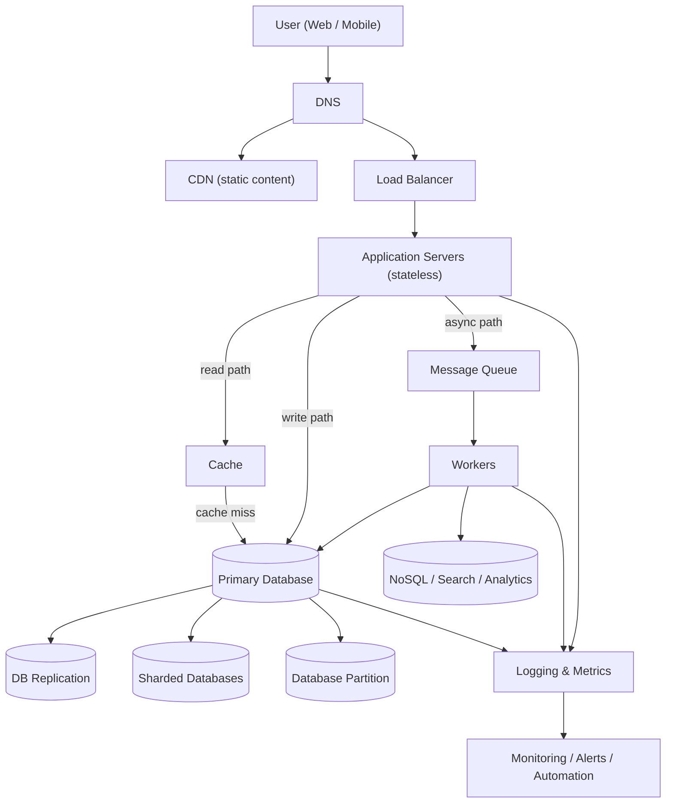

# System design (HLD)

[← Start here](../README.md) · [The plan](../PLAN.md) · [All notes](README.md)

The design method, the numbers, every classic design with its hard part, all prompts with outlines, failure follow-ups, and the anchor designs. Per-problem cards are in DESIGNS.md.

Use it like this: read one question, close it, explain it aloud from memory, then check. Reading is not the same as knowing. ⚠️ boxes mark corrections to the original text. Sections marked ➕ were added in the final version to fill gaps.

**In this chapter:**

- ➕ How to learn system design from zero
- ➕ The answer template (use it every time)
- ➕ The generic high-level design flow
- ➕ The numbers table
- ➕ How to estimate, with three worked examples
- PART E - The first three system designs
- PART A - The design framework and the numbers
- PART B - The classic designs, and the one hard part of each
- System design fundamentals — prompts and answers
- Classic system-design problems — prompts and outlines
- Estimation — prompts and answers
- Design follow-ups — prompts and answers
- Design foundations, anchor designs and LLD (12 Oct guide)
- ➕ Building blocks reference
- ➕ How to choose a database
- ➕ Single points of failure (SPOF): the full checklist
- ➕ How to answer the 25 "attack" follow-ups
- ➕ Security and operations: the section every design needs
- ➕ How to practise system design

---

<a id="add-sd-start"></a>

## ➕ How to learn system design from zero

You are starting system design from almost nothing. That is fine. System design is not a list of famous diagrams. It is one skill: you take a vague problem, make it concrete, and build a system step by step. At each step you explain why.

This section gives you the order to learn in. The next sections give you the template, the generic diagram, the numbers and the estimation method. Per-problem designs are in DESIGNS.md. Do not start them before you can explain the first five steps below.

### Why the order matters

Every big system is a small system plus fixes. Each fix solves one problem that the small system had. If you learn the fixes in the order the problems appear, each one makes sense. If you learn them out of order, they look like random boxes.

So learn like this: build the smallest working version. Ask "what breaks first?" Add the one component that fixes it. Repeat.

### The learning order

Learn each step until you can explain it aloud in two minutes, with a small drawing. Then move to the next.

| Step | Topic | The question it answers | You are ready when you can... |
|---|---|---|---|
| 1 | A single web request | What happens when a user types a URL? | Walk through DNS lookup, TCP + TLS connection, HTTP request, server work, response. Name where time is spent. |
| 2 | Client, server and API | Who talks to whom, and what do they send? | Design a small REST API: resources, methods, status codes, request and response bodies, pagination, idempotency key. |
| 3 | Database | Where does the data live, and how do we query it? | Draw tables with keys and indexes. Say which query each index serves. Explain one transaction. |
| 4 | Cache | Reads are slow and repeated. What now? | Explain cache-aside, TTL, invalidation, hit ratio. Say what happens when the cache is empty or down. |
| 5 | Load balancer | One server is not enough. What now? | Explain stateless app servers, health checks, L4 vs L7, where sessions go. |
| 6 | Queue | Some work is slow or can fail. What now? | Explain async work, acknowledgement, retries, dead-letter queue, idempotent consumers. |
| 7 | Replication and sharding | One database is not enough. What now? | Explain read replicas and lag, then sharding, shard keys and hot keys. |
| 8 | Consistency | Copies of data disagree. What do users see? | Explain strong vs eventual consistency, read-after-write, and say which one each feature needs. |
| 9 | Failure handling | Things break. What happens? | For each component, say how it fails, how you detect it and how you recover. Use timeouts, retries with backoff, circuit breakers, outbox. |
| 10 | Operations | How do you run it every day? | Explain metrics, logs, traces, alerts, deployment (blue-green, canary), backups, cost. |

You already know a lot of this from work. You used SQS, RabbitMQ and EventBridge (step 6), Redis (step 4), SignalR (connections, step 9 failure cases) and large eDiscovery processing jobs (steps 6, 7 and 9). Connect every new idea to one real thing you built. That is also what makes your interview answers sound real.

### A suggested pace (assumption, adjust to your plan)

- Steps 1–3: about two weeks. Mostly API and data model practice on small problems.
- Steps 4–6: about two weeks. Add cache, load balancer and queue to the same small problems.
- Steps 7–8: about two weeks. These are the hardest ideas. Go slowly.
- Steps 9–10: about two weeks. Then start full designs from DESIGNS.md.

After that, every week: one full design, one redo with changed requirements, and one round of follow-up attacks (see the follow-ups section at the end of this chapter).

### What a "complete" practice design contains

A practice design is complete only when it has all of these. If one is missing, the design is not finished, even if the diagram looks good.

1. **Requirements.** 3–5 functional requirements. 3–5 non-functional requirements with numbers (latency, availability, scale). A list of what is out of scope.
2. **Estimates.** QPS (average and peak), storage per year, bandwidth, cache size. Each with a one-line conclusion ("so one database is enough for writes").
3. **API.** Every endpoint with method, path, request, response and error cases. Pagination and idempotency where needed.
4. **Data model.** Tables or documents with keys, indexes and the main queries. The database choice and why.
5. **High-level diagram.** All components, with the read path and write path clearly marked.
6. **Two deep dives.** The one or two hardest parts, explained in detail (for example: key generation, fan-out, seat locking).
7. **Failure table.** For each component: what fails, how you detect it, how you recover.
8. **Trade-offs.** At least three decisions with the alternative you rejected and why.
9. **10× plan.** What breaks first at 10× traffic, and what you change.
10. **Operations.** What you monitor, what you alert on, how you deploy.

Write it down in your design log (see the practice section at the end of this chapter). A design that lives only in your head is not finished.

### Why not memorise diagrams

Memorising "the Twitter diagram" fails for four reasons:

1. **The interviewer changes the requirements.** "Now it must work for 10 users inside one company." "Now posts must be deleted within one minute everywhere." A memorised diagram cannot adapt. Reasoning can.
2. **The interviewer asks "why?"** If you cannot say why a box is there, the box hurts you. Every component must solve a problem that you named first.
3. **Memorised answers sound memorised.** Interviewers hear the same diagram many times a week. They notice when you add Kafka before you explained why a queue is needed.
4. **The score is for thinking, not for the picture.** SDE-2 rounds check that you can clarify, estimate, choose, and defend trade-offs. The final diagram is the least important output.

What you *should* memorise: the template (next section), the numbers table, the building blocks and their trade-offs, and the reusable patterns (cache-aside, outbox, idempotency key, fan-out, sharding by key). These are the bricks. The design is something you build fresh each time.

### A simple rule for every box you draw

Before you draw any box, say one sentence: "I am adding X because Y is a problem." For example: "I am adding a queue because sending email takes two seconds and I do not want the user to wait." If you cannot finish the sentence, do not draw the box.

<a id="add-sd-template"></a>

## ➕ The answer template (use it every time)

This template extends the nine steps in [PART A Q1](#m5-q1). It is the same order, written as a script: what to say, what to draw, and what to ask at each step. Use it for every practice design, so in the interview it runs by itself.

The steps:

1. Requirements (functional, non-functional, explicitly out of scope)
2. Estimates
3. API
4. Data model
5. High-level design
6. Deep dives
7. Bottlenecks and failures
8. Trade-offs
9. What changes at 10×

### Step 1 — Requirements

**Say:** "Before I design, I want to agree on the scope. Let me list what the system must do, how well it must do it, and what I will not cover."

**Draw:** Three short lists on the left side of the board. Keep them visible for the whole interview.

- *Functional:* what users can do. 3–5 items. Use verbs: "user creates a short link", "user opens a short link".
- *Non-functional:* how well. Scale (users, requests), latency target, availability target, consistency need, durability, security.
- *Out of scope:* say it clearly. "Analytics dashboards and custom domains are out of scope unless you want them."

**Ask the interviewer:**

- Who are the users? Public consumers, or businesses (tenants)?
- How many users per day? How many actions per user per day?
- Is it read-heavy or write-heavy?
- What latency is acceptable for the main action?
- Can a user see slightly old data? For which features is that not acceptable?
- Is it global or one region?
- Which feature is the most important to get right?

**Tip:** If the interviewer says "you decide", state an assumption and write it down: "I will assume 10 million daily users. Tell me if that is wrong."

### Step 2 — Estimates

**Say:** "Let me do a quick estimate, so I know if one machine is enough or if I need to scale out."

**Draw:** A small box with 4–6 numbers: average QPS, peak QPS, read:write ratio, storage per year, bandwidth, cache size.

**Ask:** "Is a peak of about 3× the average reasonable here, or is the traffic very spiky?"

**Tip:** Every number needs a conclusion. "Write QPS is about 100. One database primary can handle that, so I will not shard writes yet." See the estimation section below for the method and worked examples.

### Step 3 — API

**Say:** "Here are the main endpoints. I will keep them simple and focus on the core flows."

**Draw:** One line per endpoint: `METHOD /path (request) → response`. Mark which ones need authentication, pagination or an idempotency key.

**Ask:**

- Do clients need real-time updates (WebSocket or server-sent events), or is polling fine?
- Is this a public API used by third parties (then versioning and rate limits matter more)?

**Tip:** Write operations that can be retried (payments, orders, messages) should take an idempotency key. Lists should use cursor pagination. Say both without being asked.

### Step 4 — Data model

**Say:** "These are the main entities. The main queries are X and Y, so I will index or partition by Z."

**Draw:** 2–4 tables or documents with the primary key, the main fields and the indexes. Write the main query next to each one.

**Ask:**

- How long must we keep the data (retention)?
- Is there a strict invariant? (No double booking, no negative balance.)
- Do we need search, or only key lookups?

**Tip:** Choose the database from the access pattern, not from fashion. Say the reason in one sentence: "Lookups are by short code only, and there are no joins, so a key-value store fits. A relational database would also work at this size." See the data-choices section at the end of this chapter.

### Step 5 — High-level design

**Say:** "Let me draw the simplest design that works, then I will improve it."

**Draw:** Client → load balancer → stateless app servers → database. Then add cache, queue, workers, CDN and object storage only when a requirement needs them. Draw the write path and the read path in different colours, or number the arrows.

**Ask:** "Does this cover the main flows? Which part do you want me to go deeper into?"

**Tip:** Walk through one request on the diagram: "A user creates a link. The request goes to the load balancer, then an app server, which generates a key and writes to the database..." This proves the design works end to end.

### Step 6 — Deep dives

**Say:** "The hardest part of this system is X. Let me spend some time on it."

**Draw:** A zoomed-in diagram or a sequence of steps for that one part. Show state changes and data movement.

**Ask:** "I think the hard parts are X and Y. Which one do you prefer?"

**Tip:** Usually the interviewer chooses. If not, choose the part that protects correctness (money, inventory, ordering, duplicates) or the part with the biggest scale problem (fan-out, hot keys).

### Step 7 — Bottlenecks and failures

**Say:** "Now let me break my own design. I will go component by component."

**Draw:** A small table next to the diagram: component, how it fails, how I detect it, how I recover. Use the 10-layer checklist from the SPOF section at the end of this chapter.

**Ask:** "What availability target should I design for? 99.9% and 99.99% lead to different designs."

**Tip:** Name the first bottleneck with a number: "At peak, the database gets 20,000 reads per second. That is too much for one primary, so the cache must absorb most of them."

### Step 8 — Trade-offs

**Say:** "Here are the main decisions and what I gave up for each."

**Draw:** Nothing new. Point to the boxes on the diagram as you speak.

**Use this sentence shape:** "I chose A over B because of requirement R. The cost is C. If R changes, I would switch to B."

Example: "I chose eventual consistency for the like counter because users do not care if it is a few seconds behind. The cost is that two users may see different numbers for a moment. For the account balance, I would not accept that."

### Step 9 — What changes at 10×

**Say:** "If traffic grows 10 times, here is what breaks first and what I change."

**Draw:** Mark the 2–3 components that change, for example with a star.

**Typical answers:** add read replicas or more cache; shard the database by a key; split one service into two; move from one region to multi-region; add a queue to absorb bursts. Give the order and the reason, not all of them at once.

### The 45-minute time split

This repeats the split given in the 12 Oct guide (section 7), now matched to the template steps. [PART A Q2](#m5-q2) gives a slightly different older split; use this one in practice.

| Minutes | Step | Output on the board |
|---|---|---|
| 0–5 | Requirements | Three lists: functional, non-functional, out of scope |
| 5–10 | Estimates | 4–6 numbers, each with a conclusion |
| 10–18 | API + data model | Endpoint list, 2–4 tables with keys and indexes |
| 18–30 | High-level design | Full diagram, read and write paths, one request walked through |
| 30–40 | Deep dive (with bottlenecks and failures) | Zoomed-in part, failure table |
| 40–45 | Trade-offs and 10× | Three decisions with alternatives, the 10× plan |

Rules:

- Look at the clock at minutes 10, 18 and 30. If you are late, say so and cut: "I will skip the detailed schema and come back to it if we have time."
- The interviewer leads. If they jump to a deep dive at minute 12, go with them. The split is a default, not a law.
- Never finish the high-level design after minute 30. Something on the board at minute 30 is better than a perfect API at minute 25 and no diagram.

### The blank-page checklist (one page)

Copy this to the top of your paper before every practice. Tick each line as you do it.

```
REQUIREMENTS
[ ] 3-5 functional requirements (verbs)
[ ] Scale: DAU, actions/user/day, read:write ratio
[ ] Latency target, availability target
[ ] Consistency need per feature (strong / eventual)
[ ] Out of scope, said aloud

ESTIMATES
[ ] Average QPS, peak QPS (state the peak factor)
[ ] Storage per year (with replication + indexes)
[ ] Bandwidth, cache size
[ ] One conclusion per number

API
[ ] Endpoints: method, path, request, response, errors
[ ] Auth, pagination (cursor), idempotency key

DATA MODEL
[ ] Entities with primary keys
[ ] Indexes, each tied to a query
[ ] Database choice + one-sentence reason
[ ] Partition / shard key if needed

HIGH-LEVEL DESIGN
[ ] Client -> LB -> stateless app -> DB
[ ] Cache / queue / CDN / object storage only if needed (say why)
[ ] Read path and write path marked
[ ] One request walked end to end

DEEP DIVES
[ ] Hardest part chosen (correctness or scale)
[ ] State changes and races explained

FAILURES
[ ] Each component: fail -> detect -> recover
[ ] Duplicates, retries, timeouts, idempotency
[ ] What we sacrifice during an outage

TRADE-OFFS + 10x
[ ] 3 decisions: chose A over B, because R, cost C
[ ] First bottleneck at 10x and the fix
[ ] Monitoring: what we measure and alert on
```

<a id="add-sd-flow"></a>

## ➕ The generic high-level design flow

*Source: "High Level Design Flow" diagram (CodeWithNishchal, PNG in the tmp folder). Every node and edge from that diagram is below. The explanations and the "when to include" notes were added here.*

Most web systems have the same shape. Learn this one picture well. In an interview, start from a small part of it and add the rest only when a requirement needs it.



### The three paths

The application servers send work down three paths. Name them aloud in every design.

- **Read path:** app server → cache → (on a miss) primary database. Fast and common. The cache absorbs repeated reads.
- **Write path:** app server → primary database. The database is the source of truth. A write is "done" when the database commits.
- **Async path:** app server → message queue → workers. For slow, retryable or fan-out work. The user does not wait for it.

### Each component, and when to include it

| Component | What it does | Include it when... | Leave it out when... |
|---|---|---|---|
| User (Web / Mobile) | Sends requests. A mobile client may be offline, retry, or use an old app version. | Always. Say which clients exist. | Never. |
| DNS | Turns a domain name into an IP address. Can route by region or health. | Always exists. Discuss it when you need multi-region routing or failover. | You can skip the details in a single-region design. |
| CDN | Serves static files (images, JS, video) from servers near the user. | There is static or media content, or global users, or heavy download traffic. | The responses are all private and personal, and there are no large files. |
| Load Balancer | Spreads requests across healthy app servers. Gives one stable address. | You have more than one app server (almost always). | Never in a real design. Even small systems use one for health checks and zero-downtime deploys. |
| Application Servers (stateless) | Run the business logic. Keep no user session in memory, so any server can take any request. | Always. | Never. If you need sessions, store them in a cache or token, not in the server. |
| Cache | Keeps hot data in memory (for example Redis). | Read-heavy traffic, repeated reads of the same data, or a slow database query. | Data changes on almost every read, or every read must be perfectly fresh. |
| Primary Database | The source of truth for writes. | Always. | Never. |
| Message Queue | Holds work until a worker takes it. Absorbs bursts. Decouples services. | Work is slow (email, video), can fail and needs retry, or one event triggers many actions. | The user must see the result in the same response, and the work is fast. |
| Workers | Take jobs from the queue and process them. Scale separately from the app servers. | You have a queue. | No queue. |
| NoSQL / Search / Analytics | Extra stores built for one kind of query: full-text search, large key lookups, reports. Usually filled by workers from events. | You need search, analytics, or a query the primary database cannot serve well. | All queries are simple and the primary database handles them. |
| DB Replication | Copies of the primary. Used for failover and to serve reads. | Availability matters (almost always), or reads are too many for one machine. | Rarely left out. At minimum, have one standby for failover. |
| Sharded Databases | Data split across many database machines by a key. | Writes or data size are too big for one primary, even after caching and replicas. | One primary can handle the writes and the data. Sharding adds a lot of complexity. |
| Database Partition | Data split into parts inside one database (for example by month). | Very large tables where queries usually touch one part (time-series, logs), or you need to drop old data quickly. | Tables are small, or queries always scan everything. |
| Logging & Metrics | Collects logs and numbers from app servers, workers and databases. | Always. | Never. |
| Monitoring / Alerts / Automation | Dashboards, alerts to on-call, and automatic actions (auto-scaling, restart, failover). | Always. Say what you alert on. | Never. |

### How to use this picture in an interview

1. Start with: User → DNS → Load Balancer → Application Servers → Primary Database. This is the "simplest design that works".
2. Add the cache when you say "reads are X times more than writes".
3. Add the queue and workers when you say "this part is slow" or "this must retry".
4. Add the CDN when there is media or global traffic.
5. Add replication always, sharding and partitioning only when your estimate says one machine is not enough.
6. Add NoSQL / search / analytics when a requirement needs a query the primary cannot serve.
7. Finish with logging, metrics and monitoring. Say one or two alerts you would set.

The arrows from workers and the database into "Logging & Metrics" are easy to forget. They matter: a queue that grows or a replica that lags is only visible if you measure it.

<a id="add-sd-numbers"></a>

## ➕ The numbers table

[PART A Q3](#m5-q3) and [Q4](#m5-q4) give the core numbers in sentences. This section puts them in tables you can copy to paper, and adds the parts that were missing: storage units, seconds per month, the availability table per year, month and day, and per-server throughput assumptions.

Rule for all numbers: round hard and say you are rounding. The interviewer checks your order of magnitude, not your third digit.

### Powers of two and storage units

| Power | Exact value | Say it as | Unit |
|---|---|---|---|
| 2^10 | 1,024 | about one thousand (10^3) | KB (kilobyte) |
| 2^20 | 1,048,576 | about one million (10^6) | MB (megabyte) |
| 2^30 | about 1.07 billion | about one billion (10^9) | GB (gigabyte) |
| 2^40 | about 1.1 trillion | about one trillion (10^12) | TB (terabyte) |
| 2^50 | about 1.13 × 10^15 | about one quadrillion (10^15) | PB (petabyte) |

Useful facts:

- 2^32 is about 4.3 billion. A 32-bit unsigned integer runs out at about 4 billion. A 64-bit integer will not run out in any interview.
- 1 byte = 8 bits. Network speeds are in **bits** per second (1 Gbps). Storage is in **bytes**. 1 Gbps is about 125 MB/s.
- 1 million × 1 KB = 1 GB. 1 billion × 1 KB = 1 TB. Use this to convert "rows × size" fast.

### Typical sizes (assumptions to state)

| Item | Size to assume |
|---|---|
| 64-bit integer, ID, timestamp | 8 bytes |
| UUID | 16 bytes binary, 36 bytes as text |
| Short string (name, email, URL) | 50–100 bytes (say your number) |
| A small database row with a few fields | 100 bytes to 1 KB |
| A chat message with metadata | about 100–200 bytes (assumption) |
| A JSON API response for a small list | a few KB |
| A compressed photo | a few hundred KB to a few MB (assumption) |
| One minute of video | many MB, depends heavily on quality (assumption) |

### Time

| Period | Seconds | Round to |
|---|---|---|
| 1 day | 86,400 | about 10^5 (round up, it makes division easy) |
| 1 month (30 days) | 2,592,000 | about 2.5 million |
| 1 year | about 31.5 million | about 3 × 10^7 |

Shortcuts (using 86,400 s/day):

| Per day | Per second (average) |
|---|---|
| 1 million | about 12 |
| 10 million | about 120 |
| 100 million | about 1,200 |
| 1 billion | about 12,000 |

If you round a day to 10^5 seconds, 1 million per day becomes 10 per second. That is fine for an interview. Say which rounding you used.

### Latency: orders of magnitude

These are **orders of magnitude**, not exact figures. Real values depend on hardware, distance and load. Use them to compare, for example "a cache hit is about 1,000 times faster than a cross-region call".

| Operation | Order of magnitude |
|---|---|
| L1 CPU cache reference | about 1 nanosecond |
| Main memory (RAM) reference | about 100 nanoseconds |
| Read 1 MB sequentially from RAM | tens of microseconds |
| SSD random read | tens to about a hundred microseconds |
| Network round trip inside one data centre | about 0.5 milliseconds |
| Read from a cache like Redis over the network (same data centre) | under a millisecond to about 1 millisecond |
| Hard disk seek | about 10 milliseconds |
| Network round trip between regions or continents | tens of milliseconds, up to about 150 milliseconds |

What to take from this table:

- Memory is much faster than disk. Disk is much faster than a cross-region call.
- Inside one data centre, a network call costs about as much as a few SSD reads. Many small calls in a row add up.
- A user request that calls another region several times in sequence cannot be fast. Keep the hot path inside one region.

### Availability: allowed downtime

[GAP-06-012](#gap-06-012) gives the yearly numbers. This table adds 99.95%, per month and per day. It uses 365 days per year and 30 days per month.

| Availability | Per year | Per month (30 days) | Per day |
|---|---|---|---|
| 99% ("two nines") | about 3.65 days | about 7.2 hours | about 14.4 minutes |
| 99.9% ("three nines") | about 8.76 hours | about 43.2 minutes | about 1.44 minutes |
| 99.95% | about 4.38 hours | about 21.6 minutes | about 43 seconds |
| 99.99% ("four nines") | about 52.6 minutes | about 4.3 minutes | about 8.6 seconds |
| 99.999% ("five nines") | about 5.3 minutes | about 26 seconds | under 1 second |

What each level means in practice:

- **99.9%**: one bad deploy that takes 45 minutes to roll back uses a whole month's budget. Manual recovery is possible.
- **99.99%**: about 4 minutes a month. A human cannot wake up, log in and fix it in time. You need automatic failover and automatic rollback.
- **99.999%**: under 30 seconds a month. This needs multi-region designs and very careful operations. Do not promise it without a reason.

**Combining components** (assuming failures are independent, which is often not fully true):

- **In series** (the request needs all of them): multiply. Two services at 99.9% each give about 99.8%. Every extra dependency on the critical path lowers availability.
- **In parallel** (any one is enough): 1 − (chance all fail). Two independent copies at 99% each give 1 − (0.01 × 0.01) = 99.99%. This is why redundancy works.

### Per-server throughput: assumptions to state aloud

There is no true number for "requests per server". It depends on the work per request, the hardware and the language runtime ([GAP-06-001](#gap-06-001)). In an interview you still need a number to size the system. So pick one from the ranges below, **say it is an assumption**, and say you would load-test to confirm.

| Component | Range to assume (assumption, not a fact) | What changes it |
|---|---|---|
| Stateless app server doing simple CRUD with one DB call | about 1,000 requests/s per server (a range of a few hundred to a few thousand) | CPU work per request, number of downstream calls, payload size |
| App server doing heavy work (image resize, PDF parse) | tens of requests/s per server | Move this work to workers behind a queue |
| Relational database primary, simple indexed writes | a few thousand writes/s | Row size, number of indexes, transaction size, disk |
| Relational database, simple indexed reads | about 10,000 reads/s or more if the working set fits in memory | Query shape, memory, connection count |
| In-memory cache node (Redis-like), simple get/set | about 100,000 operations/s | Value size, pipelining, network |
| WebSocket / SignalR server, mostly idle connections | tens of thousands of open connections per server | Memory per connection, message rate |
| Kafka-like log, one partition | tens of MB/s | Message size, batching, replication settings |
| Managed queue (SQS, etc.) | check the current service quota page | Standard vs FIFO, batching |

How to say it: "I will assume one app server handles about 1,000 simple requests per second. I would confirm with a load test. With a peak of 20,000 requests per second, that is 20 servers, plus about 30% headroom and room to lose one availability zone, so about 30."

<a id="add-sd-estimation"></a>

## ➕ How to estimate, with three worked examples

The answers in [Estimation — prompts and answers](#gap-06) give each formula on its own. This section joins them into one routine and then runs it three times, with every step shown. Every number in the examples is an **assumption made for practice**, not a fact about any real product.

### The routine (eight steps)

Do them in this order. Write each result in a small box on the board.

**1. DAU → average QPS.**
`average QPS = DAU × actions per user per day ÷ 86,400`
Do it separately for reads and writes. Round 86,400 to 10^5 if you like, and say so.

**2. Average → peak QPS.**
`peak QPS = average QPS × peak factor`
There is no universal factor ([GAP-06-004](#gap-06-004)). For practice, assume 2–3× and say it. For launches, sales or live events, assume much more and say why.

**3. Storage.**
`storage per day = writes per day × bytes per write`
`storage per year = storage per day × 365`
Then multiply for indexes (assume +25% to +100%, say your number) and for replication (usually × 3). Then multiply by retention years. Finish with a conclusion: one machine or many?

**4. Bandwidth.**
`bandwidth = QPS × bytes per request`
Do incoming and outgoing separately. Convert to bits if you compare with network cards (× 8).

**5. Cache size with the 80/20 rule.**
Assume about 20% of items get about 80% of reads (an assumption, not a law). Cache that hot 20%.
`cache size ≈ 0.2 × items read per day × bytes per item`
This overestimates when many reads hit the same items. That is fine: it is an upper bound. Say so.

**6. Servers.**
`servers = peak QPS ÷ per-server capacity`
Use an assumed capacity from the numbers table. Add headroom (about 30%) and enough spare to lose one availability zone.

**7. Queue depth with Little's law.**
`L = λ × W`
L is the average number of items in the system. λ is the arrival rate. W is the average time each item spends in the system. Use it two ways:
- *In-flight work:* how many jobs are being processed at once → how many concurrent consumers you need.
- *Backlog after an outage:* backlog = arrival rate × outage time. Drain time = backlog ÷ (consume rate − arrival rate).

**8. Conclusion per number.**
Every number ends with a sentence: "so I need to shard", "so one primary is enough", "so the cache fits on one node". A number with no conclusion is not useful ([PART A Q4](#m5-q4)).

---

### Worked example 1: URL shortener

**Assumptions (state them aloud):**
- 100 million new short links per month.
- Read:write ratio 100:1.
- Peak factor 3×.
- Keep links for 5 years.
- One stored link is about 500 bytes (short code, long URL of about 100 bytes, owner ID, timestamps, expiry, plus row overhead).

**Step 1 — average QPS.**
- Writes: 100M per month ÷ 2.5M seconds per month = **40 writes/s**.
- Reads: 40 × 100 = **4,000 reads/s**.

**Step 2 — peak.**
- Writes: 40 × 3 = **120/s**. Reads: 4,000 × 3 = **12,000/s**.
- Conclusion: writes are tiny. The design is all about reads.

**Step 3 — storage.**
- Per month: 100M × 500 B = 50 GB.
- Per year: 50 GB × 12 = **600 GB**.
- 5 years: 600 GB × 5 = 3 TB.
- Indexes: assume +50% → 4.5 TB.
- Replication × 3 → about **13.5 TB, round to 15 TB** in total.
- Conclusion: year one fits on one machine (600 GB × 1.5 is about 900 GB per copy). Five years does not fit comfortably, so plan for a key-value store that partitions by short code, or shard later.

**Key space check.**
- Base62 with 7 characters: 62^7 ≈ 3.5 trillion codes.
- Links in 5 years: 100M × 60 months = 6 billion.
- Conclusion: 7 characters is more than enough.

**Step 4 — bandwidth.**
- Reads out: 4,000/s × 500 B = 2 MB/s average, about 6 MB/s at peak.
- Writes in: 40/s × 500 B = 20 KB/s.
- Conclusion: bandwidth is not a problem.

**Step 5 — cache.**
- Reads per day: 4,000 × 86,400 ≈ 350 million.
- Hot 20%: 0.2 × 350M × 500 B = **35 GB** (upper bound, because many reads repeat the same links).
- Conclusion: fits in one large cache node or a small cluster. Mappings rarely change, so the hit ratio should be high.

**Step 6 — servers.**
- Assume 1,000 redirects/s per app server (assumption; redirects are light).
- 12,000 ÷ 1,000 = 12 servers. +30% headroom ≈ 16. Spread across 3 availability zones → **18** (6 per zone, so losing one zone leaves 12).

**Step 7 — queue (click analytics, if in scope).**
- Each redirect sends a click event to a queue. Arrival rate = 4,000/s average, 12,000/s peak.
- Assume a worker takes 50 ms per event. In-flight: L = 12,000 × 0.05 = **600 events** being processed at once at peak → about 600 concurrent consumers, or fewer with batching.
- Outage: consumers down for 10 minutes at peak → backlog = 12,000 × 600 s = **7.2M events**.
- Assume consumers can process 20,000/s when catching up. Drain rate = 20,000 − 12,000 = 8,000/s. Drain time = 7.2M ÷ 8,000 = **900 s = 15 minutes**.
- Conclusion: the queue must hold at least several million messages, and analytics may be up to about 25 minutes late after such an outage. That is acceptable for analytics.

---

### Worked example 2: Chat (one-to-one and small groups)

**Assumptions:**
- 50 million DAU.
- Each user sends 40 messages per day.
- Each message goes to 2 devices on average (multi-device).
- Peak factor 3×.
- At peak, 20% of DAU are connected at the same time.
- One stored message is about 200 bytes with metadata. Media files are stored separately and are out of scope here.
- Keep messages for 1 year in this estimate.

**Step 1 — average QPS.**
- Messages per day: 50M × 40 = 2 billion.
- Writes: 2 × 10^9 ÷ 86,400 ≈ **23,000 messages/s**.
- Deliveries: 23,000 × 2 devices = **46,000 deliveries/s**.

**Step 2 — peak.**
- Writes: 23,000 × 3 ≈ **70,000/s**. Deliveries: ≈ **140,000/s**.
- Conclusion: writes are high. One relational primary is not enough. Plan to partition by conversation ID.

**Step 3 — storage.**
- Per day: 2 × 10^9 × 200 B = **400 GB/day**.
- Per year: 400 GB × 365 ≈ **146 TB, round to 150 TB**.
- Indexes (conversation ID + sequence number): assume +25% → about 190 TB.
- Replication × 3 → about **570 TB, round to 600 TB per year**.
- Conclusion: this must be a partitioned store. A wide-column or key-value store with partition key = conversation ID and sort key = sequence number fits the access pattern "get the latest messages of a conversation".

**Step 4 — bandwidth.**
- In: 70,000/s × 200 B = 14 MB/s at peak.
- Out: 140,000/s × 200 B = 28 MB/s at peak.
- Heartbeats: 10M open connections (see step 6), one heartbeat every 30 s (assumption) → 10M ÷ 30 ≈ **330,000 small frames/s**.
- Conclusion: message bandwidth is moderate. The surprise is that heartbeats are more frames per second than messages. Keep them small and tune the interval.

**Step 5 — cache.**
- Recent messages: 20% of today's data = 0.2 × 400 GB = **80 GB** → a cache cluster.
- Session registry (which user is connected to which gateway server): 10M entries × about 100 B = **1 GB** → fits easily in one Redis node, with a replica.

**Step 6 — servers.**
- Concurrent connections at peak: 50M × 20% = **10M**.
- Assume 50,000 connections per gateway server (assumption, in the "tens of thousands" range).
- 10M ÷ 50,000 = 200 servers. +30% headroom → **about 260 gateway servers**.
- Conclusion: connection count, not request rate, sizes the gateway tier. This is like SignalR scale-out: you need a backplane or a registry to find the right server.

**Step 7 — queue (push notifications for offline devices).**
- Assume 30% of deliveries go to an offline device → 46,000 × 0.3 ≈ 14,000 pushes/s average, about 42,000/s at peak.
- Assume one call to the push provider takes 100 ms. In-flight: L = 42,000 × 0.1 = **4,200 concurrent calls**.
- Conclusion: use async I/O. For example, 40 workers with about 100 concurrent calls each. The push provider's own rate limits may be the real bottleneck, so the queue must absorb bursts.

---

### Worked example 3: News feed

**Assumptions:**
- 200 million DAU.
- Each user opens the feed 10 times per day. Each feed page shows 20 posts.
- 10% of DAU post once per day.
- Average followers per user: 200. Some celebrities have 10 million followers.
- One post is about 1 KB of text and metadata. Images and video go to object storage and a CDN, and are not counted here.
- Peak factor 3×.
- Fan-out on write for normal users. Celebrity posts are merged at read time ([PART B Q5](#m5-q5)).

**Step 1 — average QPS.**
- Feed reads: 200M × 10 = 2 billion per day → 2 × 10^9 ÷ 86,400 ≈ **23,000 reads/s**.
- Posts: 200M × 10% = 20M per day → 20M ÷ 86,400 ≈ **230 posts/s**.
- Fan-out inserts: 20M × 200 followers = 4 billion per day → ≈ **46,000 inserts/s**.

**Step 2 — peak.**
- Reads: ≈ **70,000/s**. Posts: ≈ **700/s**. Fan-out inserts: ≈ **140,000/s**.
- Celebrity check: one post from a 10M-follower account = 10M inserts. At 140,000 inserts/s for the whole fleet, that is about 70 seconds of the full fan-out capacity for **one post**.
- Conclusion: pure fan-out on write fails for celebrities. Use the hybrid.

**Step 3 — storage.**
- Posts per day: 20M × 1 KB = 20 GB.
- Per year: 20 GB × 365 ≈ **7.3 TB**.
- Indexes +25% → about 9 TB. Replication × 3 → **about 27 TB per year**.
- Conclusion: posts need partitioning in a few years, but the bigger cost is the feed storage below.

**Step 4 — bandwidth.**
- One feed page: 20 posts × 1 KB = 20 KB.
- Peak out: 70,000/s × 20 KB = **1.4 GB/s ≈ 11 Gbps**.
- Conclusion: this is large. Compress responses, send post IDs plus small summaries, and serve all media from the CDN, never through app servers.

**Step 5 — cache.**
- Precomputed feed per user: keep the latest 500 post IDs. Each entry is an 8-byte ID plus an 8-byte score → 16 B × 500 = **8 KB per user**.
- All DAU: 200M × 8 KB = 1.6 TB.
- With 80/20: assume the most active 20% of users make most feed reads. Cache full feeds for 40M users: 40M × 8 KB = **320 GB**. Build the rest on demand.
- Hot post bodies: posts from the last 2 days = 40M × 1 KB = **40 GB**.
- Conclusion: a cache cluster of a few hundred GB, partitioned by user ID. Feeds are stored as lists of IDs, and post bodies are cached once and shared.

**Step 6 — servers.**
- Feed read servers: each read merges a cached feed with celebrity posts and hydrates 20 posts. Assume 500 reads/s per server (assumption, lower than simple CRUD because of several cache calls).
- 70,000 ÷ 500 = 140 servers. +30% → **about 180 servers**.

**Step 7 — queue (fan-out jobs).**
- Arrival: 700 post events/s at peak. Assume one fan-out job (200 inserts, in batches) takes 50 ms.
- In-flight: L = 700 × 0.05 = **35 jobs** at once. Small.
- Outage: fan-out workers stop for 5 minutes at peak → backlog = 700 × 300 s = **210,000 jobs** (about 42M feed inserts).
- If workers can process 2,100 jobs/s when catching up (3× peak), drain rate = 2,100 − 700 = 1,400/s. Drain time = 210,000 ÷ 1,400 = **150 s**.
- Conclusion: after a 5-minute outage, new posts appear in feeds up to about 7–8 minutes late. For a social feed, that is acceptable. Say this trade-off aloud.

---

### Common estimation mistakes

- Forgetting replication and indexes. This under-estimates storage by 3–5 times ([PART A Q4](#m5-q4)).
- Mixing bits and bytes. Network is bits, storage is bytes.
- Using average QPS to size servers. Size for peak, then add headroom.
- Giving numbers without conclusions.
- Spending more than 5 minutes. If the math gets slow, round more.
- Presenting assumptions as facts. Always say "I assume".


<a id="m3-part-e"></a>

## PART E - The first three system designs

*Source: Q-and-A/M3_Networking_OS_and_Distributed_Data.docx. Original wording kept below; ⚠️ boxes are corrections added in the final version.*

<a id="m3-q34"></a>

#### Q34. Design a URL shortener - what are the real decisions?
Say this. Requirements and scale first - read-heavy by a large factor, so optimise reads. Key generation is the core decision: a counter encoded in base62 is short, dense and guaranteed unique but is sequential and therefore guessable and a write hotspot; a hash of the URL is not sequential but needs collision handling. Then a key-value store, an aggressive cache on the read path since mappings never change, and a 301 or 302 depending on whether you want to count clicks.
Why. The read/write ratio drives everything. Immutable mappings mean cache invalidation is a non-problem, which is unusual and worth saying out loud.
Watch out. The trade-off to name: 301 is cacheable by browsers so it is fast but you lose analytics; 302 gives you every click but costs a round trip every time.
<a id="m3-q35"></a>

#### Q35. Design a rate limiter - which algorithm and why?
Say this. Token bucket. Each key has a bucket refilling at a fixed rate up to a capacity; a request takes a token or gets 429 with Retry-After. It allows a controlled burst, which real traffic needs, and it is cheap - two numbers per key. Fixed window is simpler but allows double the limit across a boundary. Sliding window log is exact but stores a timestamp per request, so memory grows with traffic.
Why. The state must be shared across instances, so it lives in Redis, and the check-and-decrement must be atomic - a Lua script or an INCR with expiry - otherwise two instances both hand out the last token.
Watch out. The atomicity point is what separates a real answer from a textbook one. It is also exactly what you build in week 18.

> ⚠️ **Correction (final version, 19 Oct 2026):** [Interview-critical] `INCR` + `EXPIRE` implements a **fixed window**, not the token bucket the answer chose. A token bucket needs a Lua script or Redis Function that atomically reads tokens + last refill time, refills, and decrements; use Redis `TIME` to avoid client clock skew. Note: the built-in ASP.NET Core rate limiter (.NET 7+) is per-instance, in memory — exactly the bug M5 Q10 warns about for multi-replica deployments.

<a id="m3-q36"></a>

#### Q36. Design a notification service - what is the hard part?
Say this. Fan-out and deduplication. One event can produce many notifications across email, SMS and push, each with different providers, latencies and failure modes. So: an ingestion API, a queue per channel so a slow provider cannot block the others, per-user preference and quiet-hours checks, a dedup key so a retried event does not notify twice, retries with backoff, and a DLQ per channel.
Why. The channels have genuinely different characteristics, so a single shared queue means the slowest provider sets the pace for all of them. Separate queues isolate the failure.
Watch out. Templating and localisation are the other real complexity, and your multilingual work at Casepoint is a genuine credential there.

<a id="m5-part-a"></a>

## PART A - The design framework and the numbers

*Source: Q-and-A/M5_System_Design_and_Behavioural.docx. Original wording kept below; ⚠️ boxes are corrections added in the final version.*

<a id="m5-q1"></a>

#### Q1. What are the nine steps, in order?
Say this. Clarify requirements. Estimate scale. Define the API. Choose the data model. Draw the high-level architecture. Identify bottlenecks. Scale it. Handle failure. State the trade-offs.
Why. The order is the skill. Candidates who improvise the order ramble and run out of time; candidates who follow a framework sound senior even when the design is imperfect - because the interviewer can follow them.
Watch out. Step 9 is where the round is won. Anyone can draw boxes. "I chose eventual consistency here, so a user may see a stale count - fine for a view counter, unacceptable for an account balance" is what gets you hired.
<a id="m5-q2"></a>

#### Q2. How do you budget the 45 minutes?
Say this. Five minutes on requirements and scope. Five on scale estimation. Five on the API. Five on the data model. Ten on the architecture. Ten on bottlenecks, scaling and failure. Five on trade-offs and questions. Watch the clock and say what you are skipping.
Why. Running out of time before you draw anything is the single most common failure. Announcing "I have about ten minutes left so I will focus on the write path" is itself a senior signal.
Watch out. If the interviewer pushes you into a detail early, answer briefly and then say "I want to come back to that once the high-level shape is down" - and then actually come back.
<a id="m5-q3"></a>

#### Q3. What estimation numbers must you know cold?
Say this. Powers of two: 2^10 is a thousand, 2^20 a million, 2^30 a billion. So a 32-bit int holds about 4 billion, and 4 KB is a page. Time: 86,400 seconds in a day, so 1 million requests a day is about 12 per second, and 100 million a day is about 1,200 per second. Latency: memory access nanoseconds, SSD read tens of microseconds, network round trip within a datacentre about half a millisecond, cross-continent 100-150 milliseconds, disk seek a few milliseconds.
Why. You need them so you can compute out loud without stalling. The interviewer is watching whether you can reason about magnitude, not whether you are precise.
Watch out. Round aggressively and say you are rounding. "Call it a thousand a second, so ten servers at a hundred each with headroom" is exactly the right register.
<a id="m5-q4"></a>

#### Q4. How do you estimate storage for a design?
Say this. Rows per day times bytes per row times retention. Be explicit about the row: an ID is 8 bytes, a timestamp 8, a short string 50-100, a UUID 16. Then add indexes, which are often the same size again, and replication, which multiplies by the replica count.
Why. People forget indexes and replication and then under-estimate by three to five times. Mentioning both unprompted is a strong signal.
Watch out. Then sanity check it. "That is 2 TB a year, which one machine can hold, so I do not need sharding yet" is a conclusion. A number with no conclusion is not an estimate.

<a id="m5-part-b"></a>

## PART B - The classic designs, and the one hard part of each

*Source: Q-and-A/M5_System_Design_and_Behavioural.docx. Original wording kept below; ⚠️ boxes are corrections added in the final version.*

<a id="m5-q5"></a>

#### Q5. Why does neither pure fan-out strategy work for a news feed?
Say this. Fan-out on write precomputes each follower's feed when you post - reads are then trivial, but a celebrity with ten million followers causes ten million writes for one post. Fan-out on read assembles the feed at request time - writes are trivial, but every read now queries every followee, which is slow for the common case. So real systems do both: fan-out on write for normal users, and merge celebrity posts in at read time.
Why. The distributions are extreme. Most users have few followers and read often; a few have enormous follower counts. One strategy cannot be right for both ends.
Watch out. Naming this as the celebrity problem and giving the hybrid answer is the expected senior response.
<a id="m5-q6"></a>

#### Q6. How do you avoid overselling inventory without a distributed transaction?
Say this. Reserve rather than deduct. On add-to-cart or checkout, create a reservation row with a short expiry, using a conditional update - decrement available stock only if available is greater than zero, in one atomic statement. Payment success converts the reservation to a sale; expiry releases it. A background job sweeps expired reservations.
Why. The atomic conditional update is the whole trick: the database is already a consensus system for a single row, so you use it rather than coordinating across services.
Watch out. Be ready for "what if payment succeeds after the reservation expired?" Answer: a compensating action - refund, or re-reserve if stock allows - and say explicitly that you accept rare oversell over a distributed transaction. That is the saga trade.

> ⚠️ **Correction (final version, 19 Oct 2026):** [Nuance] 'The database is already a consensus system for a single row' is imprecise. A single-primary database *serialises* writes to a row; it is not a consensus system. The conditional atomic decrement is still the right technique.

<a id="m5-q7"></a>

#### Q7. Why are payment systems obsessed with idempotency?
Say this. Because a retry must not charge twice and the network cannot tell you whether the first attempt succeeded. So every charge carries a client-generated idempotency key; the provider stores it and returns the original result for any repeat. Your side does the same for your own writes.
Why. Money is the one domain where at-least-once with a non-idempotent handler is immediately and visibly wrong to the customer.
Watch out. Also: reconciliation. You compare your ledger against the provider's daily and investigate differences, because eventually something will diverge. And webhooks must be idempotent for the same reason - providers retry them.
<a id="m5-q8"></a>

#### Q8. How do you deliver a message to a device that is offline?
Say this. Persist first, deliver second. The message is written to storage with a per-conversation sequence number, then pushed to whatever devices are connected. An offline device, on reconnect, sends the last sequence number it has and pulls everything after it. A push notification via FCM or APNs wakes the app so it reconnects sooner.
Why. The connection is a fast path, not the source of truth. Once storage is authoritative, offline delivery is just a resume-from-cursor problem.
Watch out. You did this with SignalR and FCM in VCDoctor - multi-device signalling is exactly the hard part. Use that, and mention per-device cursors, since two devices are at different positions.
<a id="m5-q9"></a>

#### Q9. What is the hard part of a file storage design?
Say this. Chunking and deduplication. Split each file into fixed-size chunks, hash each chunk, and store chunks by hash - so an identical chunk is stored once no matter how many files or users contain it. Metadata maps a file to an ordered list of chunk hashes. Sync then only transfers chunks the server does not already have.
Why. It makes resumable upload trivial, makes a small edit to a large file cheap, and gives deduplication for free - all from one decision.
Watch out. The trade-off: fixed-size chunking breaks when you insert bytes near the start, because every subsequent boundary shifts. Content-defined chunking with a rolling hash fixes that at higher CPU cost.
<a id="m5-q10"></a>

#### Q10. Compare the rate limiting algorithms.
Say this. Fixed window - a counter per interval. Simplest, but allows double the limit across a boundary. Sliding window log - store every timestamp. Exact, but memory grows with traffic. Sliding window counter - weight the previous window. Good approximation, cheap. Token bucket - refills at a rate up to a capacity. Allows a controlled burst and is usually the right default. Leaky bucket - drains at a constant rate, smoothing output.
Why. They differ in how much burst they permit and how much state they cost. Token bucket wins in practice because real traffic is bursty and rejecting a legitimate burst is worse than allowing it.
Watch out. Whichever you pick, the state must be shared across instances and updated atomically. A per-instance limiter multiplies your limit by the number of instances - a real bug, not a theoretical one.


## System design fundamentals — prompts and answers

<a id="qs-1"></a>

### 1. System Design fundamentals — add these

*Source: Q-and-A/system-designdistributed-systems foundation.docx (prompt list). Original wording kept below; ⚠️ boxes are corrections added in the final version.*

- What is horizontal vs vertical scaling?
- What is stateless vs stateful architecture?
- When should you use a load balancer?
- L4 vs L7 load balancer?
- Reverse proxy vs API gateway?
- What is service discovery?
- Client-side vs server-side service discovery?
- What is DNS and how does DNS-based load balancing work?
- What is CDN and when should you use it?
- What is caching and what are cache-aside, write-through, write-back and read-through?
- What are cache invalidation strategies?
- What is cache stampede/thundering herd and how do you prevent it?
- What is consistent hashing and why is it useful?
- What is database sharding?
- What are good shard keys and bad shard keys?
- What is hot partition/hot key and how do you handle it?
- SQL vs NoSQL — when would you choose each?
- When should you use a relational database vs document/key-value/wide-column database?
- What is database indexing and what are the trade-offs?
- What is replication vs partitioning?
- What is leader-follower replication?
- What is read-after-write consistency?
- What is eventual consistency?
- What is strong consistency?
- What is quorum read/write?
- What is CAP theorem, and what does it actually mean?
- What is PACELC?
- What is backpressure?
- What is asynchronous vs synchronous communication?
- Queue vs pub/sub vs event stream?
- What is at-most-once, at-least-once and exactly-once delivery?
- What is idempotency and how do you design an idempotent API?
- What is API versioning?
- Pagination: offset vs cursor-based?
- How do you handle large API responses?
- What is request hedging?
- What is graceful degradation?
- What is graceful shutdown?
These are high-priority because they form the vocabulary needed to solve almost every system-design problem.


<a id="gap-01"></a>

#### Answers to the section 1 prompts (written 13 Oct 2026, kept in full)

Practice for every card below: Close the answer and explain the mechanism; draw one concrete flow, state a failure case and defend an alternative. For a design outline, develop APIs, data schema, estimates and failure recovery before treating it as a completed design.

<a id="gap-01-001"></a>


#### GAP-01-001 — What is horizontal vs vertical scaling?

**Answer / starting outline.** Vertical scaling gives one machine more resources; horizontal scaling adds machines. The former has hardware/failure-domain limits, while the latter needs traffic distribution and coordination. Example: add API replicas behind a balancer; shared session state and database capacity must still be addressed.


<a id="gap-01-002"></a>


#### GAP-01-002 — What is stateless vs stateful architecture?

**Answer / starting outline.** A stateless service instance does not require locally retained client session state to handle the next request. Durable state lives elsewhere. Stateful components retain identities, partitions or sessions that influence placement and recovery. Stateless APIs still depend on stateful databases; they are not systems without state.


<a id="gap-01-003"></a>


#### GAP-01-003 — When should you use a load balancer?

**Answer / starting outline.** Use a load balancer to distribute traffic across healthy instances and provide a stable endpoint. Select health checks and routing behavior deliberately. It does not cure a saturated database, and retries through a balancer can duplicate side effects.


<a id="gap-01-004"></a>


#### GAP-01-004 — L4 vs L7 load balancer?

**Answer / starting outline.** L4 routing operates on transport information such as addresses and ports. L7 routing understands application protocol fields such as HTTP paths and headers, enabling richer rules but adding processing and protocol responsibilities. TLS termination and connection persistence influence the choice.


<a id="gap-01-005"></a>


#### GAP-01-005 — Reverse proxy vs API gateway?

**Answer / starting outline.** A reverse proxy forwards requests to upstream servers and may terminate TLS or cache. An API gateway adds API-oriented concerns such as routing, authentication integration, quotas and aggregation. Products overlap; choose by required behavior rather than their label.


<a id="gap-01-006"></a>


#### GAP-01-006 — What is service discovery?

**Answer / starting outline.** Service discovery maps a logical service name to usable instances. Static configuration works at small stable scale; DNS, registries or orchestrator services handle changing membership. Discovery must address stale entries and unhealthy instances.


<a id="gap-01-007"></a>


#### GAP-01-007 — Client-side vs server-side service discovery?

**Answer / starting outline.** With client-side discovery, callers obtain instance locations and choose a destination. With server-side discovery, a proxy or balancer selects the instance. Clients gain routing control but more complexity; centralized routing simplifies clients while adding an infrastructure dependency.


<a id="gap-01-008"></a>


#### GAP-01-008 — What is DNS and how does DNS-based load balancing work?

**Answer / starting outline.** DNS maps names to records such as IP addresses. DNS-based balancing returns different destinations, sometimes considering geography or health. Resolvers cache responses according to TTL and their behavior, so failover is not instantaneous and individual request distribution is imprecise.


<a id="gap-01-009"></a>


#### GAP-01-009 — What is CDN and when should you use it?

**Answer / starting outline.** A CDN serves/cacheable content from locations near users, reducing origin traffic and user latency. Suitable data includes static assets and appropriately configured public responses. Cache keys, TTLs, invalidation and private-content permissions are essential; accidental caching of personalized data is a security bug.


<a id="gap-01-010"></a>


#### GAP-01-010 — What is caching and what are cache-aside, write-through, write-back and read-through?

**Answer / starting outline.** Cache-aside: application reads cache, then storage on a miss and populates cache. Read-through: cache performs that loading. Write-through: writes pass through cache to storage. Write-back: cache acknowledges before durable storage is updated, requiring durability/recovery. Choose using acceptable staleness, write load and failure consequences.


<a id="gap-01-011"></a>


#### GAP-01-011 — What are cache invalidation strategies?

**Answer / starting outline.** Strategies include TTL expiry, explicit deletion on writes, event-driven invalidation and versioned keys. Each has race windows or propagation delay. State acceptable staleness, define the source of truth, and consider stale fills arriving after invalidation.


<a id="gap-01-012"></a>


#### GAP-01-012 — What is cache stampede/thundering herd and how do you prevent it?

**Answer / starting outline.** A stampede occurs when many requests simultaneously miss or expire a popular entry and hit the origin. Mitigate with per-key request coalescing, jittered expiries, background refresh, stale-while-revalidate and origin concurrency limits. A lock requires failure and expiry handling.


<a id="gap-01-013"></a>


#### GAP-01-013 — What is consistent hashing and why is it useful?

**Answer / starting outline.** Consistent hashing maps keys and nodes onto a ring or related structure so membership changes remap a subset of keys rather than nearly all of them. Virtual nodes improve balance. It does not inherently fix hot keys, replication correctness or uneven item sizes.


<a id="gap-01-014"></a>


#### GAP-01-014 — What is database sharding?

**Answer / starting outline.** Sharding partitions data across independently managed storage nodes, commonly by a key. It scales storage/write capacity but complicates cross-shard joins, transactions, routing and rebalancing. Partitioning inside one database does not necessarily mean distributing across machines.


<a id="gap-01-015"></a>


#### GAP-01-015 — What are good shard keys and bad shard keys?

**Answer / starting outline.** A useful shard key distributes load and supports common access patterns. Tenant ID can preserve locality but a huge tenant creates a hotspot. Time alone may send all new writes to one partition. Consider cardinality, skew, range queries, growth and resharding before choosing.


<a id="gap-01-016"></a>


#### GAP-01-016 — What is hot partition/hot key and how do you handle it?

**Answer / starting outline.** A hot key/partition receives disproportionate traffic. Use caching, fan-out replicas, write aggregation, splitting/salting when semantics allow, dedicated capacity or tenant limits. Salting spreads writes but makes reads/aggregation more complex; measure skew before changing placement.


<a id="gap-01-017"></a>


#### GAP-01-017 — SQL vs NoSQL — when would you choose each?

**Answer / starting outline.** Choose relational storage when transactions, constraints and joins suit the data/access patterns. NoSQL covers several distinct models, not one trade-off. Choose a concrete document, key-value or wide-column store for its actual query/consistency/operational properties. Neither category automatically guarantees higher scale or weaker consistency.


<a id="gap-01-018"></a>


#### GAP-01-018 — When should you use a relational database vs document/key-value/wide-column database?

**Answer / starting outline.** Relational: structured relationships and transactional invariants. Document: aggregate-shaped records and queries matching those aggregates. Key-value: direct key access with simple values. Wide-column: partition-key and ordered-range access at scale. Test required queries, transaction boundaries, indexes and operational cost.


<a id="gap-01-019"></a>


#### GAP-01-019 — What is database indexing and what are the trade-offs?

**Answer / starting outline.** An index is an additional access structure that avoids scanning every row for supported predicates/orderings. It costs storage and maintenance on writes. Composite order, selectivity and query shape matter. The planner may still prefer a scan, so inspect the plan and representative measurements.


<a id="gap-01-020"></a>


#### GAP-01-020 — What is replication vs partitioning?

**Answer / starting outline.** Replication keeps copies of the same data for availability/read capacity. Partitioning splits data into subsets for size/load management. They often coexist: each shard may have replicas. Replication can lag; partitioning introduces placement and cross-partition operations.


<a id="gap-01-021"></a>


#### GAP-01-021 — What is leader-follower replication?

**Answer / starting outline.** A leader accepts writes and followers reproduce its changes. Synchronous and asynchronous acknowledgment choices trade latency against durability/failover guarantees. A failover process must avoid divergent leaders and define what happens to acknowledged but unreplicated writes.


<a id="gap-01-022"></a>


#### GAP-01-022 — What is read-after-write consistency?

**Answer / starting outline.** Read-after-write means a client can observe its completed write in subsequent reads under a stated scope. Route those reads to the leader, carry a replication position or use a stronger consistency path. A random asynchronous replica may serve older data.


<a id="gap-01-023"></a>


#### GAP-01-023 — What is eventual consistency?

**Answer / starting outline.** Eventual consistency says replicas converge if updates stop and the replication/conflict-resolution process succeeds. It does not give a maximum staleness duration without another bound. Define conflict rules and user behavior while replicas disagree.


<a id="gap-01-024"></a>


#### GAP-01-024 — What is strong consistency?

**Answer / starting outline.** Strong consistency is an overloaded term; specify the property. Linearizability makes each operation appear atomic between invocation and completion and respects real-time order. A consistent snapshot or serializable transaction is a different guarantee. Discuss which reads/writes and scope receive it.


<a id="gap-01-025"></a>


#### GAP-01-025 — What is quorum read/write?

**Answer / starting outline.** A quorum contacts enough replicas to meet a configured read/write rule. R+W>N ensures overlap for the same replica set, but overlap alone does not prove linearizability. Version selection, concurrent writes, membership changes and repair behavior determine the actual guarantee.


<a id="gap-01-026"></a>


#### GAP-01-026 — What is CAP theorem, and what does it actually mean?

**Answer / starting outline.** CAP concerns a network partition: a system cannot guarantee both linearizable consistency and availability as formally defined for all operations during the partition. It is not a general instruction to pick any two features permanently. State which operations reject, wait or serve potentially stale results.


<a id="gap-01-027"></a>


#### GAP-01-027 — What is PACELC?

**Answer / starting outline.** PACELC asks: during a partition, how do availability and consistency trade off; otherwise, how do latency and consistency trade off? Synchronously coordinating distant replicas adds normal-operation latency even when no partition exists.


<a id="gap-01-028"></a>


#### GAP-01-028 — What is backpressure?

**Answer / starting outline.** Backpressure communicates or enforces that a downstream stage cannot keep up, so upstream work slows or is bounded. Use bounded queues, concurrency limits and flow control. An unlimited in-memory queue hides saturation until memory/latency failure.


<a id="gap-01-029"></a>


#### GAP-01-029 — What is asynchronous vs synchronous communication?

**Answer / starting outline.** Synchronous communication waits for a response in the current request flow; asynchronous messaging decouples submission from later processing. Async reduces temporal coupling but adds delivery, ordering, state/status and retry complexity. async/await in code does not by itself make a business workflow asynchronous.


<a id="gap-01-030"></a>


#### GAP-01-030 — Queue vs pub/sub vs event stream?

**Answer / starting outline.** A work queue distributes tasks among competing consumers. Pub/sub fans notifications to subscriptions. An event stream stores ordered records within partitions for replay and independent consumer progress. Products can support multiple styles; choose delivery, retention, ordering and replay requirements.


<a id="gap-01-031"></a>


#### GAP-01-031 — What is at-most-once, at-least-once and exactly-once delivery?

**Answer / starting outline.** At-most-once permits loss but avoids redelivery at the stated delivery layer. At-least-once permits redelivery and needs idempotent effects. Exactly-once requires a precise boundary and atomic coordination/deduplication. Delivery and business effects are different; an external side effect may not share the messaging transaction.


<a id="gap-01-032"></a>


#### GAP-01-032 — What is idempotency and how do you design an idempotent API?

**Answer / starting outline.** Use a client-provided idempotency key scoped to caller/operation, a request fingerprint, a unique constraint and stored outcome/state. Concurrent duplicates must converge on one operation. Reject key reuse with different payloads. Define expiry/replay behavior and coordinate dedup state with the effect wherever an atomic boundary exists.


<a id="gap-01-033"></a>


#### GAP-01-033 — What is API versioning?

**Answer / starting outline.** Version an API when a change breaks a supported client contract. Strategies include path, header or negotiated media type; maintain compatibility and a retirement policy. Adding fields is only safe if clients tolerate them. Version request/response semantics and events deliberately.


<a id="gap-01-034"></a>


#### GAP-01-034 — Pagination: offset vs cursor-based?

**Answer / starting outline.** Offset pagination skips a number of ordered rows; large offsets can be costly and concurrent changes can shift pages. Cursor/keyset pagination continues after a stable ordering key, often including a unique tie-breaker. It suits sequential feeds but complicates arbitrary page-number jumps.


<a id="gap-01-035"></a>


#### GAP-01-035 — How do you handle large API responses?

**Answer / starting outline.** Use pagination, projections, bounded page sizes, compression where useful and streaming for suitable workflows. Huge responses consume memory and bandwidth and make retry/cancellation expensive. Maintain authorization on every page and avoid silently truncating required results.


<a id="gap-01-036"></a>


#### GAP-01-036 — What is request hedging?

**Answer / starting outline.** Hedging sends a second equivalent request after a delay to reduce tail latency, then uses an acceptable result and cancels the other if possible. It adds load and may amplify overload. Restrict it to safely repeatable operations with a budget and measured tail-latency benefit.


<a id="gap-01-037"></a>


#### GAP-01-037 — What is graceful degradation?

**Answer / starting outline.** Graceful degradation preserves essential service functions when dependencies/capacity fail. Examples: serve an explicitly stale cached catalog or disable recommendations while checkout remains available. Choose degraded semantics in advance; never silently relax authorization or payment correctness.


<a id="gap-01-038"></a>


#### GAP-01-038 — What is graceful shutdown?

**Answer / starting outline.** Graceful shutdown stops admitting new work, signals cancellation as appropriate, drains in-flight requests/jobs within a bound and releases resources. Unfinished queue work must be safely redelivered. Readiness removal and acknowledgment timing matter; killing a worker after ack can lose work.


## Classic system-design problems — prompts and outlines

<a id="qs-5"></a>

### 5. Classic system-design problems

*Source: Q-and-A/system-designdistributed-systems foundation.docx (prompt list). Original wording kept below; ⚠️ boxes are corrections added in the final version.*

Your current list gives you concepts, but you should also have a small set of designs you can actually solve from a blank page.
I'd add these to your design practice list:
##### Must know
- Design URL shortener
- Design Twitter/X news feed
- Design WhatsApp/chat system
- Design notification system
- Design rate limiter
- Design distributed cache
- Design file storage / Dropbox
- Design video streaming service
- Design Uber
- Design food delivery system
- Design ticket booking system
- Design payment system
- Design e-commerce checkout
- Design inventory/stock reservation
- Design web crawler
- Design search/autocomplete
- Design metrics/monitoring system
- Design logging system
- Design job scheduler
- Design email delivery system
##### Then a few harder ones
- Design Google Docs / collaborative editing
- Design YouTube
- Design Instagram
- Design Google Maps / nearby places
- Design distributed task queue
- Design ad-serving system
- Design recommendation system
- Design ride matching
- Design real-time leaderboard
- Design a multi-region globally distributed service
You do not need 50–100 designs.
For FAANG/MAANG, I'd rather see you become very good at 15–20 designs and understand the reusable patterns behind them.


<a id="gap-05"></a>

#### Answers to the section 5 prompts (written 13 Oct 2026, kept in full)

Practice for every card below: Close the answer and explain the mechanism; draw one concrete flow, state a failure case and defend an alternative. For a design outline, develop APIs, data schema, estimates and failure recovery before treating it as a completed design.

<a id="gap-05-001"></a>


#### GAP-05-001 — Design URL shortener

**Answer / starting outline.** Design starting point: Create/resolve short links, expiry and abuse controls. Store a unique code with destination and owner; use a unique constraint or collision retry. Resolve through a cache and durable store. Discuss redirect choice, hot links, deletion and cache invalidation; avoid treating sequential IDs as secret authorization.


<a id="gap-05-002"></a>


#### GAP-05-002 — Design Twitter/X news feed

**Answer / starting outline.** Design starting point: Store users, follow edges and posts; produce paginated home timelines. Compare write-time fan-out with read-time merging and a hybrid for celebrities. Use an event pipeline for fan-out and stable cursor pagination. Discuss deletion/privacy propagation, stale feeds, queue backlog and hot authors.


<a id="gap-05-003"></a>


#### GAP-05-003 — Design WhatsApp/chat system

**Answer / starting outline.** Design starting point: Support authenticated conversations, durable messages, ordering scope, reconnect and delivery/read receipts. Use WebSocket gateways plus durable message storage and an offline delivery path. Sequence within a conversation, deduplicate client message IDs, and separate persisted from delivered/read status. Handle disconnected devices, gateway loss and multi-device synchronization.


<a id="gap-05-004"></a>


#### GAP-05-004 — Design notification system

**Answer / starting outline.** Design starting point: Define channels, preferences, templates, scheduling and delivery status. Accept notification intent durably, route through queues/workers and integrate providers with bounded retries. Use idempotency, per-user/tenant limits and dead letters. Distinguish provider acceptance from actual user delivery; discuss opt-outs and provider outages.


<a id="gap-05-005"></a>


#### GAP-05-005 — Design rate limiter

**Answer / starting outline.** Design starting point: Define scope, limits, bursts and rejection behavior. Compare fixed window, sliding window, token bucket and leaky bucket. Coordinate atomic counters/state across instances when global enforcement matters. State clock, hot-key and Redis outage behavior; test boundaries and concurrent callers rather than relying on non-atomic get-then-set.


<a id="gap-05-006"></a>


#### GAP-05-006 — Design distributed cache

**Answer / starting outline.** Design starting point: Define get/set/delete, expiry, eviction and consistency. Partition keys with a placement strategy, optionally replicate and rebalance. Discuss cache-aside fill races, stampedes, hot keys and node loss. Keep authoritative data elsewhere unless durability is explicitly designed. Measure hit ratio, latency, memory and origin pressure.


<a id="gap-05-007"></a>


#### GAP-05-007 — Design file storage / Dropbox

**Answer / starting outline.** Design starting point: Support upload/download, metadata, permissions, versions and synchronization. Store blobs in object storage and metadata in a database; use multipart upload/checksums and resumable transfers. Separate upload initiation from finalization and reconcile abandoned uploads. Handle permission revocation, duplicate chunks, conflict versions and garbage collection.


<a id="gap-05-008"></a>


#### GAP-05-008 — Design video streaming service

**Answer / starting outline.** Design starting point: Ingest large uploads, asynchronously transcode into adaptive-bitrate segments and deliver through object storage/CDN. Store job/asset status and metadata. Handle retries, partial outputs, copyright/access policies, encoding failures and popularity spikes. Estimate storage growth, egress and startup/rebuffer latency separately.


<a id="gap-05-009"></a>


#### GAP-05-009 — Design Uber

**Answer / starting outline.** Design starting point: Model riders/drivers, location updates, trips and matching state. Use a geographic index to find candidates, then rank/assign with a guarded state transition. Location freshness and duplicate acceptance matter. Discuss GPS noise, busy drivers, region partitioning, cancellation, real-time communication and payment reconciliation.


<a id="gap-05-010"></a>


#### GAP-05-010 — Design food delivery system

**Answer / starting outline.** Design starting point: Model menus, orders, restaurant acceptance, courier assignment and payment. Use an explicit order state machine, idempotent commands and compensations where stages cannot be one transaction. Handle unavailable items, restaurant rejection, cancellation and courier reassignment. Search/location reads can tolerate different consistency from payment/order transitions.


<a id="gap-05-011"></a>


#### GAP-05-011 — Design ticket booking system

**Answer / starting outline.** Design starting point: Model shows/seats, temporary holds and confirmed bookings. Use database constraints or guarded atomic updates to prevent overselling; define hold expiry and payment reconciliation. A cache may accelerate discovery but must not authorize conflicting seat sales. Test simultaneous booking, expired holds and payment success followed by a crash.


<a id="gap-05-012"></a>


#### GAP-05-012 — Design payment system

**Answer / starting outline.** Design starting point: Model payment intents and state transitions with immutable audit history. Use provider idempotency keys, signed webhook verification and reconciliation of unknown outcomes. Separate payment, settlement and refund concepts. Protect sensitive data and tenant/object access. Explain retries, duplicate/out-of-order webhooks and why a local transaction cannot roll back an external charge.


<a id="gap-05-013"></a>


#### GAP-05-013 — Design e-commerce checkout

**Answer / starting outline.** Design starting point: Validate cart/prices, reserve inventory, initiate payment and finalize order with a state machine or saga. Record durable transitions and use idempotent operations. Discuss changed prices, tax/shipping calculation, failed payment, expired reservation and compensation. Avoid assuming every step shares one distributed transaction.


<a id="gap-05-014"></a>


#### GAP-05-014 — Design inventory/stock reservation

**Answer / starting outline.** Design starting point: Track available/reserved/sold stock per item/location, using atomic conditional updates or suitable locks/constraints. Holds have an identity, expiry and idempotent confirm/release operations. Define overselling policy, partition placement and reconciliation. Test competing buyers, release-versus-confirm races and worker crashes.


<a id="gap-05-015"></a>


#### GAP-05-015 — Design web crawler

**Answer / starting outline.** Design starting point: Maintain a frontier of URLs, normalized deduplication, fetch workers, per-host politeness and robots-policy handling. Parse discovered links and store content/metadata. Bound retries, content size and redirects; protect against SSRF and crawl traps. Discuss freshness scheduling, duplicate pages, host hotspots and failure recovery.


<a id="gap-05-016"></a>


#### GAP-05-016 — Design search/autocomplete

**Answer / starting outline.** Design starting point: Build an ingestion/indexing pipeline, query service and ranking path. Autocomplete may use a trie/prefix index with popularity signals; full search often uses an inverted index and filters. Define update freshness, tenant permissions, spelling/language handling and pagination. Measure relevance and tail latency; index replication does not remove ingestion lag.


<a id="gap-05-017"></a>


#### GAP-05-017 — Design metrics/monitoring system

**Answer / starting outline.** Design starting point: Ingest timestamped numeric samples, validate labels, partition/time-index storage and query aggregates. Apply retention/downsampling and alert evaluation. Cardinality, late data, counter resets and duplicate samples affect correctness/cost. Separate collection from visualization and monitor the monitoring pipeline itself.


<a id="gap-05-018"></a>


#### GAP-05-018 — Design logging system

**Answer / starting outline.** Design starting point: Collect structured events through buffered agents/queues, store/index with retention and expose authorized search. Bound event size and ingestion load; redact secrets/PII. Discuss dropped logs, backpressure, ordering limits and index freshness. Logs need correlation IDs but are not a substitute for a distributed trace.


<a id="gap-05-019"></a>


#### GAP-05-019 — Design job scheduler

**Answer / starting outline.** Design starting point: Persist job definitions, due times and execution attempts. Claim due work atomically using leases/fencing as needed, enqueue durably and retry idempotently. Distinguish schedule semantics from execution guarantees. Handle time zones/DST, duplicate triggers, missed runs, worker crashes, fairness and long-running jobs.


<a id="gap-05-020"></a>


#### GAP-05-020 — Design email delivery system

**Answer / starting outline.** Design starting point: Accept email intent durably, enforce preferences/rate limits and enqueue provider work. Track provider acceptance, delivery/bounce and suppression separately. Use templates and idempotency/reconciliation appropriate to provider capabilities. Discuss batch fairness, poison messages, provider throttling and retries that may send duplicate messages.


<a id="gap-05-021"></a>


#### GAP-05-021 — Design Google Docs / collaborative editing

**Answer / starting outline.** Design starting point: Support document versions, concurrent edits, presence and permissions. Compare operation transformation and CRDT approaches for conflict handling; define offline and reconnect semantics. Persist operations/snapshots and synchronize sessions. Discuss operation identity, causality, compaction and large documents; a basic last-write-wins row does not preserve collaborative intent.


<a id="gap-05-022"></a>


#### GAP-05-022 — Design YouTube

**Answer / starting outline.** Design starting point: Combine upload/transcoding/storage/CDN delivery with metadata, search, subscriptions and engagement services. Keep the design bounded by the requested flow. Use asynchronous processing states and independent read paths. Discuss hot videos, failed transcodes, recommendations freshness, moderation and egress cost.


<a id="gap-05-023"></a>


#### GAP-05-023 — Design Instagram

**Answer / starting outline.** Design starting point: Store media in object storage/CDN, metadata and graph relationships separately, and build a feed pipeline. Compare fan-out strategies, cursor pagination and ranking freshness. Handle celebrity hotspots, privacy changes, deletion propagation and media processing failures. Separate durable post acceptance from availability of all generated variants.


<a id="gap-05-024"></a>


#### GAP-05-024 — Design Google Maps / nearby places

**Answer / starting outline.** Design starting point: Partition spatial data and support viewport/nearest queries through a geographic index. Cache tiles and separate static map data from rapidly changing location/traffic data. Discuss coordinate precision, boundary searches, ranking, update freshness and global routing. A geohash prefix alone is not an exact nearest-neighbor proof.


<a id="gap-05-025"></a>


#### GAP-05-025 — Design distributed task queue

**Answer / starting outline.** Design starting point: Persist accepted tasks and delivery state, distribute work among consumers and define acknowledgments, retries and dead letters. Use leases/visibility timeouts with idempotent processing. Bound backlog and enforce tenant fairness. Test acknowledgment loss and duplicate workers; distinguish task delivery from external effect guarantees.


<a id="gap-05-026"></a>


#### GAP-05-026 — Design ad-serving system

**Answer / starting outline.** Design starting point: Accept a placement request, retrieve eligible campaigns and rank/select within a strict latency budget. Track budgets/pacing and log impressions/clicks asynchronously with deduplication. Discuss approximate counters versus billing accuracy, frequency caps, fraud, hot campaigns and fallback ads during dependency failure.


<a id="gap-05-027"></a>


#### GAP-05-027 — Design recommendation system

**Answer / starting outline.** Design starting point: Ingest behavior, generate candidate items, rank and serve with cached/fallback results. Separate training/feature pipelines from online latency. Define freshness, cold start, diversity and privacy. Evaluate offline relevance and controlled online outcomes; failed recommendations should not usually block the core transaction.


<a id="gap-05-028"></a>


#### GAP-05-028 — Design ride matching

**Answer / starting outline.** Design starting point: Index available drivers by location, select candidates and atomically guard assignment state. Define matching objectives and fairness rather than merely choosing the nearest coordinate. Handle stale location, simultaneous offers, accept/timeout races, cancellation and regional overload. Trace one assignment through failure and recovery.


<a id="gap-05-029"></a>


#### GAP-05-029 — Design real-time leaderboard

**Answer / starting outline.** Design starting point: Ingest scored events, apply idempotent updates and support top-K and user-rank queries. A sorted-set or specialized ranking store can serve the hot view while durable events permit rebuild. Define ties, season resets, late corrections and cheating controls. Discuss hot partitions, replica lag and recovery.


<a id="gap-05-030"></a>


#### GAP-05-030 — Design a multi-region globally distributed service

**Answer / starting outline.** Design starting point: Begin with required operations and their consistency/latency/RPO/RTO. Choose active-passive or carefully defined active-active ownership, replication and conflict handling. Plan global routing, regional authority/fencing, data residency and failover tests. A multi-region diagram is incomplete without partition behavior and acknowledged-write durability.


## Estimation — prompts and answers

<a id="qs-6"></a>

### 6. System-design estimation — add a few

*Source: Q-and-A/system-designdistributed-systems foundation.docx (prompt list). Original wording kept below; ⚠️ boxes are corrections added in the final version.*

Your Month 5 numbers are good, but add:
- How many requests can one server handle?
- How do you estimate QPS from DAU?
- How do you estimate peak QPS?
- What peak-to-average ratio should you assume?
- How do you estimate bandwidth?
- How do you estimate storage growth?
- How do you estimate cache size?
- How do you estimate number of servers?
- How do you estimate database capacity?
- How do you estimate number of Kafka partitions?
- How do you estimate queue depth?
- How do you calculate availability?
And know these concepts:
- 99%
- 99.9%
- 99.99%
- 99.999%
and what downtime each allows.


<a id="gap-06"></a>

#### Answers to the section 6 prompts (written 13 Oct 2026, kept in full)

Practice for every card below: Close the answer and explain the mechanism; draw one concrete flow, state a failure case and defend an alternative. For a design outline, develop APIs, data schema, estimates and failure recovery before treating it as a completed design.

<a id="gap-06-001"></a>


#### GAP-06-001 — How many requests can one server handle?

**Answer / starting outline.** No universal requests-per-second figure exists. Measure a representative request mix on known hardware/configuration at a target latency/error rate. Include CPU, memory, connection and downstream limits; simple health requests do not represent database-heavy work.


<a id="gap-06-002"></a>


#### GAP-06-002 — How do you estimate QPS from DAU?

**Answer / starting outline.** Average QPS = daily active users × average requests per active user per day / 86,400. Distinguish users from requests and reads from writes. State assumptions and include background/automated traffic where relevant.


<a id="gap-06-003"></a>


#### GAP-06-003 — How do you estimate peak QPS?

**Answer / starting outline.** Peak QPS = average QPS × an explicitly assumed/measured peak factor, or derive it from the busiest time window. Regional events and burst patterns may require a different model. Label the estimate rather than present it as observed traffic.


<a id="gap-06-004"></a>


#### GAP-06-004 — What peak-to-average ratio should you assume?

**Answer / starting outline.** There is no universal ratio. Begin with a stated scenario assumption and test alternatives, then replace it with measurements when available. Workload/region/time-of-day and launch events dominate the factor.


<a id="gap-06-005"></a>


#### GAP-06-005 — How do you estimate bandwidth?

**Answer / starting outline.** Bandwidth ≈ requests/second × average transferred bytes/request, separately for upload/download and internal replication. Include protocol overhead or a stated margin and distinguish bytes from bits; eight bits make a byte.


<a id="gap-06-006"></a>


#### GAP-06-006 — How do you estimate storage growth?

**Answer / starting outline.** Storage growth ≈ writes/day × stored bytes/write × retained days, plus indexes, replicas and overhead. Include deletions, compaction, retention and growth assumptions. Compression is a measured factor, not a guaranteed constant.


<a id="gap-06-007"></a>


#### GAP-06-007 — How do you estimate cache size?

**Answer / starting outline.** Cache size ≈ number of cached entries × average entry size, plus metadata/allocator overhead. Use measured hot-set size and target hit rate. Replicas add memory; TTL alone does not predict the active entry count under skew.


<a id="gap-06-008"></a>


#### GAP-06-008 — How do you estimate number of servers?

**Answer / starting outline.** Required instances ≈ peak load / usable per-instance capacity, rounded up, then account for headroom and failure-domain loss. Capacity must satisfy the target latency/error rate. Avoid double-counting safety margins.


<a id="gap-06-009"></a>


#### GAP-06-009 — How do you estimate database capacity?

**Answer / starting outline.** Estimate storage, read/write rates, connection/concurrency, transaction cost and index working set separately. Measure a representative schema/query mix and identify the bottleneck. Disk capacity alone does not describe database capacity.


<a id="gap-06-010"></a>


#### GAP-06-010 — How do you estimate number of Kafka partitions?

**Answer / starting outline.** Choose partitions using desired conventional consumer parallelism, measured throughput per partition, key skew and operational overhead. More partitions do not inherently preserve global order; keys control order scope. Validate broker/client limits for the deployed version.


<a id="gap-06-011"></a>


#### GAP-06-011 — How do you estimate queue depth?

**Answer / starting outline.** Over an interval, backlog grows by arrivals minus completions. In a stable system, Little’s law relates average items in system L = arrival rate λ × average time W. Queue-only depth uses queue waiting time; include in-flight work only if W covers it. For an outage, accumulate incoming work and calculate recovery rate.


<a id="gap-06-012"></a>


#### GAP-06-012 — How do you calculate availability?

**Answer / starting outline.** Time availability = available duration / total observed duration under a defined policy; request availability uses eligible successful requests / eligible requests. At 365 days/year, 99%, 99.9%, 99.99%, 99.999% allow about 3.65 days, 8.76 hours, 52.56 minutes and 5.256 minutes of annual downtime respectively. State window and exclusions.


## Design follow-ups — prompts and answers

<a id="qs-10"></a>

### 10. One major missing skill: System Design follow-ups

*Source: Q-and-A/system-designdistributed-systems foundation.docx (prompt list). Original wording kept below; ⚠️ boxes are corrections added in the final version.*

This is extremely important.
Don't just practice:
"Design WhatsApp."
Practice the interviewer attacking your design:
- What if traffic becomes 10×?
- What if one server dies?
- What if the database dies?
- What if Redis dies?
- What if Kafka is unavailable?
- What if a request is duplicated?
- What if messages arrive out of order?
- What if one user has 10M followers?
- What if one tenant sends 1M requests?
- What if one region goes down?
- What if the network partitions?
- What if the cache is stale?
- What if the cache is completely cold?
- What if the queue grows indefinitely?
- What if a worker crashes halfway through?
- What if the same job is processed twice?
- What if the downstream service is slow?
- What if payment succeeds but your service crashes?
- What if the database commits but the event isn't published?
- What if the event is published but the database transaction fails?
- What consistency guarantee do you provide?
- What can you sacrifice during an outage?
- Where is the bottleneck?
- How would you monitor it?
- What would you change at 10× scale?

<a id="gap-10"></a>

#### Answers to the section 10 prompts (written 13 Oct 2026, kept in full)

Practice for every card below: Close the answer and explain the mechanism; draw one concrete flow, state a failure case and defend an alternative. For a design outline, develop APIs, data schema, estimates and failure recovery before treating it as a completed design.

<a id="gap-10-001"></a>


#### GAP-10-001 — What if traffic becomes 10×?

**Answer / starting outline.** At 10× traffic, quantify which resource saturates first. Load test the request mix, scale stateless replicas where useful, then address storage/queue/hot-key capacity. Keep invariants and recovery behavior explicit rather than adding every scaling technology.


<a id="gap-10-002"></a>


#### GAP-10-002 — What if one server dies?

**Answer / starting outline.** Remove the failed instance from routing, retry only safely repeatable work, and recover unacknowledged jobs through durable state/redelivery. Plan spare capacity and distinguish process failure from shared dependency failure.


<a id="gap-10-003"></a>


#### GAP-10-003 — What if the database dies?

**Answer / starting outline.** Use a tested database failover/recovery plan, bounded connection retries and explicit degraded behavior. Determine whether acknowledged data can be lost. Reject operations whose invariants cannot be guaranteed; never accept durable work solely in memory.


<a id="gap-10-004"></a>


#### GAP-10-004 — What if Redis dies?

**Answer / starting outline.** If Redis is only a cache, bypass it within database capacity bounds or serve allowed stale data. If it coordinates correctness or rate limits, define an explicit fail-open/fail-closed policy. A single blanket fallback can violate invariants.


<a id="gap-10-005"></a>


#### GAP-10-005 — What if Kafka is unavailable?

**Answer / starting outline.** A durable outbox can accumulate publications while the broker is unavailable, with monitoring and storage/admission limits. Reads may continue if independent. Producers must know what “accepted” means; an unbounded backlog is not a complete availability strategy.


<a id="gap-10-006"></a>


#### GAP-10-006 — What if a request is duplicated?

**Answer / starting outline.** Use a caller/operation-scoped idempotency key, request fingerprint and durable result/state. Enforce a unique constraint under concurrent duplicates. Reusing a key with a different payload is an error; retention limits determine the deduplication window.


<a id="gap-10-007"></a>


#### GAP-10-007 — What if messages arrive out of order?

**Answer / starting outline.** Use entity version/sequence numbers and define whether to reject, buffer, reorder or reconcile late events. Broker ordering usually has a partition/key scope. A timestamp alone is insufficient for a complete cross-node ordering guarantee.


<a id="gap-10-008"></a>


#### GAP-10-008 — What if one user has 10M followers?

**Answer / starting outline.** A celebrity account creates fan-out and hot-read pressure. Consider hybrid fan-out: precompute ordinary feeds, merge high-fan-out authors at read time, cache popular data and bound page work. Address privacy/deletion propagation and freshness.


<a id="gap-10-009"></a>


#### GAP-10-009 — What if one tenant sends 1M requests?

**Answer / starting outline.** Enforce per-tenant admission/concurrency quotas, fair scheduling and isolated budgets. Large tenants may need dedicated shards or workers. Global rate limiting alone can let one tenant consume everyone’s capacity.


<a id="gap-10-010"></a>


#### GAP-10-010 — What if one region goes down?

**Answer / starting outline.** Fail over according to RPO/RTO and replica readiness; fence old writers, reroute traffic and plan recovery/reconciliation. Multi-region copies do not imply zero loss or transparent failover. Test the region-loss procedure.


<a id="gap-10-011"></a>


#### GAP-10-011 — What if the network partitions?

**Answer / starting outline.** State which operations remain available and which reject/wait to preserve consistency. Use safe authority/quorum rules and fence stale leaders. Healing a partition requires defined conflict/reconciliation behavior.


<a id="gap-10-012"></a>


#### GAP-10-012 — What if the cache is stale?

**Answer / starting outline.** Specify acceptable staleness, TTL/invalidation and read-after-write paths. Version keys or prevent stale refills where needed. Correctness-sensitive decisions should use authoritative data or a clearly justified consistent cache protocol.


<a id="gap-10-013"></a>


#### GAP-10-013 — What if the cache is completely cold?

**Answer / starting outline.** Warm gradually, coalesce per-key misses, serve allowed stale data and limit origin concurrency. A cold cache can cause a stampede; launching more API replicas may increase the database load rather than fix it.


<a id="gap-10-014"></a>


#### GAP-10-014 — What if the queue grows indefinitely?

**Answer / starting outline.** Bound backlog, shed/reject lower-priority arrivals, increase measured consumer capacity where safe and alert on queue age. Dead-letter permanent failures. Calculate drain time; a queue that grows indefinitely reflects a capacity/processing problem.


<a id="gap-10-015"></a>


#### GAP-10-015 — What if a worker crashes halfway through?

**Answer / starting outline.** Record durable job state, use leases/heartbeats for recovery and acknowledge only after the defined safe processing boundary. The replacement worker must tolerate duplicates. A lease expiring does not prove the old worker has stopped.


<a id="gap-10-016"></a>


#### GAP-10-016 — What if the same job is processed twice?

**Answer / starting outline.** Make database-local effects and deduplication atomic. External APIs require downstream idempotency or reconciliation. Test concurrent duplicate workers and crash windows; a standalone “processed” flag cannot guarantee exactly-once external effects.


<a id="gap-10-017"></a>


#### GAP-10-017 — What if the downstream service is slow?

**Answer / starting outline.** Apply deadlines, bounded concurrency, backpressure and retries only when safe. Use a circuit breaker/degraded path when appropriate. Queueing every slow call increases latency and can exhaust threads/connections.


<a id="gap-10-018"></a>


#### GAP-10-018 — What if payment succeeds but your service crashes?

**Answer / starting outline.** Record the payment’s external idempotency key/reference, query/reconcile status after uncertainty, and complete local state transitions idempotently. A timeout/crash does not prove payment failed. Avoid issuing a second unrelated charge.


<a id="gap-10-019"></a>


#### GAP-10-019 — What if the database commits but the event isn't published?

**Answer / starting outline.** Commit an outbox entry with the business change in the same database transaction, then publish asynchronously with retries. Consumers still need duplicate handling. Monitor stuck outbox records and define retention/recovery.


<a id="gap-10-020"></a>


#### GAP-10-020 — What if the event is published but the database transaction fails?

**Answer / starting outline.** Avoid publishing a business event before its associated database commit. Use a transactional outbox or another justified atomic boundary. If an invalid event already escaped, downstream consumers need explicit correction/reconciliation; an application rollback cannot retract an external message.


<a id="gap-10-021"></a>


#### GAP-10-021 — What consistency guarantee do you provide?

**Answer / starting outline.** Name the actual property and scope: for example, atomic job acceptance in one database, at-least-once delivery, deduplicated database-local effects and eventual status propagation. Do not promise stronger end-to-end behavior than your failure model supports.


<a id="gap-10-022"></a>


#### GAP-10-022 — What can you sacrifice during an outage?

**Answer / starting outline.** Choose essential operations and minimum valid responses in advance. You may relax freshness or disable recommendations; authorization, financial and inventory invariants often require rejection rather than unsafe degradation.


<a id="gap-10-023"></a>


#### GAP-10-023 — Where is the bottleneck?

**Answer / starting outline.** Use latency breakdowns, saturation/error/throughput metrics, profiles, plans and queue age to identify the bottleneck. A faster API layer cannot repair a saturated downstream service. Re-measure after each targeted change.


<a id="gap-10-024"></a>


#### GAP-10-024 — How would you monitor it?

**Answer / starting outline.** Monitor request success/tail latency, CPU/memory/GC, connections, database waits, broker lag/queue age and correctness signals such as duplicate conflicts. Correlate traces/logs and alerts with a runbook; avoid unbounded tenant/user labels.


<a id="gap-10-025"></a>


#### GAP-10-025 — What would you change at 10× scale?

**Answer / starting outline.** Re-estimate load and trace the current critical path. Change the resource actually limiting capacity, preserving ordering, consistency and tenant isolation. Compare options and operational cost, then validate the new failure modes.


## Design foundations, anchor designs and LLD (12 Oct guide)

<a id="f05-s7"></a>

### 7. System design and LLD

*Source: FAANG-Master-Plan/05_START_HERE_BASIC_TO_ADVANCED.md (12 Oct 2026). Original wording kept below; ⚠️ boxes are corrections added in the final version.*


Priority after DSA does **not** mean “wait until all DSA is finished.” Start with small requirements/API/data-model exercises, then gradually build full designs.

<a id="f05-s7-design-foundations-in-order"></a>

#### Design foundations in order

1. Functional requirements, scope, actors and constraints.
2. Nonfunctional targets: latency, availability, durability, consistency, security and cost.
3. Capacity estimation: requests/sec, peak versus average, object size, storage growth, bandwidth, concurrency and queue drain time. State assumptions and units.
4. API contracts, data model, indexes, pagination, IDs and state transitions.
5. One straightforward working architecture and its read/write flows.
6. Scaling: statelessness, load balancing, caching, replicas, partitions and hot keys.
7. Messaging: queues vs logs/pub-sub, acknowledgments, retries, DLQs, ordering and replay.
8. Correctness under failure: idempotency, outbox/inbox, duplicate effects, crash windows, leases/fencing, reconciliation.
9. Reliability: deadlines, bounded retries, jitter, backpressure, load shedding, circuit breakers and graceful degradation.
10. Operation: metrics/traces/logs, SLI/SLO, alerting, recovery objectives, backups, deploy/rollback and cost.
11. Advanced reasoning: consistency models, quorums and their assumptions, consensus overview, sagas, CDC, schema evolution, multi-region ownership and stream processing.

<a id="f05-s7-anchor-designs"></a>

#### Anchor designs

| Order | System | Main learning goal |
|---|---|---|
| 1 | URL shortener | API/data model, IDs, redirects, indexes and cache |
| 2 | Notification service | Preferences, channels, retries, duplicates and user-visible behavior |
| 3 | Distributed rate limiter | Algorithm, atomicity, per-tenant policy and Redis failure behavior |
| 4 | Job processing platform | Durable submission, outbox, scheduling, workers and recovery |
| 5 | Chat | Connections, ordering, offline delivery, presence and fan-out |
| 6 | News feed | Read/write trade-off, fan-out, celebrity/hot-key behavior |
| 7 | Ticket/hotel booking | Inventory invariant, competing writes, timeout and payment reconciliation |
| 8 | File upload/storage or video processing | Object storage, metadata, multipart uploads, CDN and background processing |
| 9 — extension | Search/autocomplete | Inverted index/trie, ranking, freshness and partitioning |
| 10 — extension | Metrics/stream pipeline | Partitions, consumer groups, windows, late data, retention and cardinality |
| 11 — extension | Ride/location service | Geospatial lookup, fresh locations, matching and regional boundaries |
| 12 — extension | Multi-region evolution of one prior system | Failover, ownership, conflict policy and recovery objectives |

Redo a few anchor designs with changed requirements rather than memorize 18 diagrams. A starting 45-minute practice split is 5 minutes requirements, 5 estimates, 8 API/data, 12 architecture/flows, 10 bottleneck/failure deep dive, 5 trade-offs. Adapt to interviewer direction; it is not a compulsory script.

<a id="f05-s7-lld-and-machine-coding"></a>

#### LLD and machine coding

Learn encapsulation, composition, responsibility, cohesion/coupling, interfaces, invariants, state machines and testability first. Use SOLID to explain a design decision, not to force extra classes.

Implement Strategy, Factory, Observer, Decorator, Adapter, Builder, State and Command through real changes. Learn Singleton risks and DI alternatives. Recognize the remaining GoF patterns; all 23 do not need full implementations.

Six useful exercises: parking lot, logging framework, LRU cache, rate limiter with a controllable clock, split-expense service, and seat reservation. For each: clarify requirements → define APIs/classes → implement the core → test edge cases → accept one change request. Add concurrency only after the sequential invariants are correct. Use money-safe representation/rounding for expense calculations and test simultaneous seat requests for reservations.

**LLD checkpoint:** implement a scoped solution in 60–90 minutes, keep it readable, test it, and extend it without rewriting everything. This is a practice goal, not a universal interview duration.


<a id="add-sd-building-blocks"></a>

## ➕ Building blocks reference

These are the bricks of every design. For each one: what it is, when to use it, the main trade-off, and the AWS service it usually maps to. The AWS names help you connect each block to what you have used at work. In an interview, name the generic block first ("a message queue"), then the product if it helps ("for example SQS").

Several of these blocks have deeper answers in [System design fundamentals](#gap-01). This table is the quick reference.

### Edge and traffic

| Block | What it is | Use it when | Main trade-off | AWS |
|---|---|---|---|---|
| DNS | Maps a domain name to addresses. Can route by latency, geography, weight or health. | Always. Discuss it for multi-region routing and failover. | Clients and resolvers cache answers for the TTL, so changes and failover are not instant. | Route 53 |
| CDN | A network of edge servers that cache content near users. | Static files, media, public responses that many users share, global users. | Fast and cheap for the origin, but cached content can be stale; invalidation takes time; never cache private data by mistake. | CloudFront |
| Load balancer, L4 | Routes by IP address and port. Does not read HTTP. | Very high throughput, non-HTTP protocols, long TCP connections. | Fast and simple, but cannot route by path or header. | Network Load Balancer |
| Load balancer, L7 | Reads HTTP. Routes by path, host or header. Can terminate TLS. | Most web APIs. Path-based routing to different services. | Richer rules, but more processing per request. | Application Load Balancer |
| API gateway | A front door for APIs: routing, authentication, rate limits, quotas, request transformation. | Public APIs, many backend services, per-client quotas. | Central control, but one more hop and one more component that can fail or limit you. | API Gateway |

### Compute

| Block | What it is | Use it when | Main trade-off | AWS |
|---|---|---|---|---|
| Stateless app tier | App servers that keep no session data in memory. Any server can serve any request. | Always, for request handling. Store sessions in a cache, a database or a signed token. | Easy to scale and replace, but every request must load its state from somewhere else. | EC2 Auto Scaling, ECS, EKS, Lambda |
| Workers | Processes that take jobs from a queue. | Slow, retryable or bursty work. | Smooth load and isolated failures, but results are delayed and you need status tracking. | ECS/EKS services, Lambda with SQS trigger |
| Workflow engine | Runs a multi-step process with saved state, retries, timeouts and compensation steps. | Long business processes (order → payment → shipping), sagas, human approval steps. | Clear and reliable, but adds a new system to learn and operate; steps must be idempotent. | Step Functions |

### Cache

A cache keeps a copy of data in memory. All four patterns below are explained in [GAP-01-010](#gap-01-010). The table adds when to choose each one.

| Pattern | How it works | Use it when | Main trade-off |
|---|---|---|---|
| Cache-aside | App reads cache; on a miss, reads the database and fills the cache. | Default choice. Read-heavy data. | Simple, and the cache can fail without data loss. First read after a miss is slow; stale data until TTL or delete. |
| Read-through | The cache library or service loads from the database on a miss. | You want loading logic in one place. | Cleaner app code, but tied to a cache that supports it. |
| Write-through | Every write goes to the cache and the database together. | Data is read soon after it is written. | Cache is fresh, but writes are slower and you cache data that may never be read. |
| Write-back (write-behind) | Write to the cache; the cache writes to the database later. | Very high write rates where small loss is acceptable (counters, metrics). | Fast writes, but data is lost if the cache dies before flushing. |

AWS: ElastiCache or MemoryDB (Redis or Valkey compatible), DAX for DynamoDB.

### Data stores

| Block | What it is | Use it when | Main trade-off | AWS |
|---|---|---|---|---|
| Relational database | Tables, SQL, joins, transactions, constraints. | Default for business data with relationships and invariants (orders, payments, users). | Strong guarantees and flexible queries, but scaling writes beyond one primary needs sharding. | RDS, Aurora |
| Key-value store | Get and put by key. | Lookups by a known key at very high scale (sessions, short links, carts). | Fast and easy to scale, but no flexible queries. | DynamoDB, ElastiCache |
| Document store | Stores JSON-like documents. Each document holds one aggregate. | Data read and written as a whole (a product with its attributes, a user profile). | Flexible schema, but joins across documents are weak. | DocumentDB, DynamoDB |
| Wide-column store | Rows grouped by a partition key and sorted by a clustering key. | Huge write volume with a known access pattern (messages per conversation, events per device). | Massive scale, but you must design tables for each query in advance. | Keyspaces (Cassandra compatible), DynamoDB |
| Search engine | Inverted index for full-text search, filters and ranking. | Text search, autocomplete, faceted filters. | Powerful queries, but it is a copy of the data, so it lags behind the source. Not the source of truth. | OpenSearch Service |
| Time-series database | Optimised for timestamped values, with retention and downsampling. | Metrics, IoT readings, monitoring data. | Efficient for time ranges, but poor for general queries. | Timestream |
| Graph database | Nodes and edges, with fast traversal. | Many-hop relationship queries (friends of friends, fraud rings). | Natural for relationships, but harder to scale and fewer engineers know it. | Neptune |
| Object storage | Stores files (objects) by key. Very cheap and durable. | Images, video, documents, backups, exports, data lake files. | Cheap and huge, but higher latency than a database and no in-place partial update. | S3 |
| Blob storage | Same idea as object storage: large binary files kept outside the database. The database stores only the key and metadata. | Any file larger than a few KB. Never store big files inside database rows. | Keeps the database small, but you must keep metadata and files consistent (orphan files, failed uploads). | S3 (with presigned URLs for direct upload) |

### Messaging

[GAP-01-030](#gap-01-030) explains the difference. Here is the quick reference.

| Block | What it is | Use it when | Main trade-off | AWS |
|---|---|---|---|---|
| Queue | Each message is processed by one consumer. Messages are deleted after acknowledgement. | Background jobs, work distribution, load smoothing. | Simple and reliable, but no replay after deletion, and ordering is limited. | SQS (Standard or FIFO), Amazon MQ (RabbitMQ) |
| Pub/sub | One message is copied to every subscriber. | One event must trigger many independent actions (email + analytics + search update). | Easy fan-out, but each subscriber needs its own durable queue if it must not miss messages. | SNS, EventBridge |
| Log / stream | An ordered, retained log split into partitions. Consumers track their own position and can replay. | Event streams, high throughput, many consumers reading the same data, rebuilding state. | Replay and ordering per partition, but more to operate; ordering only within a partition. | Kinesis Data Streams, MSK (Kafka) |

A common AWS pattern you can explain from experience: SNS topic → several SQS queues (one per consumer). That gives pub/sub fan-out plus a durable queue and DLQ for each consumer.

### ID generation

Every design needs IDs. Say how you make them.

| Method | How it works | Good | Bad | Use it when |
|---|---|---|---|---|
| Database sequence (auto-increment) | The database gives the next number. | Short, simple, ordered. | One database becomes a bottleneck and single point of failure for IDs; easy to guess; hard across shards. | One database, moderate write rate, internal IDs. |
| UUIDv4 | 128 random bits, made anywhere. | No coordination. Not guessable. | 16 bytes; random order spreads inserts across the index, which hurts B-tree insert performance. | Public IDs, distributed creation, write rate not huge. |
| UUIDv7 | 128 bits starting with a millisecond timestamp, then random bits. | No coordination, and roughly time-ordered, so index inserts stay local. | 16 bytes; reveals creation time. | A good default for new systems needing distributed IDs. |
| Snowflake-style | 64 bits: timestamp + machine ID + per-machine sequence. | Fits in a long, time-ordered, no central database. | Needs unique machine IDs and safe handling of clock going backwards. | High-scale systems that want 8-byte sortable IDs. |

Never use a guessable ID as a security check. Authorise every access, whatever the ID type.

<a id="add-sd-data-choices"></a>

## ➕ How to choose a database

Choose the database from the **access pattern**: which queries run, how often, with what consistency, at what scale. Do not choose from a slogan like "NoSQL scales". The short answers in [GAP-01-017](#gap-01-017) and [GAP-01-018](#gap-01-018) give the principle. This section gives the decision method.

### Step 1: write down the access patterns

Before you choose, list the top 3–5 queries. For each one write:

- The query in plain words: "get the last 50 messages of a conversation".
- The key it uses: conversation ID.
- Read or write, and how many per second.
- Consistency needed: must it see the latest write?
- Is there an invariant? "Seats must not be double-booked."

### Step 2: use the decision table

| Access pattern | Good first choice | Why | Example |
|---|---|---|---|
| Transactions across several rows or tables; strict invariants | Relational | ACID transactions, constraints, joins | Orders, payments, bookings, inventory |
| Look up one item by its key, very high rate | Key-value | Simple and fast at any scale | Short links, sessions, shopping carts, feature flags |
| Read and write a whole object; fields vary | Document | One read gets the whole aggregate | Product catalogue, user profile, CMS content |
| Huge write volume; read a range by partition key, sorted | Wide-column | Writes are cheap; data is laid out for the query | Chat messages, activity logs, IoT events |
| Full-text search, filters, ranking | Search engine (fed from the source of truth) | Inverted index | Document search, product search, autocomplete |
| Values over time; aggregates by time window | Time-series | Compression and time-range queries | Metrics, monitoring, sensor data |
| Many-hop relationship queries | Graph | Traversal is the main operation | Social graph queries, fraud detection |
| Large files | Object storage + metadata in a database | Cheap, durable, scales without limit | Images, video, eDiscovery documents, exports |
| Hot data read many times | Cache in front of the source of truth | Memory speed | Profiles, feeds, configuration |
| Reports over large history | Data warehouse or analytics store, fed by events | Column storage for scans | Business dashboards |

Most real systems use more than one store. That is normal. Say which one is the **source of truth** for each piece of data, and how the other copies are kept up to date (events, CDC, or batch jobs).

### SQL vs NoSQL, beyond the slogans

These common claims are only half true. Say the full version.

| Slogan | The more accurate version |
|---|---|
| "NoSQL scales, SQL does not." | Relational databases scale reads well with replicas and caches, and one primary handles a lot of writes. Many NoSQL stores make **horizontal partitioning** built-in and easy. You pay with less flexible queries. |
| "NoSQL is eventually consistent." | Many NoSQL stores offer strongly consistent reads (often with a cost or a setting). Many SQL setups serve reads from async replicas, which is eventually consistent. Consistency is a per-configuration choice. |
| "NoSQL has no schema." | The schema still exists. It moves into your application code. Old and new document shapes must both be handled. |
| "SQL is slow because of joins." | Joins on indexed keys are fast. Joins are slow when data is huge and spread across shards. |
| "Use NoSQL for big data." | Use the store whose data model matches your queries. Big data with complex ad-hoc queries may need a warehouse, not a key-value store. |

A safe interview default: "I will start with a relational database because the data has relationships and I need transactions for X. If the write rate grows past one primary, I will shard by Y, or move the high-volume part (for example messages) to a wide-column store."

### Sharding strategies

Sharding splits data across machines ([GAP-01-014](#gap-01-014)). There are three main ways to decide which shard holds a row.

| Strategy | How it works | Good | Bad |
|---|---|---|---|
| Range | Each shard holds a range of keys (A–F, G–M, or January, February). | Range queries are cheap. Easy to understand. | New data often goes to one shard (for example "today"), which becomes hot. Uneven sizes. |
| Hash | Shard = hash(key) mod N, or consistent hashing ([GAP-01-013](#gap-01-013)). | Even spread of data and load. | Range queries must ask every shard. Changing N moves data unless you use consistent hashing or many virtual partitions. |
| Directory (lookup) | A table maps each key or tenant to a shard. | Full control. Move a big tenant to its own shard. | The directory is an extra lookup and must be highly available and cached. |

### Shard-key mistakes

A bad shard key is very hard to change later. These are the common mistakes:

1. **Low cardinality.** Sharding by country or status gives only a few values. Some shards get most of the data.
2. **Monotonic keys with range sharding.** Timestamps or auto-increment IDs send all new writes to the last shard.
3. **A key that does not match the main query.** If you shard messages by user ID, but the main query is "messages of a conversation", every read must ask many shards.
4. **Ignoring skew.** Tenant ID gives good locality, but one huge tenant (in eDiscovery, one very large legal matter) can overload one shard ([GAP-01-015](#gap-01-015)).
5. **Needing cross-shard transactions often.** If common operations touch two shards, the key is wrong, or the boundary of the transaction is wrong.
6. **No plan for resharding.** Start with many logical partitions (for example 1,024) mapped onto a few physical machines. Then you move partitions, not rows.

### Hot keys

A hot key is one key that gets much more traffic than the others: a celebrity's profile, a viral link, a flash-sale product ([GAP-01-016](#gap-01-016)).

How to reason:

- **Is it hot for reads?** Cache it, in many places if needed (local in-memory cache on each app server, plus the shared cache). Add read replicas. Use the CDN if the data is public.
- **Is it hot for writes?** Split the key into sub-keys (for example `likes:post123:0` to `likes:post123:15`), write to a random sub-key, and sum on read. Or buffer writes in memory and flush in batches. The cost is more complex reads and slightly stale totals.
- **Is it one tenant?** Give that tenant a dedicated shard or its own limits.
- **Detect it first.** Track the top keys per shard. Do not salt every key "just in case".

### Secondary indexes in sharded systems

When data is sharded by key A, a query by field B has a problem: which shard holds the rows?

| Approach | How it works | Write cost | Read cost |
|---|---|---|---|
| Local index (per shard) | Each shard indexes only its own rows by B. | Cheap: one shard updated. | Expensive: a query by B must ask **every** shard and merge (scatter-gather). |
| Global index | A separate index, itself sharded by B, points to the rows. | More expensive: a write updates the data shard and an index shard, often asynchronously. | Cheap: go to one index shard. But an async global index can be briefly stale. |

What to say: "The main query uses the shard key, so it hits one shard. The secondary query by B is rare, so a scatter-gather over local indexes is fine." Or: "Lookups by B are frequent, so I will keep a global index, and accept that it may lag by a moment." In DynamoDB terms, a global secondary index is updated asynchronously and its reads are eventually consistent.

Another option: keep a separate store built for that query (for example a search index filled from events). This is the same idea as a global index, built by you.

<a id="add-sd-spof"></a>

## ➕ Single points of failure (SPOF): the full checklist

*Source: SPOF reference guide (CodeWithNishchal, 19-page PDF in the tmp folder). The categories, items, numbers and thresholds come from that guide. The simple wording and the table layout were added here. Numbers such as failover times and alert thresholds are **typical starting points from that guide**, not universal rules. Tune them for each system.*

A single point of failure is any one part whose failure stops the whole system. Your job in an interview is to find them yourself before the interviewer does.

### The four questions for every component

For each box on your diagram, answer four questions:

1. **What fails?** The machine, the process, the network to it, its configuration, or its data.
2. **How do you detect it?** Health checks, metrics, alerts, error rates. If you cannot detect it, you cannot recover.
3. **How do you recover?** Automatic failover, retry, fallback, restore. Say how long it takes.
4. **What are the trade-offs?** Cost, complexity, consistency, extra latency.

The tables below use these four columns.

### 1. Infrastructure

| What fails | How you detect it | How you recover | Trade-off |
|---|---|---|---|
| Single server | Load balancer health check fails; host metrics stop | Run at least 2 instances behind a load balancer; auto-scaling group replaces the dead one | More servers cost more; app must be stateless |
| Single availability zone (AZ) | Many health checks fail in one zone at once | Spread instances, database replicas and caches across at least 2–3 AZs | Cross-AZ traffic costs money and adds a little latency |
| Single region | Regional health checks and DNS health checks fail | **Active-passive:** a standby region takes over. **Active-active:** both regions serve traffic. **Pilot light:** a minimal copy (mostly data) runs in the second region and is scaled up during a disaster. | Active-active is the fastest recovery but hardest (data conflicts). Pilot light is cheapest but slowest to recover. |

### 2. Load balancer

| What fails | How you detect it | How you recover | Trade-off |
|---|---|---|---|
| Single load balancer instance | Synthetic checks from outside; connection errors | Use a managed load balancer (runs across AZs), or a pair with a floating IP | Managed services cost more but remove this work |
| Misconfiguration (wrong rule, wrong health check) | Error rate jumps after a config change | Treat config as code: review, test, roll out gradually, keep fast rollback | Slower config changes |
| Certificate expiry | Certificate expiry monitoring | Automatic certificate renewal; alerts well before expiry | Automation must itself be monitored |

### 3. Database

| What fails | How you detect it | How you recover | Trade-off |
|---|---|---|---|
| No replica (primary dies) | Connection failures; health check | Synchronous or semi-synchronous standby with automatic failover. The guide gives about **30–60 s** as a typical failover time. | Standby costs a full machine; sync replication adds write latency |
| Replication lag | Replica lag metric | Read-your-writes from the primary for critical reads; alert on lag; take lagging replicas out of read rotation | Primary gets more load |
| Connection-pool exhaustion | Active connections vs maximum; requests waiting for a connection | A connection pooler (for example **PgBouncer** for PostgreSQL); limits per service; alert at about **80%** pool use | Pooler is one more component; transaction-mode pooling limits some features |
| Hot shard | Per-shard CPU, latency and QPS | Split the shard, change the key, cache hot keys, isolate big tenants | Resharding is hard and risky |
| Silent backup failure | Backups "succeed" but cannot be restored | **Test a restore every week**, automatically, and check the data | Restore tests cost compute time |

### 4. Network

| What fails | How you detect it | How you recover | Trade-off |
|---|---|---|---|
| Switch or router | Packet loss, many hosts unreachable at once | Redundant network paths; cloud AZ design | Cost |
| Single ISP (on-premises or office links) | External connectivity checks | Two ISPs with failover | Cost and routing setup |
| DNS provider | External DNS resolution checks | **Multiple DNS providers**; keep **TTL around 60–300 s** for records you may need to change during failover | Lower TTL means more DNS queries; multi-provider setups must stay in sync |
| TLS certificate expiry | Certificate expiry checks | Auto-renewal; alerts at **30, 7 and 1 days** before expiry | Small effort; very common cause of outages if skipped |

### 5. Cache

| What fails | How you detect it | How you recover | Trade-off |
|---|---|---|---|
| Single Redis node | Connection errors; hit ratio drops to zero; database load jumps | **Redis Sentinel** (automatic failover of a primary with replicas) or **Redis Cluster** (sharding plus replicas) | More nodes and more client configuration |
| Cache stampede (many misses at once) | Database load spikes when popular keys expire | **Probabilistic early expiry** (refresh a little before expiry, at random), a **mutex** so only one request rebuilds a key, **TTL jitter** so keys do not expire together | More complex cache code ([GAP-01-012](#gap-01-012)) |
| Invalidation bugs (stale data) | Users report old data; version mismatch checks | **Write-through** for data that must be fresh; **CDC** (change data capture) from the database to delete or update cache entries; **versioned keys** so new data uses a new key | Each adds moving parts; CDC adds a pipeline to run |

### 6. Queues

| What fails | How you detect it | How you recover | Trade-off |
|---|---|---|---|
| Single broker | Producer errors; broker health | **Kafka:** replication factor **≥ 3** and **min.insync.replicas = 2**, so a write survives one broker loss. **RabbitMQ:** **quorum queues** (replicated with Raft). | More brokers; slightly higher write latency |
| Consumer lag | Lag (messages behind) and age of the oldest message | Scale consumers; fix the slow step; shed or delay low-priority work | Scaling consumers can overload the database behind them |
| Poison pill (a message that always fails) | Same message retried many times; DLQ depth | Limited retries, then move it to a **dead-letter queue (DLQ)**; alert; fix and replay | Someone must own the DLQ, or messages are lost in practice |

### 7. Third-party services

| What fails | How you detect it | How you recover | Trade-off |
|---|---|---|---|
| Payment provider | Error rate and latency per provider | **Two payment processors**, with routing and failover | Two integrations, two reconciliations, more contracts |
| Identity provider (login) | Login failure rate | A fallback: longer-lived sessions or tokens for already signed-in users, a secondary login method | Security review needed; longer sessions mean more risk |
| CDN | Edge error rates; external checks | A fallback CDN or direct origin serving (with enough origin capacity) | Origin must be sized for it; DNS switch time |

### 8. Application

| What fails | How you detect it | How you recover | Trade-off |
|---|---|---|---|
| Slow or failing dependency | Error rate and latency per dependency | **Circuit breaker:** after N failures it **opens** and calls fail fast; after a wait it goes **half-open** and lets a probe request through; if the probe works, it closes again | Callers must handle the fast failure (fallback or error) |
| Missing timeouts | Threads or connections pile up; latency grows everywhere | A timeout on every network call. **Each timeout must be shorter than its caller's timeout**, so the caller can still react. | Too-short timeouts cause false failures |
| Singleton job (a scheduler that must run once) | Job did not run; two copies ran | **Leader election** using etcd, ZooKeeper or a **Kubernetes Lease**; fencing tokens to stop an old leader | Extra coordination system; leader changes take seconds |
| Configuration | App starts with wrong or missing config | Central secrets and config (**Vault**, **AWS Parameter Store**); **fail fast** at startup if config is invalid | A config store outage can block deploys, so cache config locally |

### 9. Storage

| What fails | How you detect it | How you recover | Trade-off |
|---|---|---|---|
| Single disk | Disk errors; SMART metrics; I/O errors | RAID, replicated block storage, or keep state in replicated services instead of local disk | Cost; replicated disks are slower |
| NFS / shared file server | Mount errors; file operations hang | Use object storage (S3) or a managed, replicated file service; never let one file server be shared by every app server | Object storage needs code changes (no file locks, different API) |

### 10. Deployment and operations

| What fails | How you detect it | How you recover | Trade-off |
|---|---|---|---|
| Big-bang deploy (all servers at once) | Error rate rises right after the deploy | **Blue-green** (switch traffic to a new full copy, switch back to roll back) or **canary** (send **1% → 10% → 50% → 100%** of traffic, watching metrics at each step) | Blue-green needs double capacity for a short time; canary needs good metrics and takes longer |
| CI/CD pipeline itself | Pipeline failures; cannot deploy a fix | A documented manual deploy path; pipeline redundancy | The manual path must be tested, or it will not work when needed |
| Bus factor (only one person knows the system) | Only one person can answer questions or fix incidents | Runbooks, documentation, on-call rotation, pair work | Takes time from feature work |

### Observability

You cannot recover from what you cannot see.

**The three pillars:**

- **Metrics:** numbers over time (request rate, error rate, latency, queue lag). Cheap. Good for alerts and dashboards.
- **Logs:** detailed records of events. Good for "what exactly happened to this request". Must be structured and must not contain secrets.
- **Traces:** one request followed across services, with timing for each step. Good for "where is the time spent".

**Alert thresholds from the guide.** These are **typical starting points**, not universal rules. Tune them to your traffic and SLOs.

| Component | Alert when... |
|---|---|
| Load balancer | 5xx error rate > **1%** |
| Database | Replication lag > **10 s**; connection pool use > **80%** |
| Cache | Hit ratio < **80%**; memory use > **90%** |
| Queue | Consumer lag > **10,000** messages; **any** message in the DLQ |
| TLS | Certificate expires in < **30 days** |
| Disk | Use > **80%** |

**Chaos engineering.** Break things on purpose, in a controlled way, to prove recovery works. Start small: kill one instance in a test environment, then one in production during working hours, then a whole AZ in a game day. The goal is to find a SPOF before a real outage does. (AWS has Fault Injection Service for this.)

### The 10-layer interview checklist

At the end of every design, walk these ten layers aloud. For each one, say the failure and the recovery in one sentence.

| # | Layer | Question to ask yourself |
|---|---|---|
| 1 | Compute | Is there more than one instance, in more than one AZ? Can one die with no user impact? |
| 2 | Load balancer | Is it managed or redundant? Are health checks correct? Are certificates auto-renewed? |
| 3 | Database | Is there a standby with automatic failover? Is replica lag watched? Is the pool protected? Are restores tested? |
| 4 | Cache | What happens if the cache is empty or gone? Can the database survive the load? Is stampede handled? |
| 5 | Network | Is DNS redundant, with a sensible TTL? Is cross-AZ and cross-region traffic planned? |
| 6 | Queue | Is the broker replicated? Is consumer lag alerted? Is there a DLQ with an owner? |
| 7 | Third-party | What happens if the payment, email, login or CDN provider is down? Is there a fallback or a degraded mode? |
| 8 | Application | Does every call have a timeout? Are there circuit breakers? Are singleton jobs protected by leader election? Is config validated at startup? |
| 9 | Deployment | Can we roll out gradually and roll back fast? Can we deploy if CI/CD is down? |
| 10 | Observability | **"How will I know within 1 minute?"** Which metric, which alert, who gets paged? |

The last question is the strongest one to say aloud. For every failure you name, add how you would know about it within one minute.

<a id="add-sd-followups"></a>

## ➕ How to answer the 25 "attack" follow-ups

The 25 follow-ups are listed in [section 10](#qs-10), and each has a short answer in [GAP-10](#gap-10). Do not memorise 25 answers. The 25 questions fall into **seven groups**. Each group has one reasoning pattern. Learn the seven patterns and apply them to whatever design is on the board.

### The general shape of every answer

1. **Repeat the scenario in your own words.** "So Redis is completely down, and requests keep coming."
2. **Say what breaks, concretely, in your design.** Point at the box.
3. **Say what you do: prevent, detect, recover.**
4. **Say the cost, and what the user sees.**

Keep each answer to about one minute. Then stop and let the interviewer go deeper.

### Group 1: Scale and hot spots

*Questions: 10× traffic (GAP-10-001), one user with 10M followers (GAP-10-008), one tenant with 1M requests (GAP-10-009), where is the bottleneck (GAP-10-023), what changes at 10× (GAP-10-025).*

**Pattern: "Find the first thing that saturates, with a number."**

1. Multiply your estimate. "Reads go from 12,000 to 120,000 per second."
2. Walk the request path and find the first component past its capacity. Usually the database, then the cache, then a hot key.
3. Fix only that component. Then say what breaks next.
4. For skew (celebrity, big tenant), say it is not a total-capacity problem but a **distribution** problem: one key or one tenant. Fix it with isolation: hybrid fan-out, per-tenant quotas, dedicated shards, fair queues.

Sentence: "At 10×, the first thing to break is X, because Y. I would fix it with Z. After that, the next limit is W."

### Group 2: A component goes down

*Questions: one server dies (GAP-10-002), the database dies (GAP-10-003), Redis dies (GAP-10-004), Kafka is unavailable (GAP-10-005), one region goes down (GAP-10-010), the network partitions (GAP-10-011).*

**Pattern: "What is this component's role, and what is the blast radius?"**

1. Say the component's role: **source of truth** (database), **performance only** (cache), **coordination** (lock, rate-limit counter), or **transport** (queue, broker).
2. Use the four SPOF questions: what fails, how you detect it, how you recover, what it costs (see the SPOF section above).
3. The role decides the fallback:
   - Source of truth down → fail over to a standby; reject writes you cannot make safe; never keep "accepted" work only in memory.
   - Cache down → read from the database, but protect it (limit concurrency, serve stale data, shed load).
   - Coordination down → choose fail-open or fail-closed **per feature**. A rate limiter may fail open. A seat lock must fail closed.
   - Transport down → buffer durably (outbox table), bound the buffer, alert.
4. For a region or a partition: say which operations continue and which stop. State RPO (how much data can be lost) and RTO (how long recovery takes).

### Group 3: Duplicates and ordering

*Questions: duplicated request (GAP-10-006), out-of-order messages (GAP-10-007), a worker crashes halfway (GAP-10-015), the same job processed twice (GAP-10-016).*

**Pattern: "Assume at-least-once, and make the effect idempotent."**

1. Say it directly: "Networks and queues give at-least-once delivery. Duplicates will happen, so the handler must be idempotent."
2. Name the dedup key: an idempotency key from the client, a message ID, or a natural business key (order ID + step).
3. Make the dedup check and the effect **atomic** in the same database transaction, with a unique constraint.
4. For ordering: name the **scope** of order you need (per user, per conversation, per order). Use a sequence or version number per entity. Old versions are ignored or reconciled.
5. For a crash halfway: save progress as durable state, acknowledge only after the effect is saved, and let the next worker resume or redo safely.
6. External effects (email, payment API) cannot share your transaction. Use the provider's idempotency key, or reconcile.

You used SQS at work: visibility timeout redelivery is exactly this case. Mention it.

### Group 4: Crash windows between two systems

*Questions: payment succeeds but your service crashes (GAP-10-018), the database commits but the event is not published (GAP-10-019), the event is published but the database transaction fails (GAP-10-020).*

**Pattern: "Two systems cannot commit together. Pick one source of truth and make the other follow."**

1. Name the gap: "There is a moment between step A and step B where a crash leaves them disagreeing."
2. For database + event: use the **transactional outbox**. Write the business row and the outbox row in one transaction. A relay publishes the outbox later and retries. Consumers deduplicate.
3. Never publish before commit. If an event escaped by mistake, send a correcting event; you cannot "unpublish".
4. For an external call (payment): record your intent first with an idempotency key. Call the provider with that key. If you crash, a recovery job asks the provider for the status and finishes the local state. Run daily **reconciliation**.
5. Say the guarantee you get: "at-least-once publishing, idempotent consumers, eventually consistent".

### Group 5: Cache problems

*Questions: the cache is stale (GAP-10-012), the cache is completely cold (GAP-10-013).*

**Pattern: "How stale is acceptable, and can the database survive the misses?"**

1. Stale: say the acceptable staleness per feature. A product description can be minutes old. A balance or a seat count must come from the source of truth. Then choose TTL, delete-on-write, CDC or versioned keys.
2. Cold: compute the miss load. "With a 90% hit ratio, the database sees 10% of reads. With 0%, it sees 10 times more." Then protect the database: request coalescing per key, a concurrency limit, warm-up of the hottest keys, gradual traffic ramp-up.
3. Point out the trap: adding more app servers during a cold cache sends even more load to the database.

### Group 6: Overload and slow dependencies

*Questions: the queue grows without limit (GAP-10-014), the downstream service is slow (GAP-10-017).*

**Pattern: "Arrival is higher than service. Bound it, measure it, and choose what to drop."**

1. Compare rates: arrival rate vs processing rate. If arrival is higher, the queue grows forever. Use Little's law to compute drain time.
2. Bound everything: queue size, concurrency, timeouts, retries (with backoff and jitter).
3. Protect the caller: timeouts shorter than the caller's, circuit breaker, fallback response.
4. Choose what to drop or delay: low-priority work first. Tell clients with 429 or 503 and Retry-After.
5. Alert on **age of the oldest message**, not only queue length.

### Group 7: Guarantees, priorities and monitoring

*Questions: what consistency guarantee do you provide (GAP-10-021), what can you sacrifice during an outage (GAP-10-022), how would you monitor it (GAP-10-024).*

**Pattern: "Be precise and be honest."**

1. Consistency: give the guarantee **per operation**, not for the whole system. "Booking a seat is strongly consistent in one database. The 'seats left' number on the search page is eventually consistent, a few seconds behind."
2. Sacrifice: rank features in advance. Keep the core action (send message, place order). Drop extras (recommendations, read receipts, analytics). Never relax security, money or inventory rules.
3. Monitoring: name the golden signals (traffic, errors, latency, saturation) for each component, plus one **business** signal (orders per minute, messages delivered per minute). Say the alert and who gets it. Use the thresholds in the SPOF section as starting points.

### Practice drill

After each practice design, ask a partner (or yourself) to pick 5 random follow-ups from the 25. For each one: name the group, apply the pattern, answer in about one minute. Record which groups you hesitate on. Those are your next study topics.

<a id="add-sd-security-ops"></a>

## ➕ Security and operations: the section every design needs

Many candidates stop after the diagram and the failures. A short security and operations section at the end shows that you have run real systems. You do not need much time. Spend 2–3 minutes and cover the items below that matter for this design. Pick the ones that fit; do not read the whole list aloud.

### Security

| Topic | What to say | Example sentence |
|---|---|---|
| Authentication (who are you?) | Use a standard identity provider and tokens (OAuth 2.0 / OpenID Connect, JWT). Validate tokens at the gateway or in each service. Keep tokens short-lived and refresh them. | "Users log in through the identity provider. The API gateway checks the JWT on every request." |
| Authorization (what can you do?) | Check permissions on **every** request, for the specific object, on the server. Roles (RBAC) or attributes (ABAC). Never trust IDs from the client alone. | "Before returning a document, the service checks that the user's tenant and role allow access to that document." |
| Tenant isolation | Every query is filtered by tenant ID. Options from weak to strong: shared tables with a tenant column, a schema per tenant, a database per tenant. Large or sensitive tenants may get their own. | "All tables have tenant_id, and the data access layer adds it to every query, so one tenant cannot read another's data." |
| Encryption in transit | TLS on every external connection, and on internal connections too. | "All traffic uses TLS, including service-to-service calls." |
| Encryption at rest | Encrypt databases, disks, backups and object storage. Use a key management service. | "S3 buckets and RDS are encrypted with KMS keys." |
| Secrets | No secrets in code, config files or logs. Store them in a secrets manager. Rotate them. | "Database passwords live in Secrets Manager and are rotated automatically." |
| Rate limiting and abuse | Limits per user, per IP, per tenant and per API key. Bot detection on public endpoints. Size limits on uploads and requests. | "Each API key has a token-bucket limit in Redis. Above it, we return 429 with Retry-After." |
| Input validation | Validate size, type and format at the edge. Protect against injection, SSRF on any URL the server fetches, and huge payloads. | "The URL shortener checks the target URL format and blocks internal addresses." |
| PII and data retention | Know which fields are personal data. Store only what you need. Set retention periods. Support deletion requests. Mask PII in logs. | "Messages are kept for one year, then deleted by a scheduled job. Phone numbers are masked in logs." |
| Audit logs | Record who did what and when, for sensitive actions. Append-only, protected from editing, kept for the required period. | "Every download of a legal document writes an audit record with user, time and document ID." |

Your eDiscovery experience fits here directly: tenant isolation, access control on documents, audit trails and retention rules are core to legal data. Use one real example.

### Operations

| Topic | What to say | Example sentence |
|---|---|---|
| Deployment strategy | Gradual rollouts: canary or blue-green. Automatic rollback on bad metrics. Feature flags to turn new behaviour off without a deploy. Database changes in backward-compatible steps (expand, migrate, contract). | "We deploy with a canary at 1%, then 10%, 50%, 100%, and roll back automatically if the error rate rises." |
| SLIs | The measured signals of user experience: success rate, latency (p50, p99), freshness, durability. | "SLI: percentage of redirect requests that succeed in under 100 ms." |
| SLOs | The target for each SLI over a window. The gap to 100% is the **error budget**. | "SLO: 99.9% of redirects succeed in under 100 ms over 30 days. If we use the error budget, we pause risky releases." |
| Dashboards | One overview dashboard per service: traffic, errors, latency, saturation, plus one business metric. Drill-down dashboards per component. | "The main dashboard shows requests, errors, p99 latency, queue lag and messages delivered per minute." |
| Alerts | Alert on symptoms users feel (SLO burn, error rate), plus key causes (queue age, replica lag, disk). Every alert has a runbook and an owner. Avoid noisy alerts. | "We page on-call when the error budget burns too fast, and open a ticket when disk passes 80%." |
| Backups | Automatic backups and point-in-time recovery. Copies in another region or account. **Test restores regularly.** | "RDS has point-in-time recovery, and a weekly job restores the latest backup and checks it." |
| Disaster recovery (DR) | State **RPO** (how much data you can lose) and **RTO** (how long recovery can take). Choose the region strategy from them: backup and restore, pilot light, warm standby, or active-active. | "RPO is 5 minutes and RTO is 1 hour, so a pilot-light copy in a second region is enough." |
| Cost | Name the biggest cost drivers: compute, storage growth, data transfer (egress, cross-AZ), managed service fees. Use storage tiers and lifecycle rules, autoscaling, reserved or spot capacity where safe. | "Most cost is video egress, so the CDN matters more than server size. Old files move to cheaper storage after 90 days." |

### A two-minute script for the end of a design

"For security: users authenticate with the identity provider, every request is authorised per object, and tenant ID is enforced in the data layer. Data is encrypted in transit and at rest, secrets are in a secrets manager, and we rate-limit per API key. PII is masked in logs and deleted after the retention period. Sensitive actions write audit logs.

For operations: we deploy with canaries and automatic rollback. The SLO is X, measured by Y. We alert on error-budget burn, queue age and replica lag. Backups are tested weekly. RPO and RTO are A and B, so we use strategy C. The main cost driver is D."

<a id="add-sd-practice"></a>

## ➕ How to practise system design

Reading designs does not build the skill. Producing designs does. Each practice session should end with a written design, a score and a list of what you missed.

### Self-review rubric (10 criteria, 0–2 each, total 20)

Score each practice design right after you finish. Be strict. Use the scale like this: **0** = missing or wrong, **1** = present but shallow or late, **2** = clear, correct and justified.

| # | Criterion | 0 | 1 | 2 |
|---|---|---|---|---|
| 1 | Requirements | Jumped into boxes | Listed features, but no numbers or no out-of-scope list | Functional, non-functional with numbers, and out of scope, agreed early |
| 2 | Estimates | None | Numbers without conclusions | Average and peak QPS, storage, cache; each number led to a decision |
| 3 | API | None | Endpoints listed, missing errors, pagination or idempotency | Complete core endpoints with pagination, idempotency and errors |
| 4 | Data model | None | Tables without keys or indexes | Keys, indexes tied to queries, store choice justified, shard key if needed |
| 5 | High-level design | Missing or confusing | Boxes drawn, but paths unclear or components unjustified | Read, write and async paths clear; every component justified; one request walked end to end |
| 6 | Deep dive | None | Described the hard part, but no detail on races or state | Hard part solved with states, races and edge cases |
| 7 | Failures | None | A few failures named, no detection or recovery | Fail → detect → recover for each main component; duplicates and retries handled |
| 8 | Trade-offs | None | Said "it depends" | At least three decisions: chose A over B because R, cost C |
| 9 | Scale and operations | None | "Add more servers" | First bottleneck at 10× with a number; monitoring, alerts and deploy strategy named |
| 10 | Communication and time | Ran out of time or rambled | Finished, but the interviewer had to pull things out | Followed the template, checked in with the interviewer, finished on time |

How to read the total (a practice guide, not an official bar):

- **0–9:** go back to the learning order at the start of this chapter. One topic is missing.
- **10–14:** the structure is there. Work on the lowest two criteria.
- **15–17:** close to interview-ready for this design. Redo it with changed requirements.
- **18–20:** move on to a new design. Come back in a few weeks.

Track the score for each criterion over time. If one criterion stays low across several designs, it is a skill gap, not a design gap.

### How to run a mock with a partner

**Roles:** one candidate, one interviewer. Swap roles next time. Being the interviewer teaches you a lot too.

**Before the mock (interviewer):**

1. Choose a problem from DESIGNS.md that the candidate has not practised recently.
2. Prepare hidden details: the scale, one surprising requirement, and 5 follow-ups from the 25 in the follow-ups section.
3. Do not share the problem early.

**During the mock (45 minutes):**

1. Give a short, vague prompt: "Design a notification system." Answer questions only when asked.
2. Let the candidate lead. Do not rescue them. Only interrupt if they are stuck for more than about 2 minutes.
3. Around minute 30, start attacking: ask the prepared follow-ups.
4. Take notes against the rubric while they talk. Write down exact phrases that were good or unclear.

**After the mock (15 minutes):**

1. The candidate scores themselves first, with the rubric.
2. The interviewer gives their score. Discuss every criterion where the scores differ by 2 or more points.
3. The interviewer names **one** thing to keep and **two** things to change.
4. The candidate writes the design log entry (below) the same day.

**Without a partner:** set a 45-minute timer, speak aloud and record yourself on video. Next day, watch the first 10 minutes and the last 10 minutes and score with the rubric. Speaking aloud matters. It also trains your English for the interview.

### How to redo a design with changed requirements

Redoing a design with one change teaches more than starting a new design. It forces you to reason instead of remembering.

1. Take a design you scored 15 or more on.
2. Change **one** requirement. Examples:
   - **Scale:** 100× more users, or only 10 users inside one company.
   - **Consistency:** "the count must be exact" instead of "approximately right".
   - **Latency:** "the result must appear in under 1 second" instead of "within a minute".
   - **Geography:** users in three continents, or data must stay in one country.
   - **Tenancy:** add a very large tenant that is 50% of all traffic.
   - **Failure:** "the payment provider is down 1 hour every week".
   - **Feature:** add edit, delete, search or history.
3. Before drawing, write the answer to: **which of my old decisions are now wrong, and why?**
4. Redraw only what changes. Keep the rest.
5. Write one line in the log: "Requirement X changed decision Y because Z."

The 12 Oct guide says the same: redo a few anchor designs with changed requirements rather than memorise many diagrams.

### How to keep a design log

Keep one log entry per practice design. A simple document or spreadsheet is enough. Keep the old entries. Reading your own past mistakes is the fastest revision before an interview.

Template for each entry:

```
DATE:            
PROBLEM:         (for example: URL shortener, redo with 100x scale)
TIME TAKEN:      
RUBRIC SCORE:    __/20   (lowest criteria: __, __)

REQUIREMENTS
- Functional:
- Non-functional (with numbers):
- Out of scope:

KEY NUMBERS
- Peak QPS (read / write):
- Storage per year:
- Cache size:

DECISIONS (chose / because / cost)
1.
2.
3.

REJECTED ALTERNATIVES (and why)
1.
2.

WHAT I MISSED
- (found by: self-review / partner / reading the solution afterwards)

FOLLOW-UPS I STRUGGLED WITH (and the group they belong to)
-

ONE THING TO DO DIFFERENTLY NEXT TIME
-
```

Rules for the log:

- Write it the same day, while you still remember your reasoning.
- "What I missed" is the most important part. Be honest. Nobody else reads it.
- Before writing "what I missed", compare your design with the card in DESIGNS.md. Write only the real differences, not the whole card.
- Once a month, read all entries and list the misses that repeat. Each repeated miss becomes a study topic for the next month.
