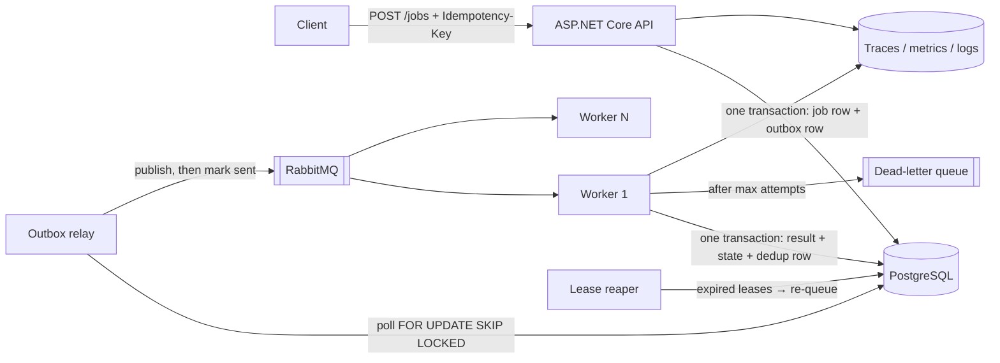
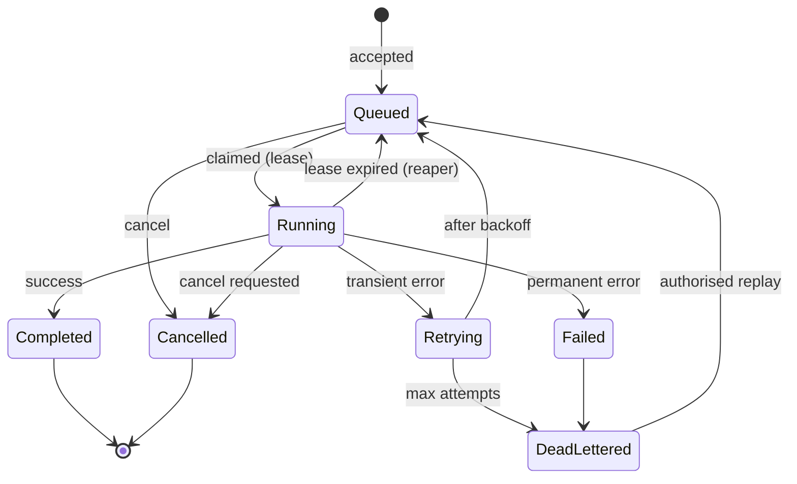
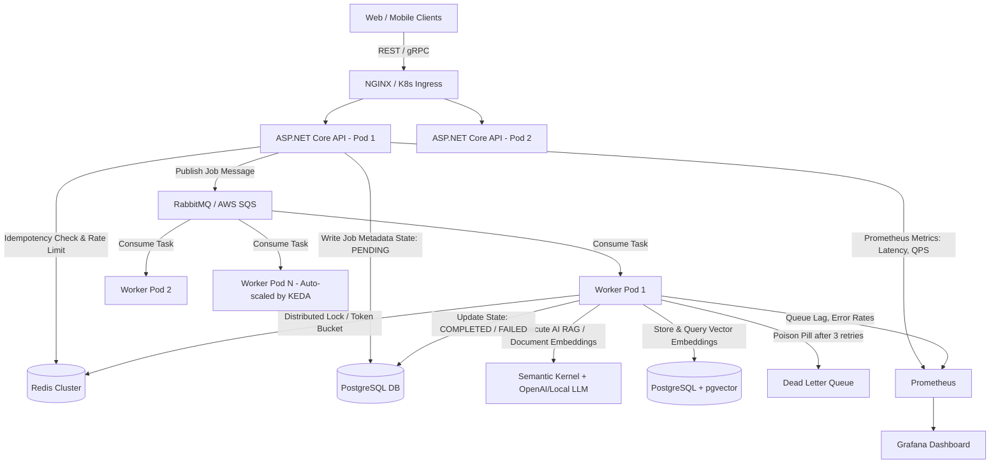

# The project — Distributed Job Processing Platform

[← Start here](README.md) · [The plan](PLAN.md) · [Week files](WEEKS/)

This is the **one** project of the plan. It merges the August spec (Study-Plan doc 10) and the October "NexusQueue" blueprint (FAANG plan 01), keeps every requirement of both, fixes their known errors, and splits the work into milestones that match the weeks. The original documents are kept word for word in the appendix at the end of this file.

> **Rule:** build it in milestones. Each milestone must run, have a test that proves its acceptance criterion, and a written limitation. Never claim a number you did not measure. Never describe the project as built (in a resume or interview) before it is.

<a id="project-overview"></a>

## 1. What it is and why

A multi-tenant service that accepts background jobs over an HTTP API, stores them durably in PostgreSQL, hands them to workers through a message broker, and runs them with retries, a dead-letter queue, fair scheduling between tenants, and full observability. Later it gains one AI job type (document indexing + retrieval).

Why this project and not CRUD: it forces you to deal with exactly the problems interviewers ask about — the dual-write problem, at-least-once delivery, duplicates, crashes in the middle of work, retries and poison messages, noisy neighbours, tenant isolation, and measuring real performance. It also connects to your real work (SQS/EventBridge pipelines, background processing).

**Honest one-sentence pitch (say this, not "exactly once"):**
"A multi-tenant job platform where jobs are accepted durably, delivered at least once through a transactional outbox, and applied once through a deduplication record committed in the same transaction; it survives worker crashes, handles poison jobs with a DLQ and safe replay, and keeps one tenant from starving the others — and I measured its throughput and latency under load."

<a id="project-guarantees"></a>

## 2. Guarantees — and where they stop

| The platform guarantees | It does NOT guarantee |
|---|---|
| A job accepted with 201/202 is durable (committed in PostgreSQL) | Zero loss under every possible failure (state the failure model you tested) |
| The job is published at least once (transactional outbox + relay) | Exactly-once *delivery* (impossible over an unreliable network) |
| Database-local effects of a job are applied once (dedup row in the same transaction) | Exactly-once *external* effects (email, payment, third-party HTTP) — those need the provider's idempotency key, or reconciliation |
| A duplicate POST with the same `Idempotency-Key` returns the original response | Ordering across tenants or priorities |
| A crashed worker's job is re-queued after its lease expires | That a paused worker cannot wake up late — fencing (attempt number) stops its stale write |
| Bounded retries with backoff + jitter; poison jobs go to the DLQ | That retries are always safe — only idempotent handlers may be retried |
| Tenant A can never read or change tenant B's job | — |

Fixed errors from the old specs:
- **Doc 10 dedup bug.** "Insert into processed_jobs first, then do the work" loses the job if the worker crashes between the insert and the work. Here the dedup row is inserted **in the same transaction** as the job's result/state change.
- **NexusQueue dual write.** It wrote to PostgreSQL and then published to the queue. Here an outbox row is written in the same transaction and a relay publishes it.
- **Redis locks as a correctness boundary.** Not used for correctness. PostgreSQL is the source of truth; Redis is optional (cache, rate limiting).
- **Invented numbers** (5,000 RPS, p99 < 45 ms, ~90 MB image, "zero message loss"). Removed. You will measure your own.
- **.NET 8** (support ends 10 Nov 2026). Use **.NET 10 LTS**.

<a id="project-stack"></a>

## 3. Stack

| Part | Choice | Why |
|---|---|---|
| Runtime | .NET 10 (LTS), C# 14 | Current LTS |
| API | ASP.NET Core minimal API, ProblemDetails, JWT bearer auth | Small, testable, AOT-friendly |
| Worker | .NET Worker Service (`BackgroundService`) | Same code base, separate process |
| Database | PostgreSQL (source of truth) | Transactions, `FOR UPDATE SKIP LOCKED`, MVCC |
| Data access | EF Core for most work; raw SQL for claiming jobs if clearer | You know EF; you learn its limits |
| Broker | RabbitMQ (quorum queues) first | Runs locally in Docker; DLX for dead letters. SQS is an optional later port |
| Cache / rate limit | Redis — optional, only when you can show the need | Not a correctness boundary |
| Containers | Docker (multi-stage, non-root), Docker Compose | Reproducible local system |
| CI | GitHub Actions | Free; branch protection |
| Observability | OpenTelemetry (traces + metrics), structured logs, Prometheus/Grafana or the .NET Aspire dashboard | Trace one job end to end |
| Load test | k6 | Scriptable, thresholds |
| Cloud (optional) | AWS: ECS Fargate + RDS PostgreSQL + Amazon MQ (RabbitMQ) or SQS; budget alarm first | Matches your experience |
| AI increment (later) | pgvector + `Microsoft.Extensions.AI` | Reuses the platform |

<a id="project-architecture"></a>

## 4. Architecture



Request flow: the API validates the request and the tenant, writes the job (status `Queued`) and an outbox message in one transaction, and returns 202 with a Location header. The relay publishes outbox messages and marks them sent. A worker receives the message, claims the job with a lease (attempt number + `locked_until`), runs the handler, and in one transaction writes the result, the new state and the dedup row; then it acks. If it crashes, the broker redelivers and/or the reaper re-queues the expired lease; the dedup row and the attempt number stop double application.

<a id="project-data"></a>

## 5. Data model (PostgreSQL)

| Table | Key columns | Notes |
|---|---|---|
| `tenants` | id, name, max_concurrency | Fairness settings per tenant |
| `jobs` | id (UUIDv7), tenant_id, type, payload jsonb, status, priority, attempt, max_attempts, locked_by, locked_until, created_at, updated_at, completed_at, last_error | Index `(tenant_id, status, created_at)`; every query filters by tenant_id |
| `job_attempts` | id, job_id, attempt, started_at, finished_at, outcome, error | History for debugging and the README |
| `outbox_messages` | id, aggregate_id, type, payload, created_at, sent_at | Partial index on unsent rows |
| `processed_messages` | message_id (PK), job_id, processed_at | Inserted in the same transaction as the job result |
| `idempotency_keys` | tenant_id + key (PK), request_hash, response_status, response_body, created_at | Same key + different body → 409 |

See [the practice schema](NOTES/04_SQL_DATABASES.md#add-sql-schema) — it is the same model.

<a id="project-states"></a>

## 6. Job state machine



Illegal transitions (e.g. Completed → Running) are rejected in code and covered by tests.

<a id="project-milestones"></a>

## 7. Milestones by week

| # | Week | Build | Acceptance test (must pass) | Interview questions it prepares |
|---|---|---|---|---|
| [M1](#project-m1) | 11 | Small API, durable metadata, state machine | Job readable after API restart; illegal transition rejected | Why PostgreSQL? Why a state machine? |
| [M2](#project-m2) | 12 | RabbitMQ + separate worker, attempt history, graceful shutdown | Stopping the worker mid-job → message redelivered, job finishes | Why a queue at all? |
| [M3](#project-m3) | 13 | Transactional outbox + relay | Crash between commit and publish → job still delivered | What is the dual-write problem? |
| [M4](#project-m4) | 14 | Idempotent consumption + idempotent submission | Duplicate delivery → one effect; duplicate POST → same response | How do you get exactly-once processing? |
| [M5](#project-m5) | 15 | Security: JWT, tenant authorization, validation, secrets, rate limiting | 10 security tests pass incl. cross-tenant 404 | How do you prove tenant isolation? |
| [M6](#project-m6) | 16 | Docker Compose + CI | Clean clone → `docker compose up` works; failing test blocks merge | What does your CI protect against? |
| [M7](#project-m7) | 17 | Retries + jitter, DLQ + replay, leases/heartbeats/reaper, cancellation | Kill worker mid-job → completes; poison → DLQ → replay | What happens when a worker dies mid-job? |
| [M8](#project-m8) | 18 | Fairness, observability, deployment | Noisy tenant cannot starve others; one job traced end to end | How do you stop one tenant starving others? |
| [M9](#project-m9) | 19 | Load tests, failure tests, restore drill | Benchmark report with every field; restore verified | Where is your bottleneck and how do you know? |
| [M10](#project-m10) | 20 | README, decision records, 15-minute defense, scope freeze | Defense recorded; clean-clone instructions work | What would you do differently? |
| [M11](#project-m11) | 25–28 | AI increment: document indexing, retrieval, evaluation, optional MCP | Measured recall@k; negative security tests | What is hard about RAG? |
| [M12](#project-ext) | 29 (optional) | Kubernetes/KEDA or SQS port | Chosen extension runs with a written limitation | Why did you (not) use Kubernetes? |

Total effort is roughly 60–80 focused hours. If you fall behind, drop extensions first (M12, then the AI increment), never the correctness milestones M3, M4 and M7.

<a id="project-m1"></a>

### M1 — Small API with durable metadata (Week 11)

- Solution: `Jobs.Api`, `Jobs.Worker`, `Jobs.Contracts`, `Jobs.Infrastructure`, `Jobs.Tests` on .NET 10.
- Docker Compose with PostgreSQL only. EF Core migrations.
- `POST /jobs` (validate, return 202/201 + Location), `GET /jobs/{id}` (200/404), `POST /jobs/{id}/cancel`.
- State machine in code; illegal transitions throw and are tested.
- Structured logging with a correlation ID per request.
- **Acceptance:** stop and restart the API, read the job back. Integration test with a real PostgreSQL (Testcontainers) for one illegal transition.
- **Limitation to write down:** nothing processes jobs yet.

<a id="project-m2"></a>

### M2 — Asynchronous work (Week 12)

- Add RabbitMQ to Compose (quorum queue). The worker consumes with manual acks and a prefetch limit.
- For now the API publishes after commit (this is the dual write you will fix in M3 — write that down).
- Attempt history in `job_attempts`. Graceful shutdown: stop taking messages, finish or release the current one.
- **Acceptance:** stop the worker in the middle of a job; on restart the message is redelivered and the job finishes.

<a id="project-m3"></a>

### M3 — Transactional outbox (Week 13)

- The API writes the job and an `outbox_messages` row in **one transaction**. It no longer publishes.
- A relay (a `BackgroundService`) selects unsent rows `FOR UPDATE SKIP LOCKED`, publishes with publisher confirms, marks them sent, retries on failure.
- **Acceptance:** add a test hook that kills the process after commit and before publish; on restart the relay publishes and the job runs.
- Decision record: polling relay vs CDC (Debezium) — why polling first.

<a id="project-m4"></a>

### M4 — Idempotent effects (Week 14)

- Consumer: in one transaction, insert `processed_messages(message_id)` **and** write the job result/state. A unique violation means "already applied" → ack and skip. A crash before commit rolls both back, so redelivery is safe.
- Submission: `Idempotency-Key` header stored with a hash of the request; same key + same body → the stored response; same key + different body → 409.
- **Acceptance:** deliver the same message twice → one effect. Crash before commit → the retry applies it once. POST twice with one key → identical response.
- Write the boundary: external effects need the provider's idempotency key.

<a id="project-m5"></a>

### M5 — Security and load control (Week 15)

- JWT bearer authentication (validate issuer, audience, lifetime, signature).
- Tenant authorization on every query (global query filter + resource checks); another tenant's job returns 404.
- DTOs only (no over-posting); request size limits; validation with ProblemDetails.
- Secrets from configuration/user-secrets, never in source; tokens and payload PII never logged.
- Per-tenant rate limiting with the built-in middleware (note: per instance only).
- **Acceptance:** the 10 security tests from [the threat model](NOTES/10_ENGINEERING_PRACTICE.md#add-sec-threat-model) pass.

<a id="project-m6"></a>

### M6 — Delivery: containers and CI (Week 16)

- Multi-stage Dockerfiles (non-root, port 8080) for API, worker and relay.
- Compose with health checks and `depends_on: condition: service_healthy`.
- GitHub Actions: restore, build, format check, unit tests, integration tests, image build; branch protection.
- `/healthz/live` (no dependencies) and `/healthz/ready` (database + broker).
- **Acceptance:** clone into an empty folder, follow the README, everything starts; a deliberately failing test blocks the PR.

<a id="project-m7"></a>

### M7 — Reliability (Week 17)

- Error classification: transient vs permanent.
- Retries with exponential backoff and full jitter, bounded by `max_attempts`; then the dead-letter queue.
- DLQ inspection endpoint and an **authorised, rate-limited** replay.
- Leases: claim sets `locked_by`, `locked_until`, `attempt = attempt + 1`; a heartbeat extends the lease; a reaper re-queues expired leases. Writes check the attempt number (fencing) so a late, paused worker cannot overwrite.
- Cancellation through `CancellationToken`.
- **Acceptance:** kill a worker mid-job → the job completes elsewhere; a poison message lands in the DLQ and replays after the fix; a failure-modes table written from what you observed.

<a id="project-m8"></a>

### M8 — Fairness, observability, deployment (Week 18)

- Per-tenant concurrency caps (fair scheduling); priority via separate queues.
- OpenTelemetry traces across API → outbox → broker → worker (propagate trace context in message headers).
- Metrics: jobs submitted/completed/failed, queue age, processing-duration histogram, DLQ depth.
- Dashboard (Grafana or the Aspire dashboard). Alerts on queue age and DLQ depth.
- Deploy to AWS with a budget alarm and teardown steps — or keep a documented local fallback.
- **Acceptance:** a flooding tenant cannot starve a quiet tenant (test); one job traced end to end (screenshot for the README).

<a id="project-m9"></a>

### M9 — Evidence (Week 19)

- k6 scripts: ramp, sustained, spike. Measure acceptance and completion separately.
- Run with 1 worker and with 4 workers; explain the difference (or why there is none).
- Re-run failure tests: kill worker, stop database, stop broker, add latency.
- Backup → restore into a clean database; verify durable records.
- **Acceptance:** the [benchmark report](#project-benchmark) with every field filled from real runs.

<a id="project-m10"></a>

### M10 — README, decisions, defense (Week 20)

- [README](#project-readme) with all sections; 3–5 [decision records](#project-decisions).
- Record a 15-minute defense; answer the [defense questions](#project-defense).
- Freeze scope: no new features after this week except the planned AI increment.
- Only now add the project to your resume — with measured numbers only ([how](#project-resume)).

<a id="project-m11"></a>

### M11 — AI increment (Weeks 25–28)

1. **Week 25:** a `DocumentIndexing` job type: extract text, chunk it (configurable size/overlap), store chunks with `tenant_id`, `doc_id`, `version`.
2. **Week 26:** embeddings + pgvector table and HNSW index; `POST /query` returns top-K chunks, always filtered by tenant on the server.
3. **Week 27:** 20–30 labelled questions; recall@k and MRR for a baseline; change one variable (chunk size or hybrid search) and compare.
4. **Week 28:** grounded generation with citations and "I don't know"; negative security tests (prompt injection in a document, cross-tenant query); optional read-only MCP tool `get_job_status`.

Keep it small. Never claim AI results you did not measure.

<a id="project-ext"></a>

### M12 — Optional extension (Week 29)

Choose one by target role: Kubernetes (deployment, service, probes, resources, KEDA scaling on queue length) **or** an SQS port of the broker (and write how its semantics differ: visibility timeout, no priority, redrive policy). Write its limitation.

<a id="project-benchmark"></a>

## 8. Benchmark report — required fields

| Field | Your value (measured) |
|---|---|
| Machine / cloud size, OS, .NET version, PostgreSQL and RabbitMQ versions | |
| Dataset size and job payload size | |
| Test duration and load model (open/closed, stages) | |
| Offered rate | |
| Accepted jobs/second and acceptance latency p50/p95/p99 | |
| Completed jobs/second and completion latency p50/p95/p99 | |
| Error rate | |
| Oldest queue age at peak | |
| CPU / memory / DB connections at peak | |
| 1 worker vs 4 workers result and explanation | |
| The bottleneck and the evidence for it | |

<a id="project-readme"></a>

## 9. README sections

1. One-sentence pitch (the honest one).
2. Architecture diagram.
3. Why it exists (the problems it solves).
4. Guarantees and their boundaries.
5. Key decisions with rejected alternatives (link the decision records).
6. Failure-modes table: failure → detection → response → observed behaviour.
7. Performance: the benchmark report.
8. The bottleneck and what you would change.
9. Limitations and what is next.
10. How to run it from a clean machine (`docker compose up`).

<a id="project-decisions"></a>

## 10. Decision records (3–5)

Template: **Context → Decision → Alternatives considered → Consequences → Status/date.** Write at least: database choice, broker choice, idempotency boundary, retry/recovery strategy, and one rejected alternative (e.g. Redis locks, Kubernetes, or two brokers).

<a id="project-defense"></a>

## 11. Defense questions to rehearse

1. Why a queue? What did it cost you?
2. A worker dies mid-job — walk through it second by second.
3. How do you get exactly-once processing on an at-least-once broker? Where does the guarantee stop?
4. Why PostgreSQL? What if jobs were 100× larger?
5. What happens to a job that runs for 6 hours?
6. You have a backlog of a million messages. What do you do?
7. How would you make it multi-region?
8. Where is the bottleneck, and how do you know?
9. What failure mode did you deliberately not handle, and why?
10. What would you do differently?
11. Committed but the event was never published — how is that impossible here?
12. The payment provider succeeded but you crashed before recording it — what now?
13. One tenant sends a million jobs — what happens to the others?
14. How do you prove tenant isolation?
15. What do your alerts watch, and why those?

Original question sets are in the appendix (doc 10 "Interview questions you must be able to answer about it" and Month 4 Part E).

<a id="project-resume"></a>

## 12. Adding it to your resume (only after M10)

- Add it only when it is built, tested and measured. Before that, do not describe it as built in any interview.
- Use your measured numbers with their conditions, e.g. "measured X accepted jobs/s at p95 Y ms on <machine>, 4 workers" — never the old invented targets.
- Keep day-job bullets separate: outbox, DLQ and idempotency belong to the project, not to your employer's systems unless they were really there.
- Add the GitHub link and make sure the README matches what you say.


---

# Appendix — original project documents (verbatim)

## A. Distributed Job Processing Platform spec (Study-Plan doc 10, Aug 2026)

*Source: Study-Plan/10_Project_Distributed_Job_Platform_Spec.docx. Original wording kept below; ⚠️ boxes are corrections added in the final version.*

<a id="s10-project-specification-distributed-job-processing-platform"></a>

### Project Specification - Distributed Job Processing Platform
Document 10 - Built across Months 4 and 5. Your primary engineering artefact.
<a id="s10-why-this-project"></a>

### Why this project
A CRUD API proves you can use a framework. This project proves you can reason about failure, concurrency, scale and trade-offs - which is exactly what an SDE II or L4/L5 interview is trying to establish.
It is also deliberately close to work you have already done. Your Casepoint email-processing pipeline using SES, EventBridge and SQS is the same shape of problem. That is not a coincidence - it means you can build this fluently and defend it from genuine experience rather than tutorial memory.
<a id="s10-the-one-sentence-pitch-memorise-this"></a>

#### The one-sentence pitch (memorise this)
A multi-tenant distributed job processing platform in .NET that accepts job submissions over HTTP, durably persists them, distributes them to horizontally scalable workers via a queue, and guarantees each job completes exactly once despite worker crashes, duplicate deliveries and downstream failures.

> ⚠️ **Correction (final version, 19 Oct 2026):** [Interview-critical] Do not memorise 'guarantees each job completes **exactly once**'. Say: 'jobs are accepted durably, delivered at least once, and their local effects are applied once through a transactional deduplication record; external effects use idempotency keys or reconciliation.' See [the guarantees section](#project-guarantees).

<a id="s10-non-negotiable-requirements"></a>

### Non-negotiable requirements
If any of these are missing, the project has not done its job. Build against this list, not against what feels comfortable.

| Capability | Must demonstrate |
|---|---|
| Durable submission | Job survives an API restart between submission and processing |
| Asynchronous processing | Real queue, real separate worker process. Not an in-memory BackgroundService pretending |
| Horizontal scaling | Run 1 worker, then 4. Throughput must measurably increase. With numbers |
| Crash recovery | Kill a worker mid-job. The job must be recovered and completed, not lost |
| Idempotency | Deliver the same message twice. The job must execute once |
| Retries | Exponential backoff with jitter, bounded attempts |
| Dead letter queue | Poison messages land in a DLQ, are inspectable, and can be replayed |
| Priority | High-priority jobs preempt a backlog of low-priority jobs |
| Fairness | One tenant flooding the queue must not starve others |
| Rate limiting | Correct across multiple API instances, not per-instance |
| Multi-tenancy | Tenant A provably cannot read or affect tenant B's jobs |
| Observability | Structured logs with correlation IDs, metrics, health checks |
| Deployment | Docker, CI/CD, running on AWS |
| Evidence | Load test results with p50/p95/p99, and a written bottleneck analysis |


> ⚠️ **Correction (final version, 19 Oct 2026):** [Nuance] 'Priority preempts a backlog' and 'prove ordering': SQS has no per-message priority — use separate queues per priority (or a database-backed scheduler). Running RabbitMQ locally but SQS in production means different semantics in dev and prod; the final plan picks **one** broker first (RabbitMQ), and treats SQS as an optional later port.

<a id="s10-architecture"></a>

### Architecture
<a id="s10-components"></a>

#### Components

| Component | Responsibility |
|---|---|
| API service (ASP.NET Core) | Job submission, status queries, DLQ inspection and replay, auth, rate limiting |
| Worker service (.NET worker) | Consumes from the queue, executes handlers, manages state transitions, heartbeats |
| PostgreSQL | Durable job metadata, state, attempt history, idempotency keys, outbox |
| Queue (SQS in AWS; RabbitMQ locally) | Work distribution, visibility timeout, DLQ |
| Redis | Status read cache, distributed rate limiting, worker registry |
| Prometheus + Grafana | Metrics and dashboards |

<a id="s10-job-state-machine"></a>

#### Job state machine
Define this explicitly and enforce illegal transitions in code. Interviewers ask about it.

| State | Transitions to |
|---|---|
| Pending | Queued (on successful enqueue), Cancelled |
| Queued | Running (worker claims it), Cancelled |
| Running | Completed, Failed, Retrying, Orphaned (heartbeat lost) |
| Retrying | Queued (after backoff), DeadLettered (attempts exhausted) |
| Orphaned | Queued (reclaimed by the reaper) |
| Failed | DeadLettered |
| Completed / Cancelled / DeadLettered | Terminal |

<a id="s10-the-three-hard-problems-and-your-answers"></a>

#### The three hard problems (and your answers)

| Problem | Your solution |
|---|---|
| Duplicate delivery. The queue guarantees at-least-once, so the same message will eventually arrive twice | Idempotency key per job. A processed_jobs table with a unique constraint. Worker attempts an insert first; a unique-violation means already processed, so acknowledge and skip |
| Worker crash mid-job. The job is Running but nobody is running it | Worker heartbeats every N seconds. A reaper process finds Running jobs whose heartbeat is stale past a threshold, transitions them to Orphaned, then re-queues. Combined with idempotency, a job that actually completed before the crash will not re-run its side effects |
| Dual write. You must both save the job and enqueue the message, and either can fail | Transactional outbox: write job and outbox row in one DB transaction, then a relay publishes from the outbox and marks it sent. At-least-once publish, made safe by idempotency |

These three answers are the heart of your interview story. Be able to draw each failure on a whiteboard and explain exactly where your design catches it.


> ⚠️ **Correction (final version, 19 Oct 2026):** [Interview-critical] Bug in answer 1. 'Insert into `processed_jobs` first; a unique violation means skip' loses the job if the worker crashes after the insert but before the work commits: the reaper re-queues it, the next worker hits the unique violation and skips it forever. Fix: insert the deduplication row **in the same database transaction** as the job's result / state change (for database-local effects), or claim jobs with a lease + attempt token and only mark processed on commit. External effects need a downstream idempotency key. The final project spec uses the fixed version.

<a id="s10-build-phases"></a>

### Build phases
<a id="s10-phase-1-walking-skeleton-month-4-week-16"></a>

#### Phase 1 - Walking skeleton (Month 4, Week 16)
•  Solution structure: Api, Worker, Contracts, Infrastructure, plus test projects.
•  Docker Compose: Postgres, Redis, RabbitMQ.
•  POST /jobs persists a job as Pending; GET /jobs/{id} returns status.
•  EF Core schema and migrations. Job entity, state enum, attempt count.
•  Enqueue on submit, worker consumes, transitions Running then Completed.
•  Serilog structured logging with a correlation ID flowing API to worker.
•  Health check endpoints. README started with an architecture diagram.

> ⚠️ **Correction (final version, 19 Oct 2026):** [Schedule] In the final plan the project starts in Week 11 and is built in milestones from Week 11 to Week 20 — see [the milestone table](#project-milestones). Use .NET 10 LTS, not .NET 8.

<a id="s10-phase-2-reliability-month-5-week-17"></a>

#### Phase 2 - Reliability (Month 5, Week 17)
•  Retry policy: exponential backoff with jitter, configurable max attempts.
•  Dead letter queue with an inspection endpoint and a replay endpoint.
•  Idempotency keys and the processed_jobs dedup table.
•  Transactional outbox with a relay.
•  Worker heartbeats and the orphan reaper.
•  Job priority with a priority-aware consumer.
•  Per-tenant fairness (round-robin or weighted).
•  Failure simulation documented: kill worker, kill DB, flood queue, add latency.
<a id="s10-phase-3-production-concerns-month-5-week-18"></a>

#### Phase 3 - Production concerns (Month 5, Week 18)
•  Redis cache-aside for status reads, with correct invalidation on state change.
•  Distributed rate limiting (token bucket in Redis), 429 with Retry-After.
•  Authentication, plus tenant isolation with a test proving cross-tenant denial.
•  Prometheus metrics: submitted, completed, failed, queue depth, duration histogram.
•  Grafana dashboard.
•  Liveness vs readiness probes, correctly distinguished.
•  Integration tests with Testcontainers against real Postgres and Redis.
<a id="s10-phase-4-ship-and-prove-month-5-week-19"></a>

#### Phase 4 - Ship and prove (Month 5, Week 19)
•  Multi-stage Dockerfiles, non-root user, image size optimised and measured.
•  GitHub Actions: build, test, lint on PR; image push on merge.
•  AWS: ECS or EC2, RDS Postgres, ElastiCache Redis, real SQS, IAM least privilege, billing alarm.
•  k6 load tests: baseline, ramp, sustained, spike.
•  Scale workers 1 to 4, re-measure, prove horizontal scaling with numbers.
•  Written performance and architecture report committed to the repo.

<a id="s10-the-readme-treated-as-a-deliverable-not-an-afterthought"></a>

### The README - treated as a deliverable, not an afterthought
Many interviewers will read your README and never run your code. It is the artefact, and it should be written from Week 16, not bolted on in Week 19.

| Section | Content |
|---|---|
| One-paragraph pitch | The memorised sentence from page 1 |
| Architecture diagram | Excalidraw, embedded as an image |
| Why this exists | The problem it solves. Not "a demo project" |
| Design decisions | Each with the alternative you rejected and why |
| Failure modes table | Failure, detection, response, observed behaviour |
| Performance results | Load test numbers, p50/p95/p99, throughput at 1 vs 4 workers |
| Bottleneck analysis | Where it breaks, why, evidenced |
| Trade-offs and limitations | Be honest. Stating a known limitation is a senior signal |
| What I would do next | Shows you know where the edges are |
| How to run it | docker compose up and it works. Test this on a clean machine |

<a id="s10-interview-questions-you-must-be-able-to-answer-about-it"></a>

### Interview questions you must be able to answer about it
•  Why a queue rather than direct processing? What did that cost you?
•  What happens if a worker dies mid-job? Walk me through the recovery, second by second.
•  How do you guarantee exactly-once processing on an at-least-once queue?
•  Why Postgres and not a NoSQL store? What would change if jobs were 100x larger?
•  How would you handle a job that takes six hours?
•  Your queue backs up to a million messages. What breaks first, and what do you do?
•  How would you make this multi-region?
•  Where is your bottleneck, and how do you know? (Have the numbers ready.)
•  What would you do differently if you started again?
•  How would you add a job that depends on another job completing first?
Rehearse all ten out loud. They are the most likely questions and the answers should be fluent, not constructed on the spot.
<a id="s10-scope-discipline"></a>

### Scope discipline
The project must be finished by the end of Month 5 because Months 6-8 belong to interviewing. Two rules protect that:
•  No new features after Week 19. Polish and documentation only.
•  When you are tempted to add something, ask whether it demonstrates a distributed-systems property you cannot already demonstrate. A React admin dashboard does not. A saga across two services might - and still probably is not worth the time.

## B. NexusQueue — Distributed AI Task Engine blueprint (FAANG plan 01, Oct 2026)

*Source: FAANG-Master-Plan/01_PROJECT_BLUEPRINT_DISTRIBUTED_AI_ENGINE.md. Original wording kept below; ⚠️ boxes are corrections added in the final version.*

<a id="f01-portfolio-showcase-project-distributed-fault-tolerant-job-ai"></a>

### 🛠️ Portfolio Showcase Project: Distributed Fault-Tolerant Job & AI Task Engine

**Project Title:** `NexusQueue` — High-Throughput Distributed Task Engine with Resilience, Concurrency Control & AI Task Processing  
**Tech Stack:** C# / .NET 8 / ASP.NET Core Web API, PostgreSQL (Durable Storage + pgvector), Redis (Distributed Locks + Caching), RabbitMQ / AWS SQS (Message Broker), Docker, Kubernetes (KEDA), Prometheus & Grafana, Semantic Kernel.  

---

<a id="f01-1-why-this-project-why-not-another-crud-app"></a>

#### 1. Why This Project? (Why Not Another CRUD App?)

FAANG interviewers see thousands of generic Todo apps, E-commerce storefronts, and basic CRUD APIs. They immediately dismiss them.

This project is deliberately engineered to prove **SDE-2 Seniority** by solving the exact distributed systems problems tested in System Design interviews:
1. **Asynchronous Decoupling & Queueing** (Handling traffic spikes without crashing).
2. **Horizontal Worker Auto-Scaling** (Using Kubernetes and KEDA based on queue depth).
3. **Idempotency & Deduplication** (Handling network retries and duplicate message deliveries).
4. **Distributed Concurrency & Locks** (Preventing race conditions using Redis Redlock / distributed mutexes).
5. **Dead-Letter Queues (DLQ) & Exponential Backoff with Jitter** (Handling poison pills and transient failures).
6. **Modern AI Task Integration (RAG with pgvector)** (Demonstrating high-value production AI engineering skills).
7. **Production Observability & Load Testing** (Prometheus metrics, structured logging, and k6 benchmark reports reaching 5,000+ RPS).

---


> ⚠️ **Correction (final version, 19 Oct 2026):** [Interview-critical] All numbers in this blueprint (5,000+ RPS, p99 < 45 ms, ~90 MB image, 'zero message loss', KEDA 1→10) are targets written as if they were results. Never quote them as your own. Record what you actually measure, with the environment and method (see [the benchmark report fields](#project-benchmark)).

<a id="f01-2-project-architecture-diagram"></a>

#### 2. Project Architecture Diagram



---


> ⚠️ **Correction (final version, 19 Oct 2026):** [Interview-critical] The diagram writes the job to PostgreSQL and then publishes to the queue — a dual write with no outbox. A crash between the two loses or duplicates work. The final spec adds a transactional outbox. A Redis lock (SETNX/Redlock) is not a correctness boundary for exactly-once (no fencing tokens; Redlock is disputed) — PostgreSQL stays the source of truth.

<a id="f01-3-when-to-build-it-5-phase-project-timeline"></a>

#### 3. When to Build It: 5-Phase Project Timeline

You do **NOT** build the project all at once while ignoring DSA. You build it iteratively in structured weekend modules:

```
┌────────────────────────────────────────────────────────────────────────┐
│                        PROJECT MILESTONE SCHEDULE                      │
├───────────────┬───────────────┬───────────────┬────────────────────────┤
│ WEEKS 11 – 13 │ WEEKS 14 – 16 │ WEEKS 17 – 18 │ WEEKS 19 – 20          │
│ Phase 1: Core │ Phase 2: Dist │ Phase 3: AI & │ Phase 4: K8s, Metrics  │
│ API & Queue   │ Locks & DLQ   │ Vector RAG    │ & Load Benchmark       │
└───────────────┴───────────────┴───────────────┴────────────────────────┘
```

<a id="f01-phase-1-core-ingestion-api-queue-decoupling-weeks-11-13"></a>

##### 🔹 Phase 1: Core Ingestion API & Queue Decoupling (Weeks 11–13)
* **What You Build:**
  1. ASP.NET Core 8 Web API with Clean Architecture / Vertical Slice Architecture.
  2. Endpoints: `POST /api/v1/jobs` (Enqueue job), `GET /api/v1/jobs/{id}` (Check status).
  3. PostgreSQL schema for Job metadata: `Id (UUID)`, `JobType`, `Payload (JSONB)`, `Status (Pending, Processing, Completed, Failed)`, `RetryCount`, `CreatedAt`, `UpdatedAt`.
  4. RabbitMQ exchange and queue bindings using MassTransit or raw RabbitMQ.Client in C#.
  5. Background Worker Service (`BackgroundService` / `IHostedService`) consuming messages from the queue.

<a id="f01-phase-2-distributed-resilience-concurrency-weeks-14-16"></a>

##### 🔹 Phase 2: Distributed Resilience & Concurrency (Weeks 14–16)
* **What You Build:**
  1. **Idempotency Interceptor:** Check `Idempotency-Key` header against Redis with TTL. If key exists, return cached response; otherwise acquire lock and proceed.
  2. **Distributed Locking:** Implement distributed mutual exclusion using Redis (`SETNX` / RedLock) so multiple workers never process the same tenant resource simultaneously.
  3. **Resilience Policy (Polly):** Exponential backoff with jitter on transient failures ($2^n \times \text{base} + \text{jitter}$).
  4. **Poison Pill Isolation:** After 3 failed attempts, route message to a dedicated **Dead-Letter Queue (DLQ)** and record failure root cause in PostgreSQL.

<a id="f01-phase-3-high-value-ai-task-pipeline-weeks-17-18"></a>

##### 🔹 Phase 3: High-Value AI Task Pipeline (Weeks 17–18)
* **What You Build:**
  1. Add an AI task type: `DOCUMENT_INDEXING_AND_RAG`.
  2. Integrate **Microsoft Semantic Kernel** in C#.
  3. Worker extracts document text, chunks into overlapping passages (500 tokens with 50-token overlap).
  4. Generate vector embeddings using OpenAI API or local Ollama/HuggingFace embeddings model.
  5. Store embeddings in PostgreSQL with the `pgvector` extension using HNSW (Hierarchical Navigable Small World) index.
  6. Endpoint: `POST /api/v1/jobs/query` performing cosine similarity semantic search and augmented context synthesis.

<a id="f01-phase-4-containerization-kubernetes-production-observability"></a>

##### 🔹 Phase 4: Containerization, Kubernetes & Production Observability (Weeks 19–20)
* **What You Build:**
  1. Multi-stage `Dockerfile` producing a lean, production-grade ~90MB container image.
  2. `docker-compose.yml` orchestrating API + Worker + PostgreSQL + Redis + RabbitMQ.
  3. Kubernetes Deployment manifests:
     * Deployments, Services, ConfigMaps, Secrets, Liveness & Readiness probes.
     * Configure **KEDA (Kubernetes Event-driven Autoscaling)** to auto-scale Worker Pods from 1 to 10 instances based on RabbitMQ queue depth!
  4. Prometheus metrics export (`/metrics`) exposing:
     * Ingestion RPS, P95/P99 latency, active queue length, worker processing time, DLQ failure count.
  5. Grafana Dashboard visualizing real-time throughput.


> ⚠️ **Correction (final version, 19 Oct 2026):** [Scope] Kubernetes/KEDA are optional extensions in the final plan (Week 29 at the earliest). Docker Compose, CI and one cloud deployment come first. Use .NET 10 LTS.

<a id="f01-phase-5-load-testing-performance-benchmark-defense-week-20"></a>

##### 🔹 Phase 5: Load Testing & Performance Benchmark Defense (Week 20)
* **What You Build:**
  1. Write a `k6` load testing script simulating 5,000 requests per second.
  2. Benchmark the system under failure: intentionally kill a worker pod or disconnect Redis to prove zero message loss.
  3. Write a 2-page GitHub README architecture defense containing:
     * System Architecture Diagram.
     * Scale & Capacity Calculations.
     * Bottlenecks Identified & Fixed (e.g. PgBouncer connection pooling, Redis index optimization).
     * Benchmark charts proving P99 latency $< 45\text{ms}$.

---

<a id="f01-4-how-to-talk-about-this-project-in-faang-interviews"></a>

#### 4. How to Talk About This Project in FAANG Interviews

In SDE-2 System Design and Resume rounds, you will guide the interviewer to this project:

> *"In my personal system, NexusQueue, I designed a distributed task platform capable of handling thousands of background operations and AI pipelines asynchronously. The core architectural challenge was ensuring exactly-once processing semantics over an at-least-once message broker. I solved this by implementing distributed locks via Redis SETNX combined with database-level idempotency keys. Under load testing at 5,000 RPS, we observed database connection exhaustion, which I resolved by introducing PgBouncer connection pooling and tuning worker batch sizes, maintaining a P99 latency under 45ms even during simulated worker node crashes."*

This level of explanation immediately demonstrates **Senior SDE-2 competence**.

> ⚠️ **Correction (final version, 19 Oct 2026):** [Interview-critical] The scripted story (PgBouncer outage fix, p99 charts, 5,000 RPS) describes events that have not happened. Rewrite this answer only from what you actually build and measure.


## C. Project milestones with acceptance tests (12 Oct guide §9)
<a id="f05-s9"></a>

### 9. One project with controlled scope

*Source: FAANG-Master-Plan/05_START_HERE_BASIC_TO_ADVANCED.md (12 Oct 2026). Original wording kept below; ⚠️ boxes are corrections added in the final version.*


Build the distributed job platform already proposed in your folder, with a smaller first release. Allocate about 60–80 hours across project, design and relevant backend slots over several months. If implementation takes longer, remove extensions first.

| Milestone | Build | Acceptance test |
|---|---|---|
| 1. Small API | Submit/get job, validation, durable metadata, clear state machine | Accepted job can be retrieved after API restart |
| 2. Asynchronous work | One broker, separate worker, attempt history | Worker processes queued work and updates status |
| 3. Durable publication | Job plus outbox row in one transaction; relay with retries | Crash after commit but before publish; accepted job is eventually delivered |
| 4. Idempotent effects | Unique durable key; business update and processed marker transactionally coupled for local effects | Duplicate message causes one committed local effect; crash-before-commit is recoverable |
| 5. Recovery | Bounded attempts, retry delay/jitter, DLQ, safe replay, worker cancellation and recovery | Kill a worker before/after commit; inspect and recover poison jobs |
| 6. Security and load control | Tenant authorization, bounded concurrency, limits, fair scheduling where needed | Cross-tenant request fails; one noisy tenant cannot exhaust all work capacity |
| 7. Delivery and evidence | Containers, CI, deployment, traces/metrics, load test, restore exercise and README | Clean start instructions work; report measured acceptance and completion behavior |

Pick RabbitMQ **or** SQS first. Learning that their semantics differ is valuable; implementing both initially is unnecessary. PostgreSQL is the durable authority. Add Redis only for a demonstrated cache/rate-limit need, not automatically as the correctness boundary for job processing.

If a job calls an external service, explicitly discuss the crash between external success and local recording. Use a downstream idempotency key when supported; otherwise describe reconciliation and possible duplicates. Do not promise universal exactly-once execution.

Benchmark report fields: machine/cloud size, versions, dataset, payload, test duration, offered rate, successful accepted jobs/sec, completed jobs/sec, p50/p95/p99 for each relevant stage, error rate, oldest queue age, resources and bottleneck. Compare 1 vs several workers and explain whether the workload permits improvement. Do not invent a required 5,000 RPS or 45 ms result.

Keep 3–5 short decision records: database choice, broker choice, idempotency boundary, retry/recovery strategy, and one rejected alternative. These are useful for project defense.


## D. Defending the project (Month 4 Q&A part E)
<a id="m4-part-e"></a>

## PART E - Your project, defended

*Source: Q-and-A/M4_Design_and_Distributed_Systems.docx. Original wording kept below; ⚠️ boxes are corrections added in the final version.*

<a id="m4-q26"></a>

#### Q26. Why a queue at all, and what did it cost you?
Say this. It decouples submission from execution, so the API can accept work in milliseconds and stay responsive under a spike, and workers scale independently. The cost is real: eventual consistency, so the caller must poll or be notified; at-least-once delivery, so every handler needs idempotency; and a whole new class of operational concern - queue depth, poison messages, DLQ monitoring.
Why. You have converted a latency problem into a complexity problem. That is usually the right trade for background work and the wrong one for something the user is waiting on.
Watch out. Never present the queue as free. Naming what it cost is what makes the choice sound like a decision.
<a id="m4-q27"></a>

#### Q27. Walk me through exactly what happens when a worker dies mid-job.
Say this. The job row stays in a Running state with a lease and a heartbeat timestamp that the worker was updating. When the worker dies the heartbeat stops. A reaper process looks for jobs whose lease has expired and returns them to Pending, incrementing the attempt count. Another worker picks it up. Because the handler is idempotent, any partial work from the first attempt does not double-apply.
Why. The heartbeat is what distinguishes "slow" from "dead" - without it you either kill slow jobs or wait forever for dead ones. The lease is the same lease-expiry problem as a distributed lock.
Watch out. Be honest about the window: a job can be re-run while the original worker is merely paused, which is exactly why idempotency is load-bearing and not decorative.
<a id="m4-q28"></a>

#### Q28. Where is your bottleneck, and how do you know?
Say this. Name it and give the number. Typically the database on status writes, or the queue receive round trip, or worker CPU on the actual job. You know because you load tested with k6, measured p95 and p99 at increasing load, watched where latency turned upward, and correlated that with queue depth, connection pool usage and CPU.
Why. A bottleneck is where the curve bends, not where you guessed. Having the numbers is what makes this a strong answer rather than a plausible one.
Watch out. This is the question that most reliably exposes a project that was never actually load tested. Have the table of numbers in your README and be able to quote a figure.
<a id="m4-q29"></a>

#### Q29. What failure mode did you deliberately not handle, and why?
Say this. Pick a real one and own it. For example: no multi-region failover, because the added complexity and cost would not have taught me anything the single-region design did not, and the recovery objective for a demonstration platform does not justify it. Or: no exactly-once external side effects, because that needs an outbox on the third-party call, and I chose to demonstrate idempotency in the core path instead.
Why. A deliberate, articulated scope decision reads as engineering judgement. "I did not think of it" reads as luck.
Watch out. This is the single best question to prepare for your project, because it distinguishes someone who built something from someone who followed a tutorial. Have your answer written down.

> ⚠️ **Correction (final version, 19 Oct 2026):** [Interview-critical] 'Exactly-once external side effects need an outbox on the third-party call' overclaims — an outbox gives at-least-once delivery of the intent. Exactly-once *effect* needs the downstream to honour an idempotency key, or you reconcile and compensate duplicates. See also M3 Q25.
